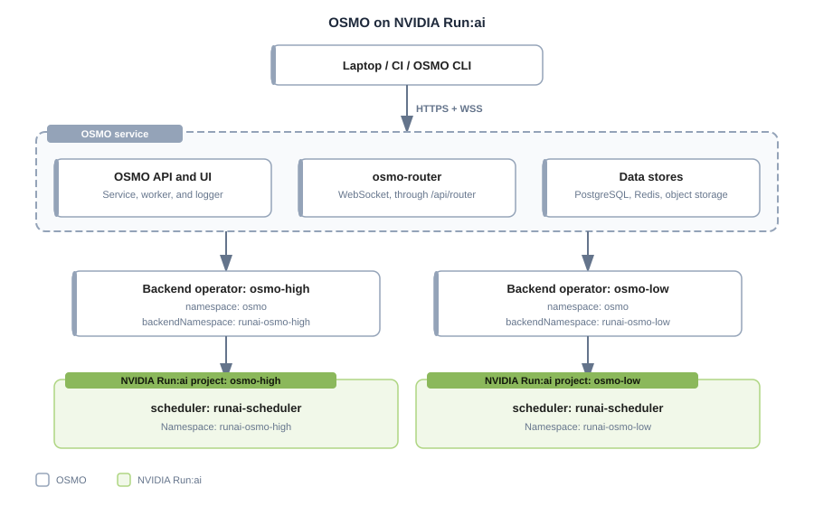

# Running NVIDIA OSMO Workflows on NVIDIA Run:ai

This tutorial demonstrates how to run NVIDIA OSMO workflows on an NVIDIA Run:ai-managed Kubernetes cluster. OSMO runs each workflow as Kubernetes pods. NVIDIA Run:ai schedules those pods under the [quota](../../platform-management/runai-scheduler/scheduling/concepts-and-principles.md#quota) and priority of an [NVIDIA Run:ai project](../../platform-management/aiinitiatives/organization/projects.md).

In this tutorial, you will learn how to:

* Create NVIDIA Run:ai projects for OSMO workflows
* Connect OSMO to each project with a backend and a pool
* Enable preemption reporting on the NVIDIA Run:ai scheduler
* Run an OSMO workflow and check it in NVIDIA Run:ai
* Test preemption

## How OSMO and NVIDIA Run:ai Work Together

OSMO and NVIDIA Run:ai each handle a different part of running workflows. OSMO is the workflow platform. Users submit workflows to it. A workflow is a graph of tasks, and each task runs as a Kubernetes pod. NVIDIA Run:ai is the scheduler. It decides which pods run, where they run, and which pods give way when capacity is short.

Each part of the setup is responsible for the following:

- **OSMO** manages the workflows. It includes:
  - **The OSMO service.** The central service that provides the API and UI for workflow submission, monitoring, and management. For more details, refer to [Architecture](https://nvidia.github.io/OSMO/main/deployment_guide/introduction/architecture.html) in the OSMO documentation.
  - **Pools.** A pool is a group of resources that users share. Users choose a pool when they submit a workflow. Each pool references the backend that runs its workflows. For more details, refer to [Resource Pools](https://nvidia.github.io/OSMO/main/user_guide/resource_pools/index.html).
  - **Backends and the backend operator.** A backend is a compute backend where workflows run. The backend operator runs on the compute cluster. Its worker creates the Kubernetes pods for the tasks, and its listener reports state changes back to the OSMO service. In this tutorial, each backend uses the namespace of one NVIDIA Run:ai project. For more details, refer to [Deploy Compute Backend](https://nvidia.github.io/OSMO/main/deployment_guide/install_backend/deploy_backend.html).
- **NVIDIA Run:ai** schedules the pods and enforces limits. It is responsible for:
  - **Projects and namespaces.** Each NVIDIA Run:ai project has its own Kubernetes namespace, which OSMO uses as a backend.
  - **Quota and priority.** NVIDIA Run:ai schedules every pod under the [quota](../../platform-management/runai-scheduler/scheduling/concepts-and-principles.md#quota), [priority, and preemption](../../platform-management/runai-scheduler/scheduling/concepts-and-principles.md#priority-and-preemption) rules of the project.
  - **Pod placement.** NVIDIA Run:ai decides which nodes the pods run on.

Each NVIDIA Run:ai project maps to one OSMO backend, one OSMO pool, and one backend-operator Helm release. The following example shows the mapping:

| OSMO pool | OSMO backend | NVIDIA Run:ai project | Namespace |
|---|---|---|---|
| `osmo-high` | `osmo-high` | `osmo-high` | `runai-osmo-high` |
| `osmo-low` | `osmo-low` | `osmo-low` | `runai-osmo-low` |



## Prerequisites

Before you start, make sure the following requirements are met:

### OSMO Prerequisites

- **A running OSMO service and the OSMO CLI.** This tutorial uses OSMO **6.3.1**, with the `service` and `backend-operator` Helm charts at version **1.3.1**. For the installation, refer to [Deploy Service](https://nvidia.github.io/OSMO/main/deployment_guide/getting_started/deploy_service.html). Use Helm 3. Helm 4 was not used with these charts. The values in this tutorial match these chart versions. A later chart can use a different values structure. The OSMO CLI must be logged in to the service.

### NVIDIA Run:ai Prerequisites

- **Administrator access.** You need a role that can create projects and change the scheduler settings.
- **Kubernetes permissions.** You need Kubernetes cluster-admin permissions, or delegated permissions that allow creating the namespaces and the cluster-scoped objects of the OSMO backend operator, such as PriorityClasses.
- **Command-line tools.** `kubectl`, `helm`, and `jq`.

### Values to Replace

Throughout this tutorial, replace:

| Placeholder | Meaning | Example |
|---|---|---|
| `<project>` | An NVIDIA Run:ai project that runs OSMO workflows | `osmo-high` |
| `runai-<project>` | The Kubernetes namespace of that project | `runai-osmo-high` |
| `<workflow-id>` | The ID that OSMO returns when you submit a workflow | - |

## Step 1: Creating the NVIDIA Run:ai Projects

Create one NVIDIA Run:ai project for each OSMO pool that you want to run on NVIDIA Run:ai. This tutorial creates two, `osmo-high` for high-priority workflows and `osmo-low` for low-priority workflows. Two projects with different priorities let you test preemption in [Step 5](#step-5-testing-preemption).

1. **Create the projects.** Create `osmo-high` and `osmo-low`, as described in [Adding a New Project](../../platform-management/aiinitiatives/organization/projects.md#adding-a-new-project). NVIDIA Run:ai creates the namespace of each project, `runai-osmo-high` and `runai-osmo-low`.
2. **Set the quota.** Give each project the GPU and CPU quota that you want to guarantee for its pool, as described in [Assigning GPU Quota](../../platform-management/aiinitiatives/organization/projects.md#assigning-gpu-quota) and [Assigning CPU Quota](../../platform-management/aiinitiatives/organization/projects.md#assigning-cpu-quota). Workloads that run over the quota of a project can be preempted when other projects need the resources, so set the quotas intentionally. For how this works, refer to [Priority and Preemption](../../platform-management/runai-scheduler/scheduling/concepts-and-principles.md#priority-and-preemption).

3. **Check the namespaces.** Each namespace must belong to its project and must enforce the NVIDIA Run:ai scheduler:

   ```bash
   kubectl get namespace runai-osmo-high runai-osmo-low -o yaml
   ```

   Each namespace must have the label `runai/queue` set to the name of its project. NVIDIA Run:ai [enforces the scheduler at the namespace level](../../platform-management/runai-scheduler/scheduling/default-scheduler.md#enforce-the-scheduler-at-the-namespace-level) with `enforceRunaiScheduler`, which is enabled by default. This matters because OSMO submits Kubernetes pods, not NVIDIA Run:ai workloads. Enforcement makes sure that every pod in the namespace uses the `runai-scheduler`.
4. **Label the compute nodes (only if your pod template uses a node selector).** The OSMO pod template used in this tutorial, `default_compute`, selects compute nodes with the node selector `osmo-compute: "true"`. If your pod template does not set a node selector, skip this item. Otherwise, label each node that can run OSMO workflows:

   ```bash
   kubectl label nodes <node-name> --overwrite osmo-compute=true
   kubectl get nodes -L osmo-compute
   ```

   Pods stay `Pending` on nodes that do not have the label that the pod template selects. When autoscaling or hibernation replaces a node, apply the label again, or add it to the node group bootstrap template.

## Step 2: Connecting OSMO to Each Project

Each NVIDIA Run:ai project needs three things in OSMO: a backend, a pool, and a backend-operator Helm release. The sections below show only the settings that connect OSMO to NVIDIA Run:ai. For the other chart values and the service installation, refer to [Deploy Service](https://nvidia.github.io/OSMO/main/deployment_guide/getting_started/deploy_service.html).

1. **Create the backend.** In the `services.configs.backends` section of the OSMO service values, add one backend for each project. The backend uses the namespace of the project and the NVIDIA Run:ai scheduler:

   ```yaml
   services:
     configs:
       backends:
         osmo-high:
           description: NVIDIA Run:ai osmo-high project
           k8s_namespace: runai-osmo-high
           scheduler_settings:
             scheduler_type: kai
             scheduler_name: runai-scheduler
             scheduler_timeout: 30
   ```

   * `k8s_namespace` - The namespace of the NVIDIA Run:ai project. It must match `backendNamespace` in the backend-operator release in item 3.
   * `scheduler_type: kai` - The OSMO scheduler integration type that works with the NVIDIA Run:ai scheduler.
   * `scheduler_name: runai-scheduler` - Sets the scheduler name on every pod that OSMO creates. NVIDIA Run:ai enforces the same scheduler at the namespace level by default, as described in [Step 1](#step-1-creating-the-nvidia-runai-projects). Setting it in OSMO as well means the setting still applies if enforcement is turned off.

2. **Create the pool.** In `services.configs.pools`, add one pool for each project. The pool points to the backend by name. Each pool uses one backend, and each backend uses one namespace, so the workflows of a pool run in one NVIDIA Run:ai project. This tutorial uses one pool and one backend for each project:

   ```yaml
   services:
     configs:
       pools:
         osmo-high:
           description: High-priority NVIDIA Run:ai project
           backend: osmo-high
   ```

   For the other pool settings, refer to [Pool Configuration](https://nvidia.github.io/OSMO/main/deployment_guide/advanced_config/pool.html).

   After you add the backend and the pool of each project, apply the updated values to your OSMO service release with `helm upgrade`, as described in [Deploy Service](https://nvidia.github.io/OSMO/main/deployment_guide/getting_started/deploy_service.html).

3. **Create the backend operator token.** The backend operator authenticates to the OSMO service with a token that has the `osmo-backend` role. Create the token and store it in a Kubernetes Secret in the OSMO namespace (`osmo` in this tutorial), as described in [Deploy Compute Backend](https://nvidia.github.io/OSMO/main/deployment_guide/install_backend/deploy_backend.html).
4. **Install the backend operator.** Install one `backend-operator` release for each project. The release runs in the OSMO namespace (`osmo`), and `backendNamespace` is the namespace of the NVIDIA Run:ai project:

   ```yaml
   global:
     name: osmo-high
     backendName: osmo-high
     backendNamespace: runai-osmo-high
     includeNamespaceUsage: runai-osmo-high
   ```

   A Kubernetes PriorityClass gives a priority level a name that pods can use. PriorityClass objects belong to the whole cluster, so only one release should create them. The release for `osmo-high` creates them. In the release for `osmo-low`, turn off their creation:

   ```yaml
   priorityClasses:
     enabled: false
   ```

   If you add more projects, turn off the creation in every release except the first.

5. **Repeat for the other project.** Add the backend, the pool, and the release for `osmo-low`. Use the same steps, except for the token, with the names `osmo-low` and `runai-osmo-low`.

6. **Check the pools.** Both pools must show as `ONLINE` before you submit workflows:

   ```bash
   osmo pool list
   ```

## Step 3: Enabling Preemption Reporting

When the NVIDIA Run:ai scheduler evicts a pod to make room for a higher-priority pod, OSMO needs to know that the scheduler caused it. OSMO reads this from a pod condition called `PreemptionByScheduler`. In the setup this tutorial was validated on, the scheduler did not set this condition. Without the condition, OSMO reports the evicted workflow as `FAILED` with code `2001`, and does not return it to a state where it can be rescheduled.

To set the condition, enable the scheduler argument `--update-pod-eviction-condition`. Set it in the cluster configuration, so that the NVIDIA Run:ai operator keeps the setting. A direct edit of the scheduler deployment can be reverted by the operator. For how to change the cluster configuration, refer to [Cluster Configuration](../../installation-and-configuration/configuration/cluster-config.md).

```yaml
spec:
  runai-scheduler:
    args:
      updatePodEvictionCondition: true
```

Check that the scheduler is using the setting:

```bash
kubectl -n runai rollout status deployment/runai-scheduler
kubectl -n runai get deployment runai-scheduler \
  -o jsonpath='{.spec.template.spec.containers[0].args}' | tr ' ' '\n' | grep update-pod-eviction-condition
```

The output must include `--update-pod-eviction-condition=true`.

## Step 4: Running a Workflow and Inspecting Its Pods

Submit a small workflow to each pool, and check the pods that OSMO creates.

1. **Create a workflow file.** Save the following as `hello-osmo.yaml`. It runs until you cancel it, so that you can inspect it:

   ```yaml
   workflow:
     name: hello-osmo
     resources:
       default:
         cpu: 1
         memory: 1Gi
         storage: 1Gi
         gpu: 0
     tasks:
     - name: hello
       image: ubuntu:24.04
       command: [sh, -c]
       args: ["echo Hello from OSMO; exec sleep infinity"]
   ```

   For the workflow file format, refer to [Workflow Specification](https://nvidia.github.io/OSMO/main/user_guide/workflows/specification/index.html).

2. **Submit the workflow to both pools:**

   ```bash
   osmo workflow submit hello-osmo.yaml --pool osmo-high
   osmo workflow submit hello-osmo.yaml --pool osmo-low --priority LOW
   ```

3. **Check the pods.** Each pod runs in the namespace of its project, with the NVIDIA Run:ai scheduler and the queue of its project. First, find the pod name:

   ```bash
   kubectl get pods -n runai-osmo-high -o wide
   ```

   The pod must be in the `Running` phase. Then check the pod:

   ```bash
   kubectl get pod <pod-name> -n runai-osmo-high -o json | jq '{
     namespace: .metadata.namespace,
     scheduler: .spec.schedulerName,
     queue: .metadata.labels["runai/queue"],
     priority: .spec.priorityClassName,
     phase: .status.phase
   }'
   ```

   The `scheduler` value must be `runai-scheduler`, and the `queue` value must be the name of the project. Repeat the check for the pod in `runai-osmo-low`.

4. **Cancel the workflows** when you finish checking. Use the workflow IDs that OSMO returned when you submitted them:

   ```bash
   osmo workflow cancel <workflow-id>
   ```

## Step 5: Testing Preemption

This step checks that OSMO reports a preempted workflow correctly. Use the setting from [Step 3](#step-3-enabling-preemption-reporting).

1. **Submit a long-running low-priority workflow** to the `osmo-low` pool, with the file from [Step 4](#step-4-running-a-workflow-and-inspecting-its-pods). The pool must use capacity that the NVIDIA Run:ai scheduler can reclaim:

   ```bash
   osmo workflow submit hello-osmo.yaml --pool osmo-low --priority LOW
   ```

2. **Submit a high-priority workflow** to the `osmo-high` pool that needs the same capacity:

   ```bash
   osmo workflow submit hello-osmo.yaml --pool osmo-high
   ```

3. **Watch the pods** in the low-priority namespace:

   ```bash
   kubectl get pods -n runai-osmo-low -w
   ```

4. **Check the state in OSMO:**

   ```bash
   osmo workflow events <workflow-id>
   osmo workflow query <workflow-id>
   ```

   OSMO must report the evicted workflow as `Preempted` with code `3006`, not as `FAILED` with code `2001`. OSMO then reschedules the workflow according to its policy.

## Scope and Limitations

This tutorial does not cover how users reach OSMO from outside the cluster, where OSMO stores its data, or how users log in to OSMO. For these topics, refer to [Deploy Service](https://nvidia.github.io/OSMO/main/deployment_guide/getting_started/deploy_service.html) in the OSMO documentation.

The quotas, node pools, and user permissions of your NVIDIA Run:ai projects depend on your cluster. Set them to match your environment.

## Troubleshooting

| Symptom | Cause | Fix |
|---|---|---|
| A pool is offline | The backend listener cannot authenticate to the OSMO service or cannot reach it | Check the token Secret, the service URL, DNS, and the listener logs. Both pools must show as `ONLINE` in `osmo pool list` ([Step 2](#step-2-connecting-osmo-to-each-project)) |
| A workflow runs in the wrong namespace | `k8s_namespace` in the backend does not match `backendNamespace` in the backend-operator release | Set both to the namespace of the NVIDIA Run:ai project ([Step 2](#step-2-connecting-osmo-to-each-project)) |
| A pod uses the default scheduler | The backend has no `scheduler_name`, and the namespace does not enforce the NVIDIA Run:ai scheduler | Set `scheduler_name: runai-scheduler` in the backend, and check the namespace of the project ([Step 1](#step-1-creating-the-nvidia-runai-projects)) |
| A workflow is rejected because the pool is not found | The command refers to a pool that is not defined | Run `osmo pool list`, and add the pool under `services.configs.pools` ([Step 2](#step-2-connecting-osmo-to-each-project)) |
| A pod stays `Pending` and reports a node selector mismatch | The label that your OSMO pod template selects, `osmo-compute` in this tutorial, is missing from the nodes, for example after a node replacement | Label the nodes with `osmo-compute=true` ([Step 1](#step-1-creating-the-nvidia-runai-projects)) |
| A preempted workflow shows `FAILED` with code `2001` | The scheduler did not set the `PreemptionByScheduler` pod condition | Enable `--update-pod-eviction-condition` in the cluster configuration ([Step 3](#step-3-enabling-preemption-reporting)) |
| The installation of the second backend-operator release conflicts with the first | Both releases create the shared PriorityClass objects | Set `priorityClasses.enabled: false` in every release except the first ([Step 2](#step-2-connecting-osmo-to-each-project)) |
