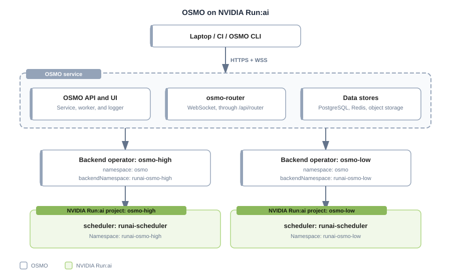

# Running NVIDIA OSMO Workflows on NVIDIA Run:ai

This tutorial demonstrates how to run NVIDIA OSMO workflows on an NVIDIA Run:ai-managed Kubernetes cluster, with an OSMO backend and pool for each [NVIDIA Run:ai project](../../platform-management/aiinitiatives/organization/projects.md). OSMO runs each workflow task as a Kubernetes pod, and NVIDIA Run:ai schedules those pods under the [quota](../../platform-management/runai-scheduler/scheduling/concepts-and-principles.md#quota) of the project. You can adapt this workflow for other teams, NVIDIA Run:ai projects, and OSMO pools.

<Note>

**Note**

This tutorial is written for OSMO 6.3.1. The links to the OSMO documentation point to the 6.3 version. A later OSMO release can use different values and steps.

</Note>

In this tutorial, you will learn how to:

* Create NVIDIA Run:ai projects for OSMO workflows
* Connect OSMO to each project with a backend and a pool
* Enable preemption reporting on the NVIDIA Run:ai Scheduler
* Run an OSMO workflow and monitor it in NVIDIA Run:ai
* Check preemption reporting

## How OSMO and NVIDIA Run:ai Work Together

OSMO and NVIDIA Run:ai each handle a different part of running workflows. OSMO is the workflow platform. Users submit their workflows to OSMO, and OSMO manages them. A [workflow](https://nvidia.github.io/OSMO/release/6.3/user_guide/workflows/index.html) is a set of tasks that can depend on each other, and each task runs as a Kubernetes pod. The NVIDIA Run:ai Scheduler schedules these pods. It decides which pods run, which nodes they run on, and which pods are preempted when there are not enough resources for all of them.

Each part of the setup is responsible for the following:

- **OSMO** manages the workflows. It includes:
  - **The OSMO service.** The central service that provides the API and UI for workflow submission, monitoring, and management. For more details, refer to [Architecture](https://nvidia.github.io/OSMO/release/6.3/deployment_guide/introduction/architecture.html) in the OSMO documentation.
  - **OSMO users and roles.** Users log in to the OSMO service from the OSMO CLI or the UI. They can log in with their organization's credentials through an external identity provider (IdP), or with an OSMO access token. OSMO roles then control which pools they can submit workflows to. For more details, refer to [Authentication Flow](https://nvidia.github.io/OSMO/release/6.3/deployment_guide/appendix/authentication/authentication_flow.html).
  - **Pools.** A pool is a group of resources that users share. Users choose a pool when they submit a workflow. Each pool references the backend that runs its workflows. For more details, refer to [Resource Pools](https://nvidia.github.io/OSMO/release/6.3/user_guide/resource_pools/index.html).
  - **Backends and the backend operator.** A backend is a compute backend where workflows run. The backend operator runs on the compute cluster. Its worker creates the Kubernetes pods for the tasks, and its listener reports state changes back to the OSMO service. In this tutorial, each backend uses the namespace of one NVIDIA Run:ai project. For more details, refer to [Deploy Backend Operator](https://nvidia.github.io/OSMO/release/6.3/deployment_guide/install_backend/deploy_backend.html).
- **NVIDIA Run:ai** schedules the pods and enforces limits. It is responsible for:
  - **Access to projects.** NVIDIA Run:ai administrators manage access to the projects. This is separate from how OSMO manages its users.
  - **Projects and namespaces.** Each NVIDIA Run:ai project has its own Kubernetes namespace, which OSMO uses as a backend.
  - **Quota and priority.** NVIDIA Run:ai schedules every pod under the [quota](../../platform-management/runai-scheduler/scheduling/concepts-and-principles.md#quota), [priority, and preemption](../../platform-management/runai-scheduler/scheduling/concepts-and-principles.md#priority-and-preemption) rules of the project.
  - **Pod placement.** NVIDIA Run:ai decides which nodes the pods run on.

Each NVIDIA Run:ai project maps to one OSMO backend, one OSMO pool, and one backend-operator Helm release. The following example shows the mapping:

| OSMO pool | OSMO backend | NVIDIA Run:ai project | Namespace |
|---|---|---|---|
| `osmo-high` | `osmo-high` | `osmo-high` | `runai-osmo-high` |
| `osmo-low` | `osmo-low` | `osmo-low` | `runai-osmo-low` |

The following diagram shows how users reach OSMO, and how each backend operator creates pods in the namespace of its NVIDIA Run:ai project:



## Prerequisites

Before you start, make sure the following requirements are met:

### OSMO Prerequisites

- **A running OSMO service.** For the installation, refer to [Deploy Service](https://nvidia.github.io/OSMO/release/6.3/deployment_guide/getting_started/deploy_service.html). The OSMO administrator sets up the following before you start, and this tutorial does not cover them:
  - **Data storage.** Where OSMO stores its data. Refer to [Step 1: Configure PostgreSQL](https://nvidia.github.io/OSMO/release/6.3/deployment_guide/getting_started/deploy_service.html#step-1-configure-postgresql) and [Step 3: Configure Storage Access](https://nvidia.github.io/OSMO/release/6.3/deployment_guide/getting_started/deploy_service.html#configure-storage-access) in Deploy Service.
  - **External access.** How users reach OSMO from outside the cluster. Refer to [Networking](https://nvidia.github.io/OSMO/release/6.3/deployment_guide/requirements/networking.html).
  - **User login.** How users log in to OSMO. Refer to [Authentication Flow](https://nvidia.github.io/OSMO/release/6.3/deployment_guide/appendix/authentication/authentication_flow.html).
- **The OSMO CLI, logged in to the service.** For the installation, refer to [Install Client](https://nvidia.github.io/OSMO/release/6.3/user_guide/getting_started/install/index.html).
- **OSMO 6.3.1.** This tutorial uses OSMO 6.3.1, with the `service` and `backend-operator` Helm charts at version 1.3.1. The values in this tutorial match these chart versions. A later chart can use a different values structure.
- **Helm 3.x.** Helm installs and upgrades the OSMO charts.
- **Access to the OSMO images and charts.** The cluster must be able to pull the OSMO images from `nvcr.io/nvidia/osmo`. The commands in this tutorial install the OSMO charts from the `osmo` Helm repository. For how to add the repository, refer to [Deploy Backend Operator](https://nvidia.github.io/OSMO/release/6.3/deployment_guide/install_backend/deploy_backend.html) in the OSMO documentation.
- **Kubernetes permissions.** You need Kubernetes cluster-admin permissions, or delegated permissions that cover the steps in this tutorial, including cluster-scoped OSMO objects such as PriorityClasses.

### NVIDIA Run:ai Prerequisites

- **Administrator access.** You need NVIDIA Run:ai administrator access to create projects and change the Scheduler settings. For the roles that can create projects, refer to [Roles](../../platform-management/authentication/roles.md).

## Step 1: Creating the NVIDIA Run:ai Projects

Create one NVIDIA Run:ai project for each OSMO pool that you want to run on NVIDIA Run:ai. This tutorial creates two, `osmo-high` for high-priority workflows and `osmo-low` for low-priority workflows. Two projects let you test preemption in [Step 5](#step-5-checking-preemption-reporting).

<Note>

**Note**

The project names are examples. If you use other names, replace `osmo-high`, `osmo-low`, and their namespaces, `runai-osmo-high` and `runai-osmo-low`, in every command and file in this tutorial.

</Note>

1. **Create the projects.** Create `osmo-high` and `osmo-low`, as described in [Adding a New Project](../../platform-management/aiinitiatives/organization/projects.md#adding-a-new-project). NVIDIA Run:ai creates the namespace of each project, `runai-osmo-high` and `runai-osmo-low`.
2. **Set the quota.** Give each project the GPU and CPU quota that you want to guarantee for its pool, as described in [Assigning GPU Quota](../../platform-management/aiinitiatives/organization/projects.md#assigning-gpu-quota) and [Assigning CPU Quota](../../platform-management/aiinitiatives/organization/projects.md#assigning-cpu-quota). How much quota each project needs depends on the priority of its OSMO workflows:

   * OSMO workflows with the `NORMAL` or `HIGH` priority are non-preemptible. They run only within the quota of the project, so give `osmo-high` enough quota for them.
   * OSMO workflows with the `LOW` priority are preemptible. They can also run on unused capacity beyond the quota of `osmo-low`, and NVIDIA Run:ai takes that capacity back when another project needs it within its quota.

3. **Check the namespaces.** Each namespace must belong to its project and must enforce the NVIDIA Run:ai Scheduler:

   ```bash
   kubectl get namespace runai-osmo-high runai-osmo-low -o yaml
   ```

   Each namespace must be associated with its NVIDIA Run:ai project and queue: `runai-osmo-high` with `osmo-high`, and `runai-osmo-low` with `osmo-low`. Pods that third-party tools create in either namespace must receive or keep `schedulerName: runai-scheduler`. NVIDIA Run:ai [enforces the Scheduler at the namespace level](../../platform-management/runai-scheduler/scheduling/default-scheduler.md#enforce-the-scheduler-at-the-namespace-level) for third-party Kubernetes workloads.
4. **Label the compute nodes (only if your pod template uses a node selector).** The OSMO pod template `default_compute`, which you define in [Step 2](#step-2-connecting-osmo-to-each-project), selects compute nodes with the node selector `osmo-compute: "true"`. If your pod template does not set a node selector, skip this item. Otherwise, label each node that can run OSMO workflows, replacing `<node-name>` with the name of the node:

   ```bash
   kubectl label nodes <node-name> --overwrite osmo-compute=true
   kubectl get nodes -L osmo-compute
   ```

   <Note>

   **Note**

   Pods stay `Pending` on nodes that do not have the label that the pod template selects. When autoscaling or hibernation replaces a node, apply the label again, or add it to the node group bootstrap template.

   </Note>

## Step 2: Connecting OSMO to Each Project

Each NVIDIA Run:ai project needs its own OSMO backend, OSMO pool, and backend-operator Helm release. The following items show only the settings that connect OSMO to NVIDIA Run:ai. For the other chart values and the service installation, refer to [Deploy Service](https://nvidia.github.io/OSMO/release/6.3/deployment_guide/getting_started/deploy_service.html).

<Note>

**Note**

This step connects the `osmo-high` project to OSMO. Repeat it to connect the `osmo-low` project.

</Note>

1. **Create the backend.** In the `services.configs.backends` section of the OSMO service values, add one backend for each project. The backend uses the namespace of the project and the NVIDIA Run:ai Scheduler:

   ```yaml
   services:
     configs:
       backends:
         osmo-high:
           description: NVIDIA Run:ai osmo-high project
           scheduler_settings:
             scheduler_type: kai
             scheduler_name: runai-scheduler
             scheduler_timeout: 30
   ```

   * `scheduler_type: kai` - The OSMO scheduler integration type that works with the NVIDIA Run:ai Scheduler.
   * `scheduler_name: runai-scheduler` - Sets the scheduler name on every pod that OSMO creates. NVIDIA Run:ai enforces the same Scheduler at the namespace level by default, as described in [Step 1](#step-1-creating-the-nvidia-runai-projects). Setting it in OSMO as well means the setting still applies if enforcement is turned off.

   The namespace where OSMO creates the pods of the backend comes from `backendNamespace` in the backend-operator release in item 7. Do not set it in this section.

2. **Define the pod template (only if your nodes use a node selector).** If your nodes do not use a node selector, skip this item. Otherwise, define the `default_compute` pod template in `services.configs.podTemplates`:

   ```yaml
   services:
     configs:
       podTemplates:
         default_compute:
           spec:
             nodeSelector:
               osmo-compute: "true"
   ```

3. **Create the pool.** In `services.configs.pools`, add one pool for each project. The pool points to the backend by name. Each pool uses one backend, and each backend uses one namespace, so the workflows of a pool run in one NVIDIA Run:ai project. This tutorial uses one pool and one backend for each project:

   ```yaml
   services:
     configs:
       pools:
         osmo-high:
           description: High-priority NVIDIA Run:ai project
           backend: osmo-high
           default_platform: default
           common_pod_template:
             - default_ctrl
             - default_user
             - default_compute
           common_resource_validations:
             - default_cpu
             - default_memory
             - default_storage
             - default_gpu
           common_default_variables:
             USER_CPU: 1
             USER_GPU: 0
             USER_MEMORY: 1Gi
             USER_STORAGE: 1Gi
           platforms:
             default:
               labels: {}
   ```

   * `common_pod_template` - The pod templates that OSMO applies to the pods of the pool. A pod template is a reusable part of a pod specification, such as a node selector. `default_ctrl` and `default_user` are built-in templates of the OSMO service chart. `default_compute` is the pod template from item 2, which sets the node selector from [Step 1](#step-1-creating-the-nvidia-runai-projects). If your nodes do not use a node selector, leave out `default_compute`.
   * `common_resource_validations` - Built-in rules of the OSMO service chart. They reject a workflow that requests more resources than the nodes have.
   * `common_default_variables` - The resource values that OSMO uses when a workflow does not set them. A workflow that sets `gpu: 0` counts as not setting `gpu`. Without these values, OSMO fails the submission of such a workflow with an internal server error.
   * `default_platform` and `platforms` - A platform routes workflows to specific hardware in the pool. This pool has one platform, `default`, which workflows use when they do not choose one.

   For the other pool settings, refer to [Resource Pools](https://nvidia.github.io/OSMO/release/6.3/deployment_guide/advanced_config/pool.html) in the OSMO deployment guide.

4. **Give users access to the pools.** The default `osmo-user` role allows workflow submission only to the `default` pool. To let users submit workflows to the new pools, add a role for each pool and assign it to the users, as described in [Creating a Role for a Pool](https://nvidia.github.io/OSMO/release/6.3/deployment_guide/appendix/authentication/roles_policies.html#creating-a-role-for-a-pool).

5. **Apply the values.** Apply the updated values to your OSMO service release with `helm upgrade`, as described in [Deploy Service](https://nvidia.github.io/OSMO/release/6.3/deployment_guide/getting_started/deploy_service.html). These values take effect only when the OSMO service reads its configuration from the Helm values, with `services.configs.enabled: true`, as set in [Step 4: Prepare values](https://nvidia.github.io/OSMO/release/6.3/deployment_guide/getting_started/deploy_service.html#deploy-service-osmo-values) of Deploy Service. The OSMO service reloads the updated configuration without a restart, and the new pools can take a few minutes to appear in the pool list.

6. **Create the backend operator token.** The backend operator authenticates to the OSMO service with a token that has the `osmo-backend` role. Create the token and store it in a Kubernetes Secret in the OSMO namespace (`osmo` in this tutorial), as described in [Deploy Backend Operator](https://nvidia.github.io/OSMO/release/6.3/deployment_guide/install_backend/deploy_backend.html).

7. **Define the backend-operator values.** Define the values of one `backend-operator` release for each project. The release runs in the OSMO namespace (`osmo`). The following values are for the release of `osmo-high`:

   ```yaml
   global:
     name: osmo-high
     backendName: osmo-high
     backendNamespace: runai-osmo-high
     includeNamespaceUsage: "runai-osmo-high,runai-osmo-low"
     osmoImageTag: 6.3.1
   ```

   * `name` - The name of this deployment. If you leave it out, the chart uses the Helm release name.
   * `backendName` - The name of the backend from item 1.
   * `backendNamespace` - The namespace of the NVIDIA Run:ai project, where the workflow pods run. OSMO creates the pods of the backend in this namespace, so NVIDIA Run:ai schedules them under the quota of the project that owns it.
   * `osmoImageTag` - The tag of the OSMO images that the release runs. Set it to the version of your OSMO service, `6.3.1` in this tutorial. The chart default is `latest`, which can differ from your service version.
   * `includeNamespaceUsage` - The namespaces whose pods OSMO counts as workflow pods when it reports node usage. This tutorial lists the namespaces of both projects in both releases, so that each release counts the pods of the other project as workflow pods.

   The release also needs the values that connect it to the OSMO service:

   * `serviceUrl`, `agentNamespace`, and `loginMethod` - Set `loginMethod` to `token`, because the chart default is `password`.
   * `accountTokenSecret` and `accountTokenSecretKey` - The name and key of the token Secret from item 6.

   For these values, and for adding the OSMO Helm repository, refer to [Deploy Backend Operator](https://nvidia.github.io/OSMO/release/6.3/deployment_guide/install_backend/deploy_backend.html).

   <Warning>

   **Important**

   Do not point two backend-operator releases at the same backend name or namespace.

   </Warning>

8. **Install the backend operator.** Save the values of the release in a file, for example `osmo-backend-high-values.yaml`, and install the release:

   ```bash
   helm upgrade --install osmo-backend-high osmo/backend-operator \
     --namespace osmo \
     --values osmo-backend-high-values.yaml \
     --version 1.3.1 \
     --wait --timeout 10m
   ```

9. **Repeat for the other project.** To connect `osmo-low`, repeat this step with the names `osmo-low` and `runai-osmo-low`, and use the same token Secret. Keep the same `includeNamespaceUsage` value, which lists both namespaces. A Kubernetes PriorityClass gives a priority level a name that pods can use. PriorityClass objects belong to the whole cluster, so only one release should create them. The release for `osmo-high` creates them. In the release for `osmo-low`, turn off their creation:

   ```yaml
   global:
     priorityClasses:
       enabled: false
   ```

   If you add more projects, turn off the creation in every release except the first.

10. **Check the pools.** The `osmo-high` and `osmo-low` pools must show as `ONLINE` before you submit workflows:

    ```bash
    osmo pool list
    ```

    If a pool is not `ONLINE`, check the logs of the backend listener of its release, replacing `<project>` with the project name, `osmo-high` or `osmo-low`:

    ```bash
    kubectl logs -n osmo deployment/<project>-osmo-backend-listener --tail=100
    ```

## Step 3: Enabling Preemption Reporting

When the NVIDIA Run:ai Scheduler evicts a pod of an OSMO workflow to free its resources, OSMO needs to know that the Scheduler caused the eviction. OSMO looks for a pod condition of the type `DisruptionTarget` with the reason `PreemptionByScheduler`. Without it, OSMO reports the workflow as `FAILED` with code `2001`, treats it as a final failure, and does not reschedule it.

1. **Set the condition.** Add the argument `--update-pod-eviction-condition=true` to the NVIDIA Run:ai Scheduler deployment:

   ```bash
   kubectl -n runai patch deployment runai-scheduler \
     --type=json \
     -p='[{"op":"add","path":"/spec/template/spec/containers/0/args/-","value":"--update-pod-eviction-condition=true"}]'
   ```

2. **Check the setting.** Check that the Scheduler is using the argument:

   ```bash
   kubectl -n runai rollout status deployment/runai-scheduler
   kubectl -n runai get deployment runai-scheduler \
     -o jsonpath='{.spec.template.spec.containers[0].args}' | tr ' ' '\n' | grep update-pod-eviction-condition
   ```

   The output must include `--update-pod-eviction-condition=true`.

<Warning>

**Important**

The NVIDIA Run:ai operator can revert a direct edit of the Scheduler deployment, so check that the argument is still set before you test preemption in [Step 5](#step-5-checking-preemption-reporting).

</Warning>

## Step 4: Running and Monitoring a Workflow

Submit a small workflow to each pool, and check the pods that OSMO creates.

1. **Create a workflow file.** Save the following as `hello-osmo.yaml`. For the workflow file format, refer to [Workflow Specification](https://nvidia.github.io/OSMO/release/6.3/user_guide/workflows/specification/index.html). The workflow runs until you cancel it, so that you can inspect it:

   ```yaml
   workflow:
     name: hello-osmo
     resources:
       default:
         cpu: 1
         memory: 1Gi
         storage: 1Gi
         gpu: 0
     tasks:
     - name: hello
       image: ubuntu:24.04
       command: [sh, -c]
       args: ["echo Hello from OSMO; exec sleep infinity"]
   ```

2. **Submit the workflow to both pools:**

   ```bash
   osmo workflow submit hello-osmo.yaml --pool osmo-high
   osmo workflow submit hello-osmo.yaml --pool osmo-low --priority LOW
   ```

3. **Check the pods.** Each pod runs in the namespace of its project, with the NVIDIA Run:ai Scheduler and the queue of its project. First, find the pod name:

   ```bash
   kubectl get pods -n runai-osmo-high -o wide
   ```

   The pod must be in the `Running` phase. Then check the pod, replacing `<pod-name>` with the name from the previous command, and do the same for the pod in `runai-osmo-low`. The `scheduler` value must be `runai-scheduler`:

   ```bash
   kubectl get pod <pod-name> -n runai-osmo-high -o json | jq '{
     namespace: .metadata.namespace,
     scheduler: .spec.schedulerName,
     phase: .status.phase
   }'
   ```

   Finally, check the pod group that NVIDIA Run:ai schedules the pod under. The `QUEUE` value must be the name of the project. The `PRIORITY` value is the OSMO priority class of the workflow: `osmo-normal` for the default priority, and `osmo-low` for the `LOW` priority:

   ```bash
   kubectl get podgroups.scheduling.run.ai -n runai-osmo-high \
     -o custom-columns=NAME:.metadata.name,QUEUE:.spec.queue,PRIORITY:.spec.priorityClassName
   ```

   <Note>

   **Note**

   The pod itself carries an `osmo-pool-...` queue label that OSMO sets. NVIDIA Run:ai schedules the pod under the queue of the project, as the pod group shows.

   </Note>

4. **Monitor the workflows in NVIDIA Run:ai.** NVIDIA Run:ai provides full monitoring for externally submitted Kubernetes workloads, including event history, metrics, and logs. Each task pod appears in the project of its namespace, named after the pod. For more details, refer to [Supported Features](../../workloads-in-nvidia-run-ai/workload-types/supported-features.md#externally-submitted-kubernetes-workloads).

5. **Cancel the workflows** when you finish checking. Use the workflow IDs that OSMO returned when you submitted them:

   ```bash
   osmo workflow cancel <workflow-id>
   ```

## Step 5: Checking Preemption Reporting

This step checks that OSMO reports a preempted workflow correctly. Before you start, run the check in [Step 3](#step-3-enabling-preemption-reporting) again to confirm that the Scheduler argument is set.

1. **Request GPUs in the workflow file.** In the file from [Step 4](#step-4-running-and-monitoring-a-workflow), set `gpu` to the number of free GPUs. Preemption happens only when the two workflows compete for the same GPUs.

2. **Submit a long-running low-priority workflow** to the `osmo-low` pool. The pool must use capacity that the NVIDIA Run:ai Scheduler can reclaim, which means GPUs beyond the GPU quota of `osmo-low`:

   ```bash
   osmo workflow submit hello-osmo.yaml --pool osmo-low --priority LOW
   ```

   Wait until its pod is in the `Running` phase before you continue.

3. **Submit a higher-priority workflow** to the `osmo-high` pool that needs the same capacity. The GPU quota of `osmo-high` must be at least the number of GPUs in the file:

   ```bash
   osmo workflow submit hello-osmo.yaml --pool osmo-high
   ```

4. **Watch the pods** in the low-priority namespace. The low-priority pod is evicted to free the GPUs for the higher-priority workflow:

   ```bash
   kubectl get pods -n runai-osmo-low -w
   ```

5. **Check the state in OSMO.** Use the workflow ID that OSMO returned when you submitted the low-priority workflow:

   ```bash
   osmo workflow events <workflow-id>
   osmo workflow query <workflow-id> -t json
   ```

   The text output of `osmo workflow query` does not show the exit code, so use the JSON output. OSMO must report the evicted workflow as `FAILED_PREEMPTED` with exit code `3006`, not as `FAILED` with code `2001`. To have OSMO reschedule the preempted workflow, set an exit action that reschedules tasks with exit code `3006`, and allow retries with `max_retry_per_task` in the workflow configuration. For more details, refer to [Exit Actions](https://nvidia.github.io/OSMO/release/6.3/user_guide/workflows/specification/exit_actions.html).

## Troubleshooting

| Symptom | Cause | Fix |
|---|---|---|
| A pool is offline | The backend listener cannot authenticate to the OSMO service or cannot reach it | Check the token Secret, the service URL, DNS, and the listener logs. Both pools must show as `ONLINE` in `osmo pool list` ([Step 2](#step-2-connecting-osmo-to-each-project)) |
| A workflow runs in another project than the project of its pool | `backendNamespace` in the backend-operator release is the namespace of another project. OSMO creates the pods in `backendNamespace`, so NVIDIA Run:ai schedules the workflow under that project | Set `backendNamespace` to the namespace of the project of the backend, and upgrade the release. Check the namespace that OSMO uses with `osmo config show BACKEND <backend-name>` ([Step 2](#step-2-connecting-osmo-to-each-project)) |
| Submitting a workflow fails with an internal server error | The pool does not set `common_default_variables`, and the workflow sets `gpu: 0` | Add `common_default_variables` to the pool ([Step 2](#step-2-connecting-osmo-to-each-project)) |
| A workflow ends as `FAILED_SERVER_ERROR`, and the backend worker log reports that an image is required | The OSMO service reads its configuration from the Helm values, and `services.configs.workflow.backend_images` is not set there | Set `init` and `client` under `services.configs.workflow.backend_images` in the OSMO service values, for example `nvcr.io/nvidia/osmo/init-container:6.3.1` and `nvcr.io/nvidia/osmo/client:6.3.1`, and upgrade the release ([Step 2](#step-2-connecting-osmo-to-each-project)) |
| A pod uses the default scheduler | The backend has no `scheduler_name`, and the namespace does not enforce the NVIDIA Run:ai Scheduler | Set `scheduler_name: runai-scheduler` in the backend, and check the namespace of the project ([Step 1](#step-1-creating-the-nvidia-runai-projects)) |
| A workflow is rejected because the pool is not found | The command refers to a pool that is not defined | Run `osmo pool list`, and add the pool under `services.configs.pools` ([Step 2](#step-2-connecting-osmo-to-each-project)) |
| A pod stays `Pending` and reports a node selector mismatch | The label that your OSMO pod template selects, `osmo-compute` in this tutorial, is missing from the nodes, for example after a node replacement | Label the nodes with `osmo-compute=true` ([Step 1](#step-1-creating-the-nvidia-runai-projects)) |
| A preempted workflow shows `FAILED` with code `2001` | The Scheduler did not set the `PreemptionByScheduler` pod condition | Add `--update-pod-eviction-condition=true` to the Scheduler deployment ([Step 3](#step-3-enabling-preemption-reporting)) |
| The installation of the second backend-operator release conflicts with the first | Both releases create the shared PriorityClass objects | Set `global.priorityClasses.enabled: false` in every release except the first ([Step 2](#step-2-connecting-osmo-to-each-project)) |
