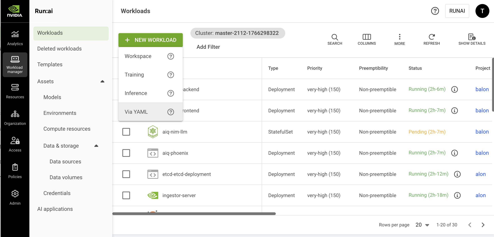

# Submit Supported Workload Types via YAML

This guide describes how to run supported workload types using the NVIDIA Run:ai UI by submitting a YAML manifest directly.

To learn more about workload types in NVIDIA Run:ai and determine what is the most suitable workload type for your goals, see [Workload types and features](workload-types/supported-workload-types.md).

<Note>

**Note**

Workloads can be submitted using YAML outside of NVIDIA Run:ai (for example, with `kubectl`). For details, see [Supported features](workload-types/supported-features.md#externally-submitted-kubernetes-workloads).

</Note>

<figure><figcaption></figcaption></figure>

## Before You Start

Make sure you have created a [project](../platform-management/aiinitiatives/organization/projects.md) or have one created for you.

<Note>

**Note**

Via YAML submission is enabled by default. If you do not see it in the menu, contact your administrator to enable it under **General settings** → Workloads → Submit supported workload types via YAML.

</Note>

## Supported Workload Types

Supported workload types include a broad range of workloads from the ML and Kubernetes ecosystem that are already registered as workload types in the platform and ready to use. See [Supported workload types](workload-types/supported-workload-types.md) for more details.

* Your administrator can also register additional workload types for your organization. See [Registering new workload types](workload-types/extending-workload-support/#registering-new-workload-types) for more details.
* By default, workload types are grouped into Build, Train and Deploy categories. These categories determine how the workload is scheduled and prioritized within a project and how they are grouped for monitoring and reporting.

<Note>

**Note**

Some supported workload types require additional installation or cluster preparation before they can be used. Refer to the documentation for each workload type for specific prerequisites.

</Note>

## Workload Priority and Preemption
By default, supported workload types are assigned a priority and preemptibility based on their workload type. These defaults determine how workloads are scheduled relative to others within the same project, whether they can use over-quota resources, and whether they may be interrupted once running. You can override the defaults by configuring priority and preemptibility. For more details on the default values per workload type, see [Workload types default](workload-types/supported-workload-types.md#workload-types-defaults).

## Setting GPU Fractions

To enable GPU fractions for workloads submitted via YAML, use the following annotations to define the GPU fraction configuration. You can configure `gpu-fraction`, `gpu-memory`, or the NVIDIA-native `nvidia.com/container.<container-name>.gpu-memory.request` alternative. For concept details, deployment considerations, and a full example, see [GPU Fractions](../platform-management/runai-scheduler/resource-optimization/memory-fractions.md#setting-gpu-memory-fractions-via-yaml).

GPU fractions can be assigned to only one container in the pod. By default, GPU fraction allocation is applied to the first container (index 0) in the pod. Set the `gpu-fraction-container-name` annotation to specify which container should consume the fractional GPU resources. The specified container can be the main container, a sidecar, or an init container, any container other than the default first container.

| Variable | Input Format | Where to Set |
| --- | --- | --- |
| `gpu-fraction` | A portion of GPU memory as a double-precision floating-point number. Example: `0.25`, `0.75`. | Pod annotation (`metadata.annotations`) |
| `gpu-memory` | Memory size in MiB. Example: `2500,` `4096`. The `gpu-memory` values are always in MiB. | Pod annotation (`metadata.annotations`) |
| `gpu-fraction-num-devices` | The number of GPU devices to allocate using the specified `gpu-fraction` or `gpu-memory` value. Set this annotation only if you want to request multiple GPU devices. | Pod annotation (`metadata.annotations`) |
| `gpu-fraction-container-name` | By default, GPU fraction allocation is applied to the first container (index 0) in the pod. Set this annotation to specify a different container to receive the GPU allocation. | Pod annotation (`metadata.annotations`) |
| `nvidia.com/container.<container-name>.gpu-memory.request` | Memory size in Kubernetes resource quantity format. Example: `40G`. This is the official NVIDIA alternative to `gpu-memory`, and names the container directly instead of relying on `gpu-fraction-container-name`. | Pod annotation (`metadata.annotations`) |

## Setting DRA Resource Claims

To request hardware managed via Kubernetes [Dynamic Resource Allocation (DRA)](../platform-management/runai-scheduler/scheduling/concepts-and-principles.md#dynamic-resource-allocation-dra), reference a `ResourceClaim` or `ResourceClaimTemplate` in the pod spec. For the field reference and a full example, see the Kubernetes documentation on [scheduling DRA resources](https://kubernetes.io/docs/tasks/configure-pod-container/assign-resources/allocate-devices-dra/).

## Setting Stale Gang Eviction Timeout

For gang-scheduled workloads (for example, distributed training or distributed inference), set the `kai.scheduler/staleness-grace-period` annotation to override the cluster-wide default grace period before the Scheduler evicts a stale pod group. For concept details, see [Stale Gang Eviction](../platform-management/runai-scheduler/scheduling/concepts-and-principles.md#stale-gang-eviction).

```yaml
metadata:
  annotations:
    kai.scheduler/staleness-grace-period: "1m"
```

The value is a duration string, a number followed by a unit (`s`, `m`, or `h`), for example `30s`, `5m`, or `1h`. An invalid value is ignored, and the cluster-wide default applies. A negative value disables stale gang eviction for that pod group entirely.

## Creating a New Workload

1. To create a workload, go to Workload manager → Workloads.
2. Click **+ NEW WORKLOAD** and select **Via YAML** from the dropdown.
3. In the YAML submission form, select the **cluster** where the workload will run.
4. Upload or paste your YAML manifest. Hover over **Supported workload types** to view a full list of available workloads:
   * To upload a file, click **UPLOAD YAML FILE** and choose your YAML.
   * To **paste the YAML**, insert it directly into the editor.
5. Select a **project**:
   * If the `namespace` is not defined in the YAML, select a **project** from the submission form. To create a new project, click **+NEW PROJECT** and refer to [Projects](../platform-management/aiinitiatives/organization/projects.md) for a step-by-step guide.
   * If a project is selected in the form, it **overrides** the `namespace` defined in the YAML.
   *   Alternatively, set the project directly in the YAML using the `metadata.namespace` field.

       ```yaml
       metadata:
         namespace: my-project-name
       ```
6. Set whether the **workload may be interrupted**. Change this setting only if you want to override the default preemptibility defined for the workload type. Non-preemptible workloads use the project's available GPU quota and will not be interrupted once they start running. Preemptible workloads may be interrupted if resources are needed for higher priority workloads. Semi-preemptible workloads guarantee their minimum required replicas run without interruption, while any replicas beyond that minimum behave as preemptible replicas:
   * In the UI, select **Preemptible**, **Semi-preemptible**, or **Non-preemptible** from the dropdown.
   *   In the YAML, set the following label under `metadata.labels`:

       ```yaml
       metadata:
         labels:
           kai.scheduler/preemptibility: non-preemptible
       ```
7. Set the **workload priority**. Change this setting only if you want to override the default priority defined for the workload type. Higher priority workloads are scheduled before lower-priority ones:
   * In the UI, select a **priority** from the dropdown.
   *   In the YAML, set `priorityClassName` under `metadata.labels` using one of the supported values: `very-low`, `low`, `medium-low`, `medium`, `medium-high`, `high`, `very-high`:

       ```yaml
       metadata:
         labels:
           priorityClassName: high
       ```
8.  If the project's node pools support MNNVL, set whether **Multi-Node NVLink (MNNVL) acceleration** is required for this workload. MNNVL provides high-bandwidth, low-latency communication between GPUs on supported nodes, improving performance for multi-GPU workloads:

    * **Not required** - The workload will not use MNNVL acceleration, even if MNNVL-capable nodes are available.
    * **Required** - The workload will require MNNVL-capable nodes. Scheduling may be restricted to compatible nodes, and if none are available, the workload may remain pending.

    For more information, see [Using GB200 NVL72 and Multi-Node NVLink Domains](../platform-management/aiinitiatives/resources/using-gb200.md).
9. Click **CREATE WORKLOAD**

## Managing and Monitoring

After the workload is created, it is added to the [Workloads](workloads.md) table, where it can be managed and monitored.

## Accessing Workload Endpoints

NVIDIA Run:ai automatically discovers and displays network endpoints for workloads that include Kubernetes networking resources. For more information, see [Kubernetes Services, Load Balancing, and Networking](https://kubernetes.io/docs/concepts/services-networking/).

To expose endpoints, include the relevant networking configuration in your YAML. For example, the following Dynamo workload defines an Ingress that NVIDIA Run:ai will automatically discover:

```yaml
apiVersion: nvidia.com/v1alpha1
kind: DynamoGraphDeployment
metadata:
  name: secure-llm
spec:
  services:
    Frontend:
      dynamoNamespace: secure-llm
      componentType: frontend
      replicas: 1
      ingress:
        enabled: true
        host: api
        hostPrefix: llm-
        hostSuffix: example.com
        ingressControllerClassName: haproxy
      extraPodSpec:
        mainContainer:
          image: nvcr.io/nvidia/ai-dynamo/vllm-runtime:1.2.0
```

Once the workload is running, the **Connections** column shows the endpoint URL directly if there is one, or the number of endpoints if there are multiple. See [Connections associated with the workload](workloads.md#connections-associated-with-the-workload) for more details.

**Using an endpoint:**

* Click **Copy** to copy the URL to your clipboard.

**No endpoints displayed:**

If no endpoints appear, the workload may not yet be in a running state, or the networking configuration in your YAML manifest may not be set up correctly. Check the following:

* Verify the workload status is **Running**.
* Confirm that your YAML manifest includes the required networking configuration.
* Check that the networking configuration is correctly defined and applied.

## Using CLI

To view the available actions, see the [CLI v2 reference](../reference/cli/runai/runai.md).

## Using API

To view the available actions, see the [Workloads V2](api:main-api:POST/api/v2/workloads) API reference.

## Troubleshooting

<Accordion title="Generic or unknown errors">

**Generic or unknown errors**

**Description:** Not specific enough to diagnose from the message alone.

```
Something went wrong
```

</Accordion>

<Accordion title="Authentication and permissions">

**Authentication and permissions**

**Description**: You may not be authorized to submit/manage workloads in the selected scope, or your token issuer is not recognized.

```
insufficient permissions
Issuer is not familiar
```

</Accordion>

<Accordion title="Cluster or API compatibility">

**Cluster or API compatibility**

**Description**: The API endpoint you used is not compatible with the target cluster version.

```
This API is incompatible with the version of cluster '<clusterId>'
```

</Accordion>

<Accordion title="Priority or category not available">

**Priority or category not available**

**Description**: The selected priority or category isn’t supported in the target cluster.

```
category '<name>' is not available in this cluster
priority '<name>' is not available in this cluster
```

</Accordion>

<Accordion title="Workload name validation">

**Workload name validation**

**Description**: The workload name is missing, invalid, too long, or already exists.

```
Workload name must not be empty
The length of a workload name must not exceed 63 characters
The workload name must consist of lower case alphanumeric characters or '-', and start with an alphabetic character.
workload with name '<name>' already exists in this project
```

</Accordion>

<Accordion title="Project or cluster selection errors">

**Project or cluster selection errors**

**Description**: The request context is missing or ambiguous.

```
either projectId or clusterId must be provided
projectId and clusterId are mutually exclusive, provide only one
Failed to read request body
```

</Accordion>

<Accordion title="Workload type (GVK) not found or not ready in the cluster">

**Workload type (GVK) not found or not ready in the cluster**

**Description**: NVIDIA Run:ai can’t map your manifest’s **GVK** (group/version/kind) to a workload type that is registered and ready in the selected cluster. See [Supported workload types](workload-types/supported-workload-types.md).

```
failed to extract resource info: <error>
failed to get workload types: <error>
workload type not found for GVK: <group>/<version>/<kind>
workload type has no cluster status information
workload type has no status information for cluster <clusterId> and version <version>
workload type phase is not available for this cluster
workload type is not ready in cluster <clusterId> (phase: <phase>) - <conditions>
```

</Accordion>

<Accordion title="Batch job workload stuck in Resuming state">

**Batch job workload stuck in Resuming state**

**Description**: After using the Run action on a batch job workload type (such as Job, PyTorchJob, or RayJob), the workload gets stuck in the **Resuming** state indefinitely. This is a known Kubernetes issue.

**Affected versions**: Kubernetes versions prior to v1.32.9, v1.33.6, v1.34.2, or v1.35.0 (depending on your minor version).

**Resolution**: Upgrade your cluster to a fixed Kubernetes release: v1.32.9 or later, v1.33.6 or later, v1.34.2 or later, or v1.35.0 or later.

</Accordion>

<Accordion title="Manifest structure and parsing errors">

**Manifest structure and parsing errors**

**Description**: The submitted YAML is not a valid Kubernetes-style manifest, or it can’t be parsed.

```
these are all the validations missing required field: apiVersion
missing required field: kind
manifest metadata is not a valid map
failed to convert YAML to JSON
failed to unmarshal JSON manifest
```

</Accordion>
