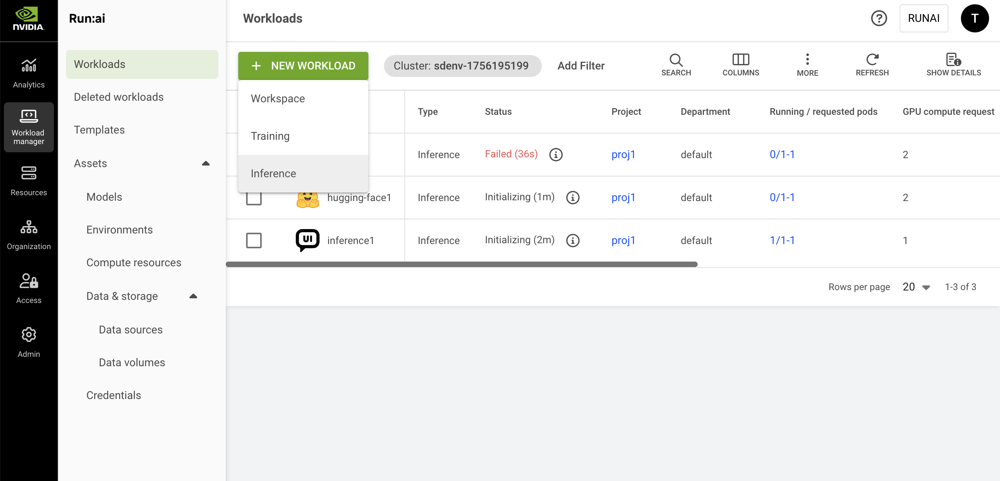

# Deploy Inference Workloads with Custom Server

This guide explains how to deploy an inference workload using a custom inference server in NVIDIA Run:ai. The Custom server option is selected when creating a Standard inference (single-node) workload and allows you to bring your own container image and server configuration - for example, when using an inference server not natively supported by NVIDIA Run:ai, such as SGLang.

An inference workload provides the setup and configuration needed to deploy your trained model for real-time or batch predictions. It includes specifications for the container image, data sets, network settings, and resource requests required to serve your models.

The inference workload is assigned to a project and is affected by the project’s quota.

To learn more about the inference workload type in NVIDIA Run:ai and determine that it is the most suitable workload type for your goals, see [Workload types and features](../workload-types/native-workloads.md).

<figure><figcaption></figcaption></figure>

## Before You Start

* Make sure you have created a [project](../../platform-management/aiinitiatives/organization/projects.md) or have one created for you.
* Make sure [Knative](../../installation-and-configuration/installation/install-using-helm/system-requirements.md#inference) is properly installed by your administrator.
* If the image you are planning to use is hosted in NGC, make sure you have an NGC account with an active NGC API key. To obtain a key, go to [NGC](https://catalog.ngc.nvidia.com/) → Setup → API Keys, then generate or copy an existing key. In NVIDIA Run:ai, store the key either as a [shared secret](../workload-assets/credentials.md#ngc-api-key) (created by an administrator) or a [user credential](../../settings/user-settings/user-credentials.md) (created under User settings).

<Info>

**Note**

**Docker registry URL for inference workloads** - For Knative-based inference workloads, Docker Hub credentials must be configured using `https://index.docker.io/v1/` as the registry URL. Credentials configured with `docker.io` result in `401 Unauthorized` errors for Knative-based inference workloads due to differences in how image digests are resolved during image pull. See [Credentials](../workload-assets/credentials.md#docker-registry) for more details.

</Info>

## Workload Priority and Preemption <a href="#workload-priority-class" id="workload-priority-class"></a>

By default, inference workloads in NVIDIA Run:ai are assigned a **Very high** priority and are **non-preemptible**. These defaults ensures that inference workloads, which often serve real-time or latency-sensitive traffic, are guaranteed the resources they need. The default very-high priority ensures the fastest possible scheduling, and the default non-preemptible value guarantees that the workload will not be disrupted by other workloads once it starts running.

You can override the defaults by configuring priority and preemptibility. For more details, see [Workload priority and preemption](../../platform-management/runai-scheduler/scheduling/workload-priority-control.md).

## Workload Policies

When creating a new workload, fields and assets may have limitations or defaults. These rules and defaults are derived from a policy your administrator set.

Policies allow you to control, standardize, and simplify the workload submission process. For additional information, see [Policies and rules](../../platform-management/policies/policies-and-rules.md).

The effects of the policy are reflected in the workspace creation form:

* Defaults derived from the policy will be displayed automatically for specific fields.
* Disabled actions and permitted value ranges for values will be visibly explained per field.
* Rules and defaults for entire sections (such as environments, compute resources, or data sources) may prevent selection and will appear on the entire library card with an option for additional information via an external modal.

## Submission Form Options

You can create a new workload using either the **Flexible** or **Original** submission form. The Flexible submission form offers greater customization and is the **recommended** method. Within the Flexible form, you have two options:

* **Load from an existing setup** - You can select an existing setup to populate the workload form with predefined values. While the Original submission form also allows you to select an existing setup, with the Flexible submission you can customize any of the populated fields for a one-time configuration. These changes will apply only to this workload and will not modify the original setup. If needed, you can reset the configuration to the original setup at any time.
* **Provide your own settings** - Manually fill in the workload configuration fields. This is a one-time setup that applies only to the current workload and will not be saved for future use.

<Info>

**Note**

* Flexible workload submission is enabled by default. If unavailable, contact your administrator to enable it under **General settings** → Workloads → Flexible workload submission.
* The Original submission form will be deprecated in a future release.

</Info>

## Creating a Custom Inference Workload

1. To create an inference workload, go to Workload manager → Workloads.
2. Click **+NEW WORKLOAD** and select **Inference** from the dropdown men&#x75;**.**
3. Within the new form, select the **cluster** and **project**. To create a new project, click **+NEW PROJECT** and refer to [Projects](../../platform-management/aiinitiatives/organization/projects.md) for a step-by-step guide.
4. Set the inference workload architecture as **Standard.** This workload will only be able to use environments that support standard workloads. A standard workload consists of a single process.
5. Set the inference server to **custom** (if applicable). This allows you to use an inference server not listed, such as SGLang. This requires a custom container image and manual server configuration.
6. Select a [**template**](../workload-templates/inference-templates/custom-inference-templates.md) or **Start from scratch** to launch a new workload quickly. You can use a workload template to populate the workload form with predefined configuration values. You can still modify the populated fields before submitting the workload. Any changes you make will apply only to the workload and will not be saved back to the original template.
7. Enter a unique **name** for the workload. If the name already exists in the project, you will be requested to submit a different name.
8. Click **CONTINUE**

### Setting Up an Environment

<Info>

**Note**

* NGC catalog is disabled by default. If unavailable, your administrator must enable it under **General settings** → Workloads → NGC catalog.
* To select an image from the NGC private registr&#x79;**,** your administrator must configure it under **General settings** → Workloads → NGC private registry.

</Info>

<Tabs>

<Tab title="Flexible">

**Load from existing setup**

1. Click the **load** icon. A side pane appears, displaying a list of available environments. Select an environment from the list.
2. Optionally, customize any of the environment’s predefined fields as shown below. The changes will apply to this workload only and will not affect the selected environment.
3. Alternatively, click the **➕** icon in the side pane to create a new environment. For step-by-step instructions, see [Environments](../workload-assets/environments.md).

**Provide your own settings**

Manually configure the settings below as needed. The changes will apply to this workload only.

**Configure environment**

1. Set the **environment image**:
   * Select **Custom image** and add the **Image URL** or update the URL of the existing setup.
   * **Select from the NGC catalog** and then set how to **access the NGC catalog**:
     * **As a guest** - Choose the **image name** and **tag** from the dropdown.
     * **Authenticated** - Configure **access** to NGC and then choose the **image name** and **tag** from the dropdown:
       * Under **Source**, select [**Shared secret**](../workload-assets/credentials.md#ngc-api-key) or [**My credentials**](../../settings/user-settings/user-credentials.md).
       * The **Type** field is fixed to **NGC API key**.
       * Under **Credential name**, select an existing credential from the dropdown. If you select **My credentials**, you can also create a new credential directly from the dropdown. The credential is also saved under **User settings** → Credentials.
   * **Select from the NGC private registry** and then set how to access the registry:
     * Select a **registry** from the dropdown.
     * Under **Source**, select [**Shared secret**](../workload-assets/credentials.md#ngc-api-key) or [**My credentials**](../../settings/user-settings/user-credentials.md).
     * The **Type** field is fixed to **NGC API key**.
     * Under **Credential name**, select an existing credential from the dropdown. If you select **My credentials**, you can also create a new credential directly from the dropdown. The credential is also saved under **User settings** → Credentials.
2. Set the **image pull policy**:
   * Set the **condition for pulling the image**. It is recommended to pull the image only if it's not already present on the host.
   * Set the **credentials for pulling the image**:
     * Under **Source**, select [**Shared secret**](../workload-assets/credentials.md) or [**My credentials**](../../settings/user-settings/user-credentials.md).
     * Under **Type**, select **Docker registry** or **NGC API key**.
     * Under **Credential name**, select an existing credential from the dropdown. If you select **My credentials**, you can also create a new credential directly from the dropdown. The credential is also saved under **User settings** → Credentials.
3. Set an inference **serving endpoint**. The connection protocol and the container port are defined within the environment:
   * Select **HTTP** or **gRPC** and enter a corresponding **container port**
   * Modify who can access the endpoint. See [Accessing the inference workload](custom-inference.md#accessing-the-inference-workload) for more details:
     * By default, **Public** is selected giving everyone within the network access to the endpoint with no authentication
     * If you select **All authenticated users and service accounts**, access is given to everyone within the organization’s account that can log in (to NVIDIA Run:ai or SSO).
     * For **Specific group(s)**, enter **group names** as they appear in your identity provider. You must be a member of one of the groups listed to have access.
     * For **Specific user(s) and service account(s)**, enter a valid user email or name. If you remove yourself, you will lose access.
4. Set whether inference serving endpoints can be accessed externally or only by internal cluster traffic:
   * **External (Public access)** - Available only if your administrator has configured **Knative** to support external access. See the [Inference requirements](../../installation-and-configuration/installation/install-using-helm/system-requirements.md#inference) section for more details.
   * **Internal only** - Endpoint is accessible only within cluster traffic.
5. Set the connection for your **tool(s)**. If you are loading from existing setup, the tools are configured as part of the environment.
   * Select the connection type:
     * **Auto generate** - A unique URL / port is automatically created for each workload using the environment.
     * **Custom URL** / **Custom port** - Manually define the URL or port. For custom port, make sure to enter a port between `30000` and `32767.` If the node port is already in use, the workload will fail and display an error message.
     * **Load Balancer** - Set the container port. Connection handling is managed by the load balancer. For more information, see [External access to containers](../../infrastructure-setup/advanced-setup/container-access/external-access-to-containers.md).
   * Modify who can **access** the tool:
     * By default, **All authenticated users** **and service accounts** is selected giving access to everyone within the organization’s account.
     * For **Specific group(s)**, enter **group names** as they appear in your identity provider. You must be a member of one of the groups listed to have access to the tool.
     * For **Specific user(s) and service account(s)**, enter a valid user email or name. If you remove yourself, you will lose access to the tool.
6. Set the **command and arguments** for the container running the workload. If no command is added, the container will use the image’s default command (entry-point).
   * Modify the existing command or click **+COMMAND & ARGUMENTS** to add a new command.
   * Set multiple arguments separated by spaces, using the following format (e.g.: `--arg1=val1`).
7.  Set the **environment variable(s)**:

    * Modify the existing environment variable(s) or click **+ENVIRONMENT VARIABLE**. The existing environment variables may include instructions to guide you with entering the correct values.
    * You can either select **Custom** to define a value manually, or choose an existing value from [**Shared secret**](../workload-assets/credentials.md), [**My Credentials**](../../settings/user-settings/user-credentials.md), or [**ConfigMap**](../workload-assets/environments.md). If you select **My credentials**, you can also create a new credential directly from the dropdown. The credential is also saved under **User settings** → Credentials.

    Some environment variables are automatically injected by NVIDIA Run:ai. See [Built-in workload environment variables](../workloads.md#built-in-workload-environment-variables) for more details.
8. Enter a path pointing to the **container's working directory**
9. Set where the UID, GID, and supplementary groups for the container should be taken from. If you select **Custom**, you’ll need to manually enter the **UID,** **GID and** **Supplementary groups values**.
10. Select additional Linux capabilities for the container from the drop-down menu. This grants certain privileges to a container without granting all the root user's privileges.

</Tab>

<Tab title="Original">

1. Select an environment or click **+NEW ENVIRONMENT** to add a new environment to the gallery. For a step-by-step guide on adding environments to the gallery, see [Environments](../workload-assets/environments.md). Once created, the new environment will be automatically selected.
2. Set an inference **serving endpoint**. The connection protocol and the container port are defined within the environment.
   * Modify who can access the endpoint:
     * By default, **Public** is selected giving everyone within the network access to the endpoint with no authentication
     * If you select **All authenticated users and service accounts**, access is given to everyone within the organization’s account that can log in (to NVIDIA Run:ai or SSO).
     * For **Specific group(s)**, enter **group names** as they appear in your identity provider. You must be a member of one of the groups listed to have access.
     * For **Specific user(s) and service account(s)**, enter a valid user email or name. If you remove yourself, you will lose access.
3. Set the connection for your **tool(s)**. If you are loading from existing setup, the tools are configured as part of the environment.
   * Select the connection type - **External URL** or **NodePort:**
     * **Auto generate** - A unique URL/ port is automatically created for each workload using the environment.
     * **Custom URL** / **Custom port** - Manually define the URL or port. For custom port, make sure to enter a port between `30000` and `32767.` If the node port is already in use, the workload will fail and display an error message.
   * Optional: Modify who can **access** the tool:
     * By default, **All authenticated users** **and service accounts** is selected giving access to everyone within the organization’s account.
     * For **Specific group(s)**, enter **group names** as they appear in your identity provider. You must be a member of one of the groups listed to have access to the tool.
     * For **Specific user(s) and service account(s)**, enter a valid user email or name. If you remove yourself, you will lose access to the tool.
4. Optional: Set the **command and arguments** for the container running the workload. If no command is added, the container will use the image’s default command (entry-point):
   * Modify the existing command or click **+COMMAND & ARGUMENTS** to add a new command.
   * Set multiple arguments separated by spaces, using the following format (e.g.: `--arg1=val1`).
5.  Set the **environment variable(s)**:

    * Modify the existing environment variable(s) or click **+ENVIRONMENT VARIABLE**. The existing environment variables may include instructions to guide you with entering the correct values.
    * You can either select **Custom** to define your own variable or choose from a predefined list of [**Credentials**](../workload-assets/credentials.md)**.**

    Some environment variables are automatically injected by NVIDIA Run:ai. See [Built-in workload environment variables](../workloads.md#built-in-workload-environment-variables) for more details.

</Tab>

</Tabs>

### Setting Up Compute Resources

<Info>

**Note**

GPU memory limit is disabled by default. If unavailable, your administrator must enable it under **General Settings** → Resources → GPU resource optimization.

</Info>

<Tabs>

<Tab title="Flexible">

**Load from existing setup**

1. Click the **load** icon. A side pane appears, displaying a list of available compute resources. Select a compute resource from the list.
2. Optionally, customize any of the compute resource's predefined fields as shown below. The changes will apply to this workload only and will not affect the selected compute resource.
3. Alternatively, click the **➕** icon in the side pane to create a new compute resource. For step-by-step instructions, see [Compute resources](../workload-assets/compute-resources.md).

**Provide your own settings**

Manually configure the settings below as needed. The changes will apply to this workload only.

**Configure compute resources**

1. Set the number of **GPU devices** per pod (physical GPUs).
2. Enable **GPU fractioning** to set the GPU memory per device using either a fraction of a GPU device’s memory **(% of device)** or a GPU memory unit **(MB/GB)**:
   * **Request** - The minimum GPU memory allocated per device. Each pod in the workload receives at least this amount per device it uses.
   * **Limit** - The maximum GPU memory allocated per device. Each pod in the workload receives **at most** this amount of GPU memory for each device(s) the pod utilizes. This is disabled by default, to enable see the above note.
3. Set the **CPU resources**
   * Set **CPU compute resources** per pod by choosing the unit (**cores** or **millicores**):
     * **Request** - The minimum amount of CPU compute provisioned per pod. Each running pod receives this amount of CPU compute.
     * **Limit** - The maximum amount of CPU compute a pod can use. Each pod receives **at most** this amount of CPU compute. By default, the limit is set to **Auto** which means that the pod may consume up to the node's maximum available CPU compute resources.
   * Set the **CPU memory per pod** by selecting the unit (**MB** or **GB**):
     * **Request** - The minimum amount of CPU memory provisioned per pod. Each running pod receives this amount of CPU memory.
     * **Limit** - The maximum amount of CPU memory a pod can use. Each pod receives at most this amount of CPU memory. By default, the limit is set to **Auto** which means that the pod may consume up to the node's maximum available CPU memory resources.
4. Set **extended resource(s)**
   * Enable **Increase shared memory size** to allow the shared memory size available to the pod to increase from the default 64MB to the node's total available memory or the CPU memory limit, if set above.
   * Click **+EXTENDED RESOURCES** to add resource/quantity pairs. For more information on how to set extended resources, see the [Extended resources](https://kubernetes.io/docs/tasks/configure-pod-container/extended-resource/) and [Quantity](https://kubernetes.io/docs/reference/kubernetes-api/common-definitions/quantity/) guides.
5. Set the **minimum and maximum** number of replicas to be scaled up and down to meet the changing demands of inference services:
   * If the number of minimum and maximum replicas are different, autoscaling will be triggered and you'll need to set **conditions for creating a new replica**. A replica will be created every time a condition is met. When a condition is no longer met after a replica was created, the replica will be automatically deleted to save resources.
   * Select one of the **variables to set** the conditions for creating a new replica. The variable's values will be monitored via the container's port. When you set a **value**, this value is the threshold at which autoscaling is triggered.
6. Set when the replicas should be automatically **scaled down to zero**. This allows compute resources to be freed up when the model is inactive (i.e., there are no requests being sent). Automatic scaling to zero is enabled only when the minimum number of replicas in the previous step is set to 0.
7. Set the **order of priority** for the **node pools** on which the Scheduler tries to run the workload. When a workload is created, the Scheduler will try to run it on the first node pool on the list. If the node pool doesn't have free resources, the Scheduler will move on to the next one until it finds one that is available:
   * Drag and drop them to change the order, remove unwanted ones, or reset to the default order defined in the project.
   * Click **+NODE POOL** to add a new node pool from the list of node pools that were defined on the cluster. To configure a new node pool and for additional information, see [Node pools](../../platform-management/aiinitiatives/resources/node-pools.md).
8. Select a **node affinity** to schedule the workload on a specific node type. If the administrator added a ‘[node type (affinity)](../../platform-management/policies/scheduling-rules.md#node-type-affinity)’ scheduling rule to the project/department, then this field is mandatory. Otherwise, entering a node type (affinity) is optional. [Nodes must be tagged](../../platform-management/policies/scheduling-rules.md#labelling-nodes-for-node-types-grouping) with a label that matches the node type key and value.
9. Click **+TOLERATION** to allow the workload to be scheduled on a node with a matching taint. Select the **operator** and the **effect**:
   * If you select **Exists**, the effect will be applied if the key exists on the node.
   * If you select **Equals,** the effect will be applied if the key and the value set match the value on the node.

</Tab>

<Tab title="Original">

1. Select a compute resource or click **+NEW COMPUTE RESOURCE** to add a new compute resource to the gallery. For a step-by-step guide on adding compute resources to the gallery, see [Compute resources](../workload-assets/compute-resources.md). Once created, the new compute resource will be automatically selected.
2. Set the **minimum and maximum** number of replicas to be scaled up and down to meet the changing demands of inference services:
   * If the number of minimum and maximum replicas are different, autoscaling will be triggered and you'll need to set **conditions for creating a new replica**. A replica will be created every time a condition is met. When a condition is no longer met after a replica was created, the replica will be automatically deleted to save resources.
   * Select one of the **variables to set** the conditions for creating a new replica. The variable's values will be monitored via the container's port. When you set a **value**, this value is the threshold at which autoscaling is triggered.
3. Set when the replicas should be automatically **scaled down to zero**. This allows compute resources to be freed up when the model is inactive (i.e., there are no requests being sent). When automatic scaling to zero is enabled, the minimum number of replicas set in the previous step, automatically changes to 0.
4. Optional: Set the **order of priority** for the **node pools** on which the Scheduler tries to run the workload. When a workload is created, the scheduler will try to run it on the first node pool on the list. If the node pool doesn't have free resources, the Scheduler will move on to the next one until it finds one that is available:
   * Drag and drop them to change the order, remove unwanted ones, or reset to the default order defined in the project.
   * Click **+NODE POOL** to add a new node pool from the list of node pools that were defined on the cluster.\
     To configure a new node pool and for additional information, see [Node pools](../../platform-management/aiinitiatives/resources/node-pools.md).
5. Select a **node affinity** to schedule the workload on a specific node type. If the administrator added a ‘[node type (affinity)](../../platform-management/policies/scheduling-rules.md#node-type-affinity)’ scheduling rule to the project/department, then this field is mandatory. Otherwise, entering a node type (affinity) is optional. [Nodes must be tagged](../../platform-management/policies/scheduling-rules.md#labelling-nodes-for-node-types-grouping) with a label that matches the node type key and value.
6. Optional: Click **+TOLERATION** to allow the workload to be scheduled on a node with a matching taint. Select the **operator** and the **effect**:
   * If you select **Exists**, the effect will be applied if the key exists on the node.
   * If you select **Equals**, the effect will be applied if the key and the value set match the value on the node.

</Tab>

</Tabs>

### Setting Up Data & Storage

<Info>

**Note**

* Data volumes is enabled by default and applies only to flexible workload submission (enabled by default). If unavailable, contact your administrator to enable it under **General Settings** → Workloads → Data volumes.
* If Data volumes is not enabled, **Data & storage** appears as **Data sources** only, and no data volumes will be available.
* S3 data sources are not supported for inference workloads.

</Info>

<Tabs>

<Tab title="Flexible">

**Load from existing setup**

1. Click the **load** icon. A side pane appears, displaying a list of available data sources/volumes. Select a data source/volume from the list.
2. Optionally, customize any of the data source's predefined fields as shown below. The changes will apply to this workload only and will not affect the selected data source:
   * **Container path** - Enter the **container path** to set the **data target location**.
   * **ConfigMap** **sub-path** - Specify a **sub-path** (file/key) inside the ConfigMap to mount (for example, `app.properties`). This lets you mount a single file from an existing ConfigMap.
3. Alternatively, click the **➕** icon in the side pane to create a new data source/volume. For step-by-step instructions, see [Data sources](../workload-assets/overview.md) or [Data volumes](../workload-assets/data-volumes.md).

**Configure data sources for a one-time configuration**

<Info>

**Note**

[PVCs](../workload-assets/data-volumes.md), [Secrets](../workload-assets/credentials.md), [ConfigMaps](../workload-assets/environments.md) and [Data volumes](../workload-assets/data-volumes.md) cannot be added as a one-time configuration.

</Info>

1. Click the **➕** icon and choose the data source from the dropdown menu. You can add multiple data sources.
2. Once selected, set the **data origin** according to the required fields and enter the **container path** to set the **data target location**.

The required fields vary by data source. For detailed configuration options and usage guidelines for each data source type, see [Data sources](../workload-assets/overview.md).

**Configure EmptyDir for a one-time configuration**

Use **EmptyDir** to allocate temporary storage that exists only for the lifetime of the workload. The **EmptyDir** volume is ephemeral, the volume and its data is deleted every time the workload’s status changes to “Stopped

1. Set the **size** and **units** to define the maximum storage capacity.
2. Enter the **container path** to set the **data target location**.
3. Select the **storage medium**:
   * **Disk-backed storage** - The data is stored on the node's filesystem, which persists across container restarts but not pod rescheduling, and is slower than memory
   * **Memory-backed storage** - The data is stored in RAM, which provides faster access but is not persistent, and will be lost if the pod restarts

**Configure Volume for a one-time configuration**

Select **Volume** to allocate a storage space to your workspace that is persistent across restarts:

1. Set the **Storage class** to **None** or select an existing storage class from the list. To add new storage classes, and for additional information, see [Kubernetes storage classes](../../infrastructure-setup/procedures/shared-storage.md). If the administrator defined the storage class configuration, the rest of the fields will appear accordingly.
2. Select one or more **access mode(s)** and define the **claim size** and its **units**.
3. Select the **volume mode**:
   1. **Filesystem** (default) - The volume will be mounted as a filesystem, enabling the usage of directories and files.
   2. **Block** - The volume is exposed as a block storage, which can be formatted or used directly by applications without a filesystem.
4. Enter the **container path** to set the **data target location**.

</Tab>

<Tab title="Original">

1. Optional: Click **+VOLUME** to set the volume needed for your workload. A volume allocates storage space to your workload that is persistent across restarts:
   * Set the **Storage class** to **None** or select an existing storage class from the list. To add new storage classes, and for additional information, see [Kubernetes storage classes](../../infrastructure-setup/procedures/shared-storage.md). If the administrator defined the storage class configuration, the rest of the fields will appear accordingly.
   * Select one or more **access mode(s)** and define the **claim size** and its **units**.
   * Select the **volume mode.** If you select **Filesystem** (default), the volume will be mounted as a filesystem, enabling the usage of directories and files. If you select **Block**, the volume is exposed as a block storage, which can be formatted or used directly by applications without a filesystem.
   * Set the **Container path** with the volume target location.
2. Optional: Select an existing **data source**. Modify the data target location if needed.
3. To add a new data source, click **+ NEW DATA SOURCE**. For a step-by-step guide, see [Data sources](../workload-assets/overview.md). Once created, it will be automatically selected.

<Info>

**Note**

If there are connectivity issues with the cluster or problems during data source creation, the data source may not appear in the list.

</Info>

</Tab>

</Tabs>

### Setting Up General Settings

<Info>

**Note**

The following general settings are optional.

</Info>

<Tabs>

<Tab title="Flexible">

1. Set whether the workload may be interrupted by selecting **Preemptible** or **Non-preemptible**:
   * Non-preemptible workloads use the project's available GPU quota and will not be interrupted once they start running.
   * Preemptible workloads may be interrupted if resources are needed for higher-priority workloads.
2. Set the **workload priority**. Choose the appropriate priority level for the workload. Higher-priority workloads are scheduled before lower-priority ones.
3. Set the **workload initialization timeout.** This is the maximum amount of time the system will wait for the workload to start and become ready. If the workload does not start within this time, it will automatically fail. Enter a value between 5 seconds and 720 minutes. If you do not set a value, the default is taken from [Knative’s max-revision-timeout-seconds](https://knative.dev/docs/serving/configuration/config-defaults/#max-revision-timeout-seconds).
4. Set the **request timeout.** This defines the maximum time allowed to process an end-user request. If the system does not receive a response within this time, the request will be ignored. Enter a value between 5 seconds and 10 minutes. If you do not set a value, the default is taken from [Knative’s revision-timeout-seconds](https://knative.dev/docs/serving/configuration/config-defaults/#revision-timeout-seconds).
5. Set **annotations(s).** Kubernetes annotations are key-value pairs attached to the workload. They are used for storing additional descriptive metadata to enable documentation, monitoring and automation.
6. Set **labels(s).** Kubernetes labels are key-value pairs attached to the workload. They are used for categorizing to enable querying.

</Tab>

<Tab title="Original">

1. Set **annotations(s).** Kubernetes annotations are key-value pairs attached to the workload. They are used for storing additional descriptive metadata to enable documentation, monitoring and automation.
2. Set **labels(s).** Kubernetes labels are key-value pairs attached to the workload. They are used for categorizing to enable querying.

</Tab>

</Tabs>

### Completing the Workload

1. Before finalizing your workload, review your configurations and make any necessary adjustments.
2. Click **CREATE INFERENCE**

## Managing and Monitoring

After the workload is created, it is added to the [Workloads](../workloads.md) table, where it can be managed and monitored.

## Rolling Inference Updates <a href="#rolling-inference-updates" id="rolling-inference-updates"></a>

<Info>

**Note**

Rolling inference update via the UI is supported only for workloads created using the flexible submission form.

</Info>

When deploying models and running inference workloads, you may need to update the workload configuration in real-time without disrupting critical services. Rolling inference updates allow you to submit changes to an existing inference workload, regardless of its current status (running, pending, etc.).

To update an inference workload, select the workload and click **UPDATE**. Only the settings listed below can be modified.

### Supported Updates

You can update various aspects of an inference workload, for example:

* **Container image** – Deploy a new model version.
* **Configuration parameters** – Modify command arguments and/or environment variables.
* **Compute resources** – Adjust resources to optimize performance.
* **Replica count and scaling policy** – Adapt to changing workload demands.

Throughout the update process, the workload remains operational, ensuring uninterrupted access for consumers (e.g., interacting with an LLM).

### Update Process

When an inference workload is updated, a **new revision** of the pod(s) is created based on the updated specification.

* Multiple updates can be submitted in succession, but only the latest update takes effect—previous updates are ignored.
* Once the new revision is fully deployed and running, traffic is redirected to it.
* The original revision is then terminated, and its resources are released back to the shared pool.

### GPU Quota Considerations

To successfully complete an inference workload update, the project must have sufficient free GPU quota. For example:

* **Existing workload** - The current inference workload is running with 3 replicas. Assuming each replica uses 1 GPU, the project is currently consuming 3 GPUs from its quota. For clarity, we'll refer to this as **Revision 1**.
* **Updated workload** - The workload is updated to use 8 replicas, which requires 8 additional GPUs during the update process. These GPUs must be available in the project's quota before the update can begin. Once the update is complete and the new revision is running, the 3 GPUs used by **Revision 1** are released.

### Monitoring Updates in the UI

In the UI, the **Workloads table** displays the configuration of the latest submitted update. For example, if you change the container image, the **image** column will display the name of updated image.

The **status** of the workload continues to reflect the operational state of the service the workload exposes. For instance, during an update, the workload status remains "Running" if the service is still being delivered to consumers. Hovering over the workload's **status** in the grid will display the phase message for the update, offering additional insights into its update state.

### Timeout and Resource Allocation

* As long as the update process is not completed, GPUs are not allocated to the replicas of the new revision. This prevents the allocation of idle GPUs so others will not be deprived using them. This behavior is supported using the Knative behavior described below.
* If the update process is not completed within the default time limit of 10 minutes, it will automatically stop. At that point, all replicas of the new revision will be removed, and the original revision will continue to run normally.
*   The above default time limit for updates is configurable. Consider setting a longer duration if your workload requires extended time to pull the image due to its size, if the workload takes additional time to reach a 'READY' state due to a long initialization process, or if your cluster depends on autoscaling to allocate resources for new replicas. For example, to set the time limit to 30 minutes, you can run the following command:

    ```bash
    kubectl patch ConfigMap config-deployment -n knative-serving --type='merge' -p '{"data": {"progress-deadline": "1800s"}}'
    ```

#### Inference Workloads With Knative <a href="#inference-workloads-with-knative-new-behavior-in-v219" id="inference-workloads-with-knative-new-behavior-in-v219"></a>

Starting in version 2.19, all pods of a single Knative revision are grouped under a single pod-group. This means that when a new Knative revision is created:

* It either succeeds in allocating the minimum number of pods; or
* It fails and moves into a pending state, to retry again later to allocate all pods with their resources.

The resources (GPUs, CPUs) are not occupied by a new Knative revision until it succeeds in allocating all pods. The older revision pods are then terminated and release their resources (GPUs, CPUs) back to the cluster to be used by other workloads.

## Accessing the Inference Workload

You can programmatically consume an inference workload via API by making direct calls to the serving endpoint, typically from other workloads or external integrations. Once an inference workload is deployed, the serving endpoint URL appears in the **Connections** column of the [Workloads](../../workloads-in-nvidia-run-ai/workloads.md#workloads-table) table.

Access to the inference serving API depends on how the serving endpoint access was configured when submitting the inference workload:

* If **Public** access is enabled, no authentication is required.
* If **restricted** access is configured:
  * Authentication is performed either by a user (with a username/password), [user access keys](../../settings/user-settings/user-access-keys.md) or [service accounts](../../infrastructure-setup/authentication/service-accounts.md) (with client credentials).
  * Authorization to access the endpoint is enforced based on user, service account or group membership.
  * Users relying on SSO should authenticate using their user access keys.

Follow the below steps to obtain a token:

1. Use the [Tokens](https://run-ai-docs.nvidia.com/api/2.26/authentication-and-authorization/tokens) API with:
   * `grantType: password` for specific users or groups
   * `grantType: client_credentials` for service accounts and user access keys
2.  Use the obtained token to make API calls to the inference serving endpoint. For example:

    ```bash
    #replace <serving-endpoint-url> and <model-name> (e.g. "meta-llama/Llama-3.1-8B-Instruct")
    curl <serving-endpoint-url>/v1/chat/completions \
      -H "Content-Type: application/json" \
      -H "Authorization: Bearer <your-access-token>" \
      -d '{
        "model": "<model-name>",
        "messages": [{
          "role": "user",
          "content": "Write a short poem on AI"
        }]
      }'
    ```

## Using CLI

To view the available actions, see the inference workload [CLI v2 reference](../../reference/cli/runai/runai_inference.md).

## Using API

* To view the available actions for creating an inference workload, see the [Inferences](https://run-ai-docs.nvidia.com/api/2.26/workloads/inferences) API reference.
* To view the available actions for rolling an inference update, see the [Update inference spec](https://run-ai-docs.nvidia.com/api/2.26/workloads/inferences#patch-api-v1-workloads-inferences-workloadid) API reference.
