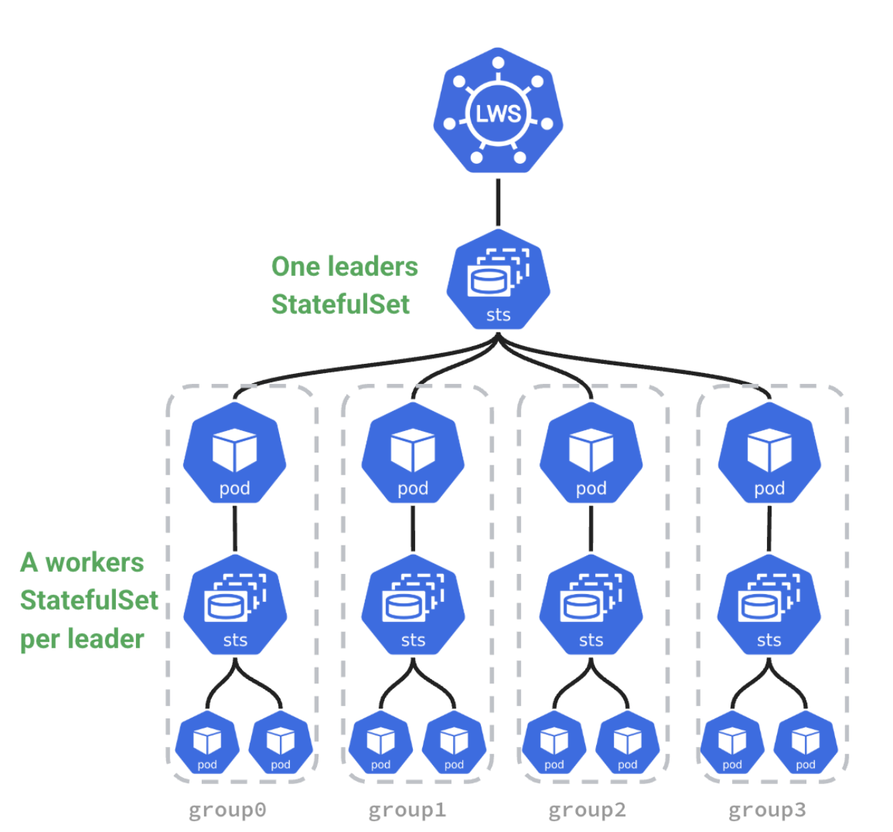

# Deploy Distributed Inference Workloads

This guide explains how to create a native distributed inference workload via the NVIDIA Run:ai UI.

An inference workload provides the setup and configuration needed to deploy your trained model for real-time or batch predictions. It includes specifications for the container image, data sets, network settings, and resource requests required to serve your models.

The inference workload is assigned to a project and is affected by the project’s quota.

To learn more about the inference workload type in NVIDIA Run:ai and determine that it is the most suitable workload type for your goals, see [Workload types and features](../workload-types/native-workloads.md).

<figure><figcaption></figcaption></figure>

## Before You Start

* Make sure you have created a [project](../../platform-management/aiinitiatives/organization/projects.md) or have one created for you.
* Make sure [LWS](../../installation-and-configuration/installation/install-using-helm/prerequisites-and-features.md#distributed-inference) is properly installed by your administrator.
* If the image you are planning to use is hosted in NGC, make sure you have an NGC account with an active NGC API key. To obtain a key, go to [NGC](https://catalog.ngc.nvidia.com/) → Setup → API Keys, then generate or copy an existing key. In NVIDIA Run:ai, store the key either as a [shared secret](../workload-assets/credentials.md#ngc-api-key) (created by an administrator) or a [user credential](../../settings/user-settings/user-credentials.md) (created under User settings).

## Workload Priority and Preemption
By default, inference workloads in NVIDIA Run:ai are assigned a **Very high** priority and are **non-preemptible**. These defaults ensures that inference workloads, which often serve real-time or latency-sensitive traffic, are guaranteed the resources they need. The default very-high priority ensures the fastest possible scheduling, and the default non-preemptible value guarantees that the workload will not be disrupted by other workloads once it starts running.

You can override the defaults by configuring priority and preemptibility. For more details, see [Workload priority and preemption](../../platform-management/runai-scheduler/scheduling/workload-priority-control.md).

## Stale Gang Eviction

Distributed inference workloads run as a gang: the leader and all worker pods must be scheduled and running together for the workload to make progress. If one or more pods fail while the rest continue running, the pod group becomes stale, and the Scheduler evicts the remaining pods after a grace period unless enough pods return to a running state in time. For more details, see [Stale gang eviction](../../platform-management/runai-scheduler/scheduling/concepts-and-principles.md#stale-gang-eviction).

By default, the grace period is set at the cluster level. You can override it per workload with the `kai.scheduler/staleness-grace-period` annotation, set under [Setting Up General Settings](#setting-up-general-settings) → **annotations(s)**.

## Workload Policies

When creating a new workload, fields and assets may have limitations or defaults. These rules and defaults are derived from a policy your administrator set.

Policies allow you to control, standardize, and simplify the workload submission process. For additional information, see [Policies and rules](../../platform-management/policies/policies-and-rules.md).

The effects of the policy are reflected in the workspace creation form:

* Defaults derived from the policy will be displayed automatically for specific fields.
* Disabled actions and permitted value ranges for values will be visibly explained per field.
* Rules and defaults for entire sections (such as environments, compute resources, or data sources) may prevent selection and will appear on the entire library card with an option for additional information via an external modal.

## Leader Worker Set Architecture

Distributed inference workloads are based on a [Leader Worker Set (LWS)](https://lws.sigs.k8s.io/docs/overview/) architecture, where each replica consists of a leader pod and a set of worker pods. The workload is configured across three steps:

* **Leader** - Defines the specification for the leader pod, which is responsible for coordinating the distributed inference workload and exposing the serving endpoint. The container image, compute resources, environment variables, and storage are configured independently for the leader.
* **Workers** - Defines the specification for the worker pods, which are responsible for model inference processing. Worker pods can be configured with a different container image and compute resources than the leader. The number of worker pods is also defined in this step.
* **Workload setup** - Defines workload-level settings, including the number of replicas (each replica consists of one leader and its associated worker pods), scheduling priority, preemptibility, and the startup policy that determines when worker pods are created relative to the leader.

<figure><figcaption></figcaption></figure>

## Creating a Custom Distributed Inference Workload

1. To create an inference workload, go to Workload manager → Workloads.
2. Click **+NEW WORKLOAD** and select **Inference** from the dropdown menu**.**
3. Within the new form, select the **cluster** and **project**. To create a new project, click **+NEW PROJECT** and refer to [Projects](../../platform-management/aiinitiatives/organization/projects.md) for a step-by-step guide.
4. Set the inference workload architecture as **Distributed**. This workload will only be able to use environments that support distributed workloads. A distributed workload consists of multiple processes working together. These processes can run on different nodes.
5. Enter a unique **name** for the workload. If the name already exists in the project, you will be requested to submit a different name.
6. Click **CONTINUE**

### Setting Up an Environment

<Info>

**Note**

* NGC catalog is disabled by default. If unavailable, your administrator must enable it under **General settings** → Workloads → NGC catalog.
* To select an image from the NGC private registry**,** your administrator must configure it under **General settings** → Workloads → NGC private registry.

</Info>

**Load from existing setup**

1. Click the **load** icon. A side pane appears, displaying a list of available environments. Select an environment from the list.
2. Optionally, customize any of the environment’s predefined fields as shown below. The changes will apply to this workload only and will not affect the selected environment.
3. Alternatively, click the **➕** icon in the side pane to create a new environment. For step-by-step instructions, see [Environments](../workload-assets/environments.md).

**Provide your own settings**

Manually configure the settings below as needed. The changes will apply to this workload only.

**Configure environment**

1. Set the **environment image**:
   * Select **Custom image** and add the **Image URL** or update the URL of the existing setup.
   * **Select from the NGC catalog** and then set how to **access the NGC catalog**:
     * **As a guest** - Choose the **image name** and **tag** from the dropdown.
     * **Authenticated** - Configure **access** to NGC and then choose the **image name** and **tag** from the dropdown:
       * Under **Source**, select [**Shared secret**](../workload-assets/credentials.md#ngc-api-key) or [**My credentials**](../../settings/user-settings/user-credentials.md).
       * The **Type** field is fixed to **NGC API key**.
       * Under **Credential name**, select an existing credential from the dropdown. If you select **My credentials**, you can also create a new credential directly from the dropdown. The credential is also saved under **User settings** → Credentials.
   * **Select from the NGC private registry** and then set how to access the registry:
     * Select a **registry** from the dropdown.
     * Under **Source**, select [**Shared secret**](../workload-assets/credentials.md#ngc-api-key) or [**My credentials**](../../settings/user-settings/user-credentials.md).
     * The **Type** field is fixed to **NGC API key**.
     * Under **Credential name**, select an existing credential from the dropdown. If you select **My credentials**, you can also create a new credential directly from the dropdown. The credential is also saved under **User settings** → Credentials.
2. Set the **image pull policy**:
   * Set the **condition for pulling the image**. It is recommended to pull the image only if it's not already present on the host.
   * Set the **credentials for pulling the image**:
     * Under **Source**, select [**Shared secret**](../workload-assets/credentials.md) or [**My credentials**](../../settings/user-settings/user-credentials.md).
     * Under **Type**, select **Docker registry** or **NGC API key**.
     * Under **Credential name**, select an existing credential from the dropdown. If you select **My credentials**, you can also create a new credential directly from the dropdown. The credential is also saved under **User settings** → Credentials.
3. Set an inference **serving endpoint**. The connection protocol and the container port are defined within the environment:
   * Select **HTTP** and enter a corresponding **container port**
   * Modify who can access the endpoint. See [Accessing the inference workload](distributed-inference.md#accessing-the-inference-workload) for more details:
     * By default, **Public** is selected giving everyone within the network access to the endpoint with no authentication
     * If you select **All authenticated users and service accounts**, access is given to everyone within the organization’s account that can log in (to NVIDIA Run:ai or SSO).
     * For **Specific group(s)**, enter **group names** as they appear in your identity provider. You must be a member of one of the groups listed to have access.
     * For **Specific user(s) and service account(s)**, enter a valid user email or name. If you remove yourself, you will lose access.
4. Set whether inference serving endpoints can be accessed externally or only by internal cluster traffic:
   * **External (Public access)** - Available only if your administrator has configured **Knative** to support external access. See the [Inference requirements](../../installation-and-configuration/installation/install-using-helm/prerequisites-and-features.md#standard-inference) section for more details.
   * **Internal only** - Endpoint is accessible only within cluster traffic.
5. Set the **command and arguments** for the container running the workload. If no command is added, the container will use the image’s default command (entry-point).
   * Modify the existing command or click **+COMMAND & ARGUMENTS** to add a new command.
   * Set multiple arguments separated by spaces, using the following format (e.g.: `--arg1=val1`).
6.  Set the **environment variable(s)**:

    * Modify the existing environment variable(s) or click **+ENVIRONMENT VARIABLE**. The existing environment variables may include instructions to guide you with entering the correct values.
    * You can either select **Custom** to define a value manually, or choose an existing value from [**Shared secret**](../workload-assets/credentials.md), [**My Credentials**](../../settings/user-settings/user-credentials.md), or [**ConfigMap**](../workload-assets/environments.md). If you select **My credentials**, you can also create a new credential directly from the dropdown. The credential is also saved under **User settings** → Credentials.

    Some environment variables are automatically injected by NVIDIA Run:ai. See [Built-in workload environment variables](../workloads.md#built-in-workload-environment-variables) for more details.
7. Enter a path pointing to the **container's working directory**.
8. Set where the UID, GID, and supplementary groups for the container should be taken from. If you select **Custom**, you’ll need to manually enter the **UID,** **GID and** **Supplementary groups values**.
9. Select additional Linux capabilities for the container from the drop-down menu. This grants certain privileges to a container without granting all the root user's privileges.

### Setting Up Compute Resources

<Info>

**Note**

GPU memory limit is disabled by default. If unavailable, your administrator must enable it under **General Settings** → Resources → GPU resource optimization.

</Info>

**Load from existing setup**

1. Click the **load** icon. A side pane appears, displaying a list of available compute resources. Select a compute resource from the list.
2. Optionally, customize any of the compute resource's predefined fields as shown below. The changes will apply to this workload only and will not affect the selected compute resource.
3. Alternatively, click the **➕** icon in the side pane to create a new compute resource. For step-by-step instructions, see [Compute resources](../workload-assets/compute-resources.md).

**Provide your own settings**

Manually configure the settings below as needed. The changes will apply to this workload only.

**Configure compute resources**

1. Set the number of workers for each replica. This setting is only available in the **Workers** step.
2. Set the number of **GPU devices** per pod (physical GPUs).
3. Enable **GPU fractioning** to set the GPU memory per device using either a fraction of a GPU device’s memory **(% of device)** or a GPU memory unit **(MB/GB)**:
   * **Request** - The minimum GPU memory allocated per device. Each pod in the workload receives at least this amount per device it uses.
   * **Limit** - The maximum GPU memory allocated per device. Each pod in the workload receives **at most** this amount of GPU memory for each device(s) the pod utilizes. This is disabled by default, to enable see the above note.
4. Set the **CPU resources**
   * Set **CPU compute resources** per pod by choosing the unit (**cores** or **millicores**):
     * **Request** - The minimum amount of CPU compute provisioned per pod. Each running pod receives this amount of CPU compute.
     * **Limit** - The maximum amount of CPU compute a pod can use. Each pod receives **at most** this amount of CPU compute. By default, the limit is set to **Auto** which means that the pod may consume up to the node's maximum available CPU compute resources.
   * Set the **CPU memory per pod** by selecting the unit (**MB** or **GB**):
     * **Request** - The minimum amount of CPU memory provisioned per pod. Each running pod receives this amount of CPU memory.
     * **Limit** - The maximum amount of CPU memory a pod can use. Each pod receives at most this amount of CPU memory. By default, the limit is set to **Auto** which means that the pod may consume up to the node's maximum available CPU memory resources.
5. Set **extended resource(s)**
   * Enable **Increase shared memory size** to allow the shared memory size available to the pod to increase from the default 64MB to the node's total available memory or the CPU memory limit, if set above.
   * Click **+EXTENDED RESOURCES** to add resource/quantity pairs. For more information on how to set extended resources, see the [Extended resources](https://kubernetes.io/docs/tasks/configure-pod-container/extended-resource/) and [Quantity](https://kubernetes.io/docs/reference/kubernetes-api/common-definitions/quantity/) guides.
6.  Set the **order of priority** for the **node pools** on which the Scheduler tries to run the workload. When a workload is created, the Scheduler will try to run it on the first node pool on the list. If the node pool doesn't have free resources, the Scheduler will move on to the next one until it finds one that is available:

    * Drag and drop them to change the order, remove unwanted ones, or reset to the default order defined in the project.
    * Click **+NODE POOL** to add a new node pool from the list of node pools that were defined on the cluster. To configure a new node pool and for additional information, see [Node pools](../../platform-management/aiinitiatives/resources/node-pools.md).

    Node pool priority is configured in the **Leader** step and inherited by the workers. It cannot be modified in the **Workers** step.
7. Select a **node affinity** to schedule the workload on a specific node type. If the administrator added a ‘[node type (affinity)](../../platform-management/policies/scheduling-rules.md#node-type-affinity)’ scheduling rule to the project/department, then this field is mandatory. Otherwise, entering a node type (affinity) is optional. [Nodes must be tagged](../../platform-management/policies/scheduling-rules.md#labelling-nodes-for-node-types-grouping) with a label that matches the node type key and value.
8. Click **+TOLERATION** to allow the workload to be scheduled on a node with a matching taint. Select the **operator** and the **effect**:
   * If you select **Exists**, the effect will be applied if the key exists on the node.
   * If you select **Equals,** the effect will be applied if the key and the value set match the value on the node.
9. Click **+TOPOLOGY** to let the workload be scheduled on nodes with a matching topology - same region, zone, placement group or any other topology you define.

### Setting Up Data & Storage

<Info>

**Note**

S3 data sources are not supported for inference workloads.

</Info>

**Load from existing setup**

1. Click the **load** icon. A side pane appears, displaying a list of available data sources. Select a data source from the list.
2. Optionally, customize any of the data source's predefined fields as shown below. The changes will apply to this workload only and will not affect the selected data source:
   * **Container path** - Enter the **container path** to set the **data target location**.
   * **ConfigMap** **sub-path** - Specify a **sub-path** (file/key) inside the ConfigMap to mount (for example, `app.properties`). This lets you mount a single file from an existing ConfigMap.
3. Alternatively, click the **➕** icon in the side pane to create a new data source/volume. For step-by-step instructions, see [Data sources](../workload-assets/overview.md).

**Configure data sources for a one-time configuration**

<Info>

**Note**

[PVCs](../workload-assets/data-volumes.md), [Secrets](../workload-assets/credentials.md), and [ConfigMaps](../workload-assets/environments.md) cannot be added as a one-time configuration.

</Info>

1. Click the **➕** icon and choose the data source from the dropdown menu. You can add multiple data sources.
2. Once selected, set the **data origin** according to the required fields and enter the **container path** to set the **data target location**.

The required fields vary by data source. For detailed configuration options and usage guidelines for each data source type, see [Data sources](../workload-assets/overview.md).

**Configure EmptyDir for a one-time configuration**

Use **EmptyDir** to allocate temporary storage that exists only for the lifetime of the workload. The **EmptyDir** volume is ephemeral, the volume and its data is deleted every time the workload’s status changes to “Stopped

1. Set the **size** and **units** to define the maximum storage capacity.
2. Enter the **container path** to set the **data target location**.
3. Select the **storage medium**:
   * **Disk-backed storage** - The data is stored on the node's filesystem, which persists across container restarts but not pod rescheduling, and is slower than memory
   * **Memory-backed storage** - The data is stored in RAM, which provides faster access but is not persistent, and will be lost if the pod restarts

**Configure Volume for a one-time configuration**

Select **Volume** to allocate a storage space to your workspace that is persistent across restarts:

1. Set the **Storage class** to **None** or select an existing storage class from the list. To add new storage classes, and for additional information, see [Kubernetes storage classes](../../installation-and-configuration/configuration/shared-storage.md). If the administrator defined the storage class configuration, the rest of the fields will appear accordingly.
2. Select one or more **access mode(s)** and define the **claim size** and its **units**.
3. Select the **volume mode**:
   1. **Filesystem** (default) - The volume will be mounted as a filesystem, enabling the usage of directories and files.
   2. **Block** - The volume is exposed as a block storage, which can be formatted or used directly by applications without a filesystem.
4. Enter the **container path** to set the **data target location**.
5. Optional: Click **+VOLUME** to set the volume needed for your workload. A volume allocates storage space to your workload that is persistent across restarts:
   * Set the **Storage class** to **None** or select an existing storage class from the list. To add new storage classes, and for additional information, see [Kubernetes storage classes](../../installation-and-configuration/configuration/shared-storage.md). If the administrator defined the storage class configuration, the rest of the fields will appear accordingly.
   * Select one or more **access mode(s)** and define the **claim size** and its **units**.
   * Select the **volume mode.** If you select **Filesystem** (default), the volume will be mounted as a filesystem, enabling the usage of directories and files. If you select **Block**, the volume is exposed as a block storage, which can be formatted or used directly by applications without a filesystem.
   * Set the **Container path** with the volume target location.

### Setting Up General Settings

1. Set **annotations(s).** Kubernetes annotations are key-value pairs attached to the workload. They are used for storing additional descriptive metadata to enable documentation, monitoring and automation.
2. Set **labels(s).** Kubernetes labels are key-value pairs attached to the workload. They are used for categorizing to enable querying.

### Configuring Workload Setup

1. Set the number of replicas for your workload. Each replica consists of one leader pod and its associated worker pods.
2. Set whether the workload may be interrupted by selecting **Preemptible**, **Semi-preemptible**, or **Non-preemptible**:
   * Preemptible workloads may be interrupted if resources are needed for higher-priority workloads.
   * Semi-preemptible workloads guarantee their minimum required replicas run without interruption, while any replicas beyond that minimum behave as preemptible replicas.
   * Non-preemptible workloads use the project's available GPU quota and will not be interrupted once they start running.
3. Set the **workload priority**. Choose the appropriate priority level for the workload. Higher-priority workloads are scheduled before lower-priority ones.
4. Set when the workers' pod should be created:
   * **When the leader pod is created** - Create the workers’ pods alongside the leader pod to reduce startup time. This may cause the deployment to fail if the leader isn't ready.
   * **Once the leader pod is ready** - Wait for the leader’s pod to be ready before creating the workers’ pods.

### Completing the Workload

1. Before finalizing your workload, review your configurations and make any necessary adjustments.
2. Click **CREATE INFERENCE**

## Managing and Monitoring

After the workload is created, it is added to the [Workloads](../workloads.md) table, where it can be managed and monitored.

## Accessing the Inference Workload

You can programmatically consume an inference workload via API by making direct calls to the serving endpoint, typically from other workloads or external integrations. Once an inference workload is deployed, the serving endpoint URL appears in the **Connections** column of the [Workloads](../../workloads-in-nvidia-run-ai/workloads.md#workloads-table) table.

Access to the inference serving API depends on how the serving endpoint access was configured when submitting the inference workload:

* If **Public** access is enabled, no authentication is required.
* If **restricted** access is configured:
  * Authentication is performed either by a user (with a username/password), [user access keys](../../settings/user-settings/user-access-keys.md) or [service accounts](../../platform-management/authentication/service-accounts.md) (with client credentials).
  * Authorization to access the endpoint is enforced based on user, service account or group membership.
  * Users relying on SSO should authenticate using their user access keys.

Follow the below steps to obtain a token:

1. Use the [Tokens](https://run-ai-docs.nvidia.com/api/2.26/authentication-and-authorization/tokens) API with:
   * `grantType: password` for specific users or groups
   * `grantType: client_credentials` for service accounts and user access keys
2.  Use the obtained token to make API calls to the inference serving endpoint. For example:

    ```bash
    #replace <serving-endpoint-url> and <model-name> (e.g. "meta-llama/Llama-3.1-8B-Instruct")
    curl <serving-endpoint-url>/v1/chat/completions \
      -H "Content-Type: application/json" \
      -H "Authorization: Bearer <your-access-token>" \
      -d '{
        "model": "<model-name>",
        "messages": [{
          "role": "user",
          "content": "Write a short poem on AI"
        }]
      }'
    ```

## Using CLI

To view the available actions, see the inference workload [CLI v2 reference](../../reference/cli/runai/runai_inference_distributed.md).

## Using API

To view the available actions for creating an inference workload, see the [Distributed Inferences](https://run-ai-docs.nvidia.com/api/2.26/workloads/distributed-inferences) API reference.
