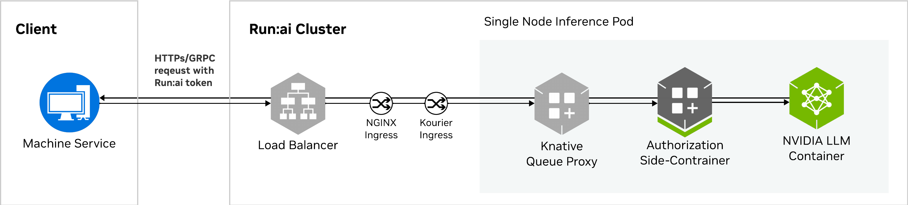
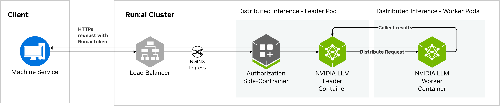

# NVIDIA Run:ai Inference Overview

NVIDIA Run:ai provides flexible and robust deployment options for AI inference workloads, offering high performance, strong security, and seamless scalability tailored to organizational needs. The platform supports both single-node and multi-node architectures and is compatible with NVIDIA NIM, vLLM, and custom inference servers. This enables integration with a wide range of frameworks and model formats.

## Use Cases

* Deploy any inference workload type, including LLMs, vision models, speech models, and others for diverse AI applications.
* Run both batch and real-time inference, adapting to varying latency and throughput needs.​
* Benefit from dynamic autoscaling - clusters scale down during idle periods and rapidly scale up as new inference jobs are submitted, improving efficiency for batch workflows.​
* Support distributed inference for very large LLMs that cannot fit on a single node, such as DeepSeek R1, enabling multi-node deployment for high-capacity models.​
* Monitor LLM and model performance using real-time and historical utilization metrics, request analytics, and token-level statistics, allowing MLOps engineers to track performance, usage, and availability for operational insights

## Key Features and Capabilities

NVIDIA Run:ai supports a wide range of workload types, from native workloads to additional supported workload types such as Dynamo and others from the ML and Kubernetes ecosystem. Feature availability can vary by workload type. For a detailed breakdown of which capabilities are supported for native workloads and supported workload types, see [Supported features](../workload-types/supported-features.md).

### Performance and Optimizations

* **Topology-aware scheduling** - Optimizes placement of distributed inference workloads, reducing communication overhead and improving workload efficiency.
* **Gang scheduling** - Schedules related pods together (for example, multi-pod inference workloads such as Dynamo deployments).
* **Automatic MNNVL support** - Optimizes placement for Multi-Node NVLink systems when available.
* **Priority and scheduling** - Uses workload priority and advanced scheduling strategies to enhance performance and reduce latency
* **Dynamic autoscaling** - Defines minimum and maximum replicas and set metric-based thresholds to handle fluctuating demand, with scaling conditions triggered by latency, throughput, or concurrency, or other custom metrics.

### Lifecycle Management

* **Flexible deployment architecture** - Choose between single-node (serverless Knative) and distributed multi-node (Leader–Worker) deployments, supporting large language models (LLMs). LLMs can be distributed across multiple nodes depending on available hardware when the model does not fit within a single node.
* **Model compatibility and serving** - Native support for deploying models using NVIDIA NIM, vLLM, and custom inference servers, enabling integration with a wide range of frameworks and model formats.
* **Access management** - Secure, customizable endpoint access for public, authenticated users, groups, or service accounts, with user-specific restrictions enforced through access token–based authentication.
* **Rolling updates** - Supports real-time, disruption-free updates to inference workloads, including container image, configuration, compute resources, and scaling policy. Revision management capabilities allow tracking and managing changes across inference workload versions.
* **Dynamic NVIDIA NIM model list from NGC catalog** - Automatically retrieve the available NVIDIA NIM models from the NGC catalog, ensuring the list remains current and reflects the latest model offerings.
* **Hugging Face model catalog browsing** - Browse and search the Hugging Face model catalog directly when creating inference workloads. The live catalog view displays model details such as download count and gated status. For gated models, the platform prompts you to provide a Hugging Face token for access, while open models can be selected without authentication.

### Visualization and Monitoring

**End-to-end observability** - Provides unified access to resource utilization (GPU, CPU, network), inference metrics (throughput, latency, replica counts), and NIM-specific workload metrics (request concurrency, request counts, TTFT, latency percentiles, GPU KV-cache utilization) for comprehensive monitoring and analysis.

## Workload Support and Framework Compatibility

### Native Inference Workloads

NVIDIA Run:ai supports multiple native inference workload types to accommodate different serving frameworks and deployment preferences:

* [**NVIDIA NIM**](nim-inference.md) - Deploy optimized NVIDIA Inference Microservices that include built-in observability, tracing, and GPU performance metrics. Supports **Multi-LLM NIM**, enabling deployment of language models from the NVIDIA NGC catalog and Hugging Face through the NIM serving path.
* [**vLLM**](hugging-face-inference.md) - Deploy language models from Hugging Face using the vLLM inference server.
* [**Custom**](custom-inference.md) - Deploy user-defined inference images built with any compatible runtime, such as SGLang.
* [**Distributed inference**](distributed-inference.md) - Deploy large models that cannot fit on a single node across multiple nodes using a Leader–Worker Set topology.

### Additional Supported Inference Workloads

NVIDIA Run:ai supports a broad range of workloads from the ML and Kubernetes ecosystem that are already registered as workload types in the platform and ready to use. These workloads can then be submitted using [via YAML](../submit-via-yaml.md) and managed with the same orchestration, monitoring, and scheduling capabilities as native workloads. See [Supported workload types](../workload-types/supported-workload-types.md) for the full list of supported inference workload types. Key workload types include the following:

* [**NVIDIA NIM Services**](https://docs.nvidia.com/nim-operator/latest/service.html) - NVIDIA NIM workloads are deployed and managed using the NVIDIA NIM Operator and exposed through a dedicated [NVIDIA NIM](https://run-ai-docs.nvidia.com/api/2.26/workloads/nvidia-nim) API. This enables standardized, production-ready deployment of optimized inference services while allowing NVIDIA Run:ai to handle scheduling, resource management, and observability.
* [**DynamoGraphDeployment**](https://docs.nvidia.com/dynamo/latest/index.html) - Dynamo workloads are deployed using the NVIDIA Dynamo Operator, which manages graph-based, distributed inference pipelines. NVIDIA Run:ai integrates with the operator to schedule and manage Dynamo-based inference workloads across the cluster.
* [**LeaderWorkerSet**](https://lws.sigs.k8s.io/docs/overview/) **(LWS)** - A Kubernetes-native abstraction for leader–worker style workloads, commonly used for distributed training and inference. NVIDIA Run:ai schedules and manages LWS workloads while preserving their execution semantics.

### Extending Inference Workload Support

For emerging ML frameworks, tools, or Kubernetes resources, Karta provides a declarative way to extend platform support. Administrators can register new workload types via the [Workload Types](https://run-ai-docs.nvidia.com/api/2.26/workloads/workload-properties#post-api-v1-workload-types) API, making them available across the organization without requiring platform updates or code changes. Once registered, these workloads can then be submitted using [via YAML](../submit-via-yaml.md) and managed with the same orchestration, monitoring, and scheduling capabilities as native workloads. See [Extending workload support with Karta](../workload-types/extending-workload-support/) for more details.

## Observability and Metrics

Inference workloads deployed through NVIDIA Run:ai provide comprehensive observability and performance monitoring. See [Workloads](../workloads.md#metrics) for more details.

* **Inference metrics** - Available for all inference workloads, tracking performance indicators such as GPU utilization, request throughput, and latency.
* **NVIDIA NIM metrics** - Specific to NVIDIA NIM workloads, offering additional visibility into model-level statistics, runtime performance, and token-level metrics for LLMs.

## Workload Architecture

NVIDIA Run:ai inference workloads can be deployed as:

* **Single-node** - Deployed as a single pod, typically for lightweight or latency-sensitive serving.
* **Multi-node** - Deployed as a coordinated set of pods (Leader–Worker Set) to support large language models (LLMs) that cannot fit on a single GPU node (for example, DeepSeek R1).

### Deployment Architecture Overview

<Info>

**Note**

The deployment architecture applies to native inference workloads only. The architecture for other workload types and frameworks (e.g., KServe or SeldonDeployment) may differ based on the framework.

</Info>

#### Single-Node Deployment

Single-node inference workloads are deployed as a single pod and use **Knative Serving**, which provides serverless capabilities such as request queuing, autoscaling, and granular rollout.

Request flow:

1. The client authenticates with the NVIDIA Run:ai control plane to obtain a token.
2. The client sends a request to the inference serving endpoint hosted in the NVIDIA Run:ai cluster.
3. The request passes through the organization’s load balancer.
4. The request reaches the NGINX Ingress, where TLS termination occurs. NGINX proxies the request to the Kourier ingress.
5. Kourier forwards the request to the Knative Queue Proxy. The queue proxy manages traffic to maintain service level objectives (SLOs), metrics, and concurrency.
6. Authorization is validated before the LLM/model container processes the request.
7. Results are returned to the client.

<figure><figcaption></figcaption></figure>

#### Multi-Node Deployment

Multi-node inference workloads use multiple pods, one **leader** and several **workers** pods, forming a **Leader–Worker Set (LWS)**. Knative is not used in this configuration.

Request flow

1. The client authenticates with the NVIDIA Run:ai control plane to obtain a token.
2. The client sends a request to the inference serving endpoint hosted in the NVIDIA Run:ai cluster
3. Requests flow through the load balancer and Ingress directly to the inference leader pod.
4. Authorization is validated by the leader pod before any computation is offloaded to workers.
5. The leader pod handles authorization and delegates computation across the worker pods.
6. Results are aggregated by the leader and returned to the client.

<figure><figcaption></figcaption></figure>
