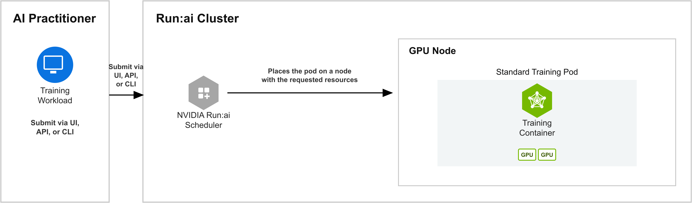
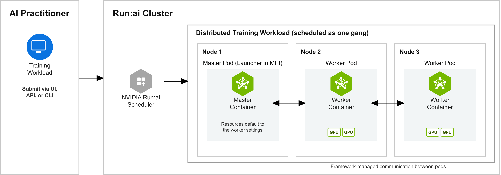
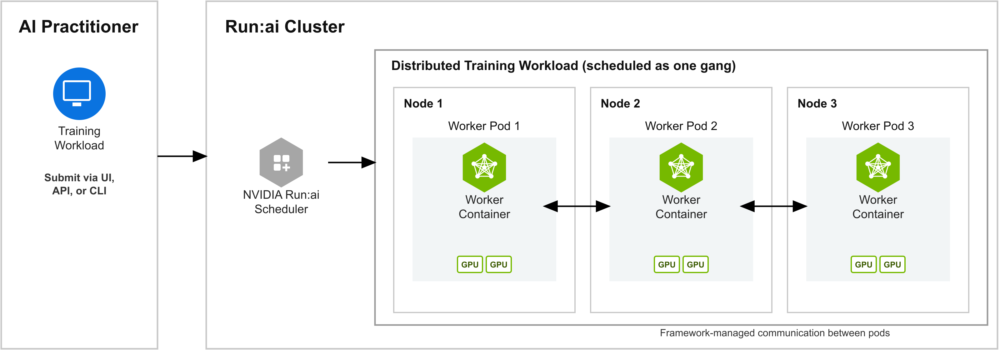

# NVIDIA Run:ai Training Overview

NVIDIA Run:ai provides standard and distributed training workloads for developing, training, and fine-tuning AI models. The platform supports training on a single node or across multiple nodes, and integrates with popular machine learning frameworks, including PyTorch, TensorFlow, JAX, XGBoost, and MPI. NVIDIA Run:ai manages workload scheduling, resource allocation, and orchestration across shared GPU infrastructure.

## Use Cases

* Train models from scratch or fine-tune pretrained models using GPU-accelerated compute resources.
* Run large-scale distributed training across multiple nodes to accommodate larger models, datasets, and computational requirements.
* Execute multiple training runs, including parallel runs, to evaluate different model configurations and hyperparameters.
* Submit unattended, long-running training workloads that execute without continuous user interaction.
* Use compute resources beyond the project's quota when they are available, through preemptible training workloads.

## Key Features and Capabilities

NVIDIA Run:ai supports native training workloads and additional supported workload types from the ML and Kubernetes ecosystem. Feature availability can vary by workload type and training framework. For a detailed breakdown of which capabilities are supported for native workloads and supported workload types, see [Supported features](../workload-types/supported-features.md).

### Performance and Optimizations

* **Flexible resource allocation** - Assign GPU, CPU, and memory resources to standard and distributed training workloads.
* **GPU sharing** - Allocate fractional GPUs according to training workload requirements. See [Request GPU memory fractions](../../platform-management/runai-scheduler/optimize-workload-scheduling-and-placement/gpu-sharing/request-gpu-memory-fractions.md).
* **Priority and scheduling** - By default, training workloads are assigned low priority and are preemptible, allowing them to use resources beyond their project's deserved quota when available. See [Set priority and preemptibility](../../platform-management/runai-scheduler/optimize-workload-scheduling-and-placement/configure-priority-and-preemption.md).
* **Gang scheduling** - Schedules the pods of a distributed training workload together, so that the workload starts only when the resources for the required pods are available. See [Gang scheduling](../../platform-management/runai-scheduler/scheduling/concepts-and-principles.md#gang-scheduling).
* **Topology-aware scheduling** - Places distributed training workers according to network topology constraints, reducing communication overhead between workers. See [Configure workload-based placement](../../platform-management/runai-scheduler/optimize-workload-scheduling-and-placement/workload-placement/configure-workload-based-placement.md).
* **Segment-based placement** - Groups workers into segments that are placed as close as possible, to match the application's parallelism. Supported for native distributed PyTorch training workloads and for PyTorchJob. See [Configure segment-based placement](../../platform-management/runai-scheduler/optimize-workload-scheduling-and-placement/workload-placement/configure-segment-based-placement.md).
* **Automatic MNNVL support** - Optimizes placement of distributed workloads on Multi-Node NVLink systems when available. See [Using GB200 NVL72 and Multi-Node NVLink domains](../../platform-management/aiinitiatives/resources/using-gb200.md).
* **Elastic scaling** - Configure minimum and maximum worker counts for supported PyTorch distributed training workloads, allowing the number of active workers to adjust to resource availability.

### Lifecycle Management

* **Flexible training architectures** - Choose between standard and distributed training. For distributed training, choose a workers and master or a workers-only configuration.
* **Framework compatibility** - Run training with custom container images and the supported distributed training frameworks.
* **Multiple training runs** - Configure the number of runs and how many of them execute concurrently for standard training workloads.
* **Reusable configurations** - Create training workloads from [workload templates](../workload-templates/training-templates/standard-training-templates.md) or reuse existing workload assets. See [Workload assets](../workload-assets/overview.md).
* **Checkpointing and recovery** - Preserve training progress across interruptions and preemption. The training application must implement checkpointing and save checkpoints to persistent shared storage. NVIDIA Run:ai does not checkpoint the application. See [Checkpointing preemptible training workloads](checkpointing-preemptible-workloads.md).
* **Failure handling** - Configure a backoff limit for retrying failed workloads. For distributed training, stale gang eviction handles the case where some pods keep running after others fail. See [Stale gang eviction](distributed-training-models.md#stale-gang-eviction).
* **Workload policies** - Apply organizational defaults and constraints to training workload configurations. See [Policies and rules](../../platform-management/policies/policies-and-rules.md).

### Visualization and Monitoring

**Workload monitoring** - Monitor workload status, resource utilization, the status of individual pods, workload events, and container logs. When [GPU profiling metrics](../../platform-management/monitor-performance/gpu-profiling-metrics.md) are enabled, they provide additional visibility into GPU device-level performance. See [Workloads](../workloads.md#show-hide-details).

## Optimize Scheduling and Placement

Configure how NVIDIA Run:ai schedules a training workload and which resources it receives:

* [Configure priority and preemption](../../platform-management/runai-scheduler/optimize-workload-scheduling-and-placement/configure-priority-and-preemption.md) - Override the default priority and preemptibility. Training workloads are low priority and preemptible by default.
* [Configure CPU and memory requests](../../platform-management/runai-scheduler/optimize-workload-scheduling-and-placement/configure-cpu-and-memory-requests.md) - Request CPU compute and memory for a training workload, and set limits.
* [Request GPU memory fractions](../../platform-management/runai-scheduler/optimize-workload-scheduling-and-placement/gpu-sharing/request-gpu-memory-fractions.md) and [Configure GPU compute mode](../../platform-management/runai-scheduler/optimize-workload-scheduling-and-placement/gpu-sharing/configure-gpu-compute-mode.md) - Share a GPU between workloads by requesting a portion of its memory and setting how workloads share its compute.

For distributed training workloads, you can also control where the pods run:

* [Configure workload-based placement](../../platform-management/runai-scheduler/optimize-workload-scheduling-and-placement/workload-placement/configure-workload-based-placement.md) - Override the topology-aware scheduling of the workers.
* [Configure segment-based placement](../../platform-management/runai-scheduler/optimize-workload-scheduling-and-placement/workload-placement/configure-segment-based-placement.md) - Group workers into segments that are placed together. Supported for native distributed PyTorch training workloads and PyTorchJob.
* [Configure GB200 NVL72 placement](../../platform-management/runai-scheduler/optimize-workload-scheduling-and-placement/workload-placement/configure-gb200-nvl72-placement.md) - Set the placement and the Multi-Node NVLink behavior in GB200 NVL72 node pools.
* [Enabling Spectrum-X networking](../../platform-management/runai-scheduler/optimize-workload-scheduling-and-placement/spectrum-x-networking.md) - Attach Spectrum-X networks to the workload.

For all workload-level scheduling and placement pages, see [Optimize workload scheduling and placement](../../platform-management/runai-scheduler/optimize-workload-scheduling-and-placement/README.md).

## Workload Support and Framework Compatibility

### Native Training Workloads

NVIDIA Run:ai provides two native training workload types:

* [**Standard training**](train-models.md) - Run training workloads that do not require coordination across multiple nodes, including single-GPU and multi-GPU training on a single node.
* [**Distributed training**](distributed-training-models.md) - Run coordinated training processes across multiple pods, with native support for PyTorch, TensorFlow, JAX, XGBoost, and MPI. A framework must be enabled in the cluster before it can be used. See [Distributed training prerequisites](../../installation-and-configuration/installation/install-using-helm/prerequisites-and-features.md#distributed-training).

### Additional Supported Training Workloads

NVIDIA Run:ai supports a broad range of workloads from the ML and Kubernetes ecosystem that are already registered as workload types in the platform and ready to use. These workloads can be submitted [via YAML](../submit-via-yaml.md) and managed with the same orchestration, monitoring, and scheduling capabilities as native workloads. See [Supported workload types](../supported-workload-types/list-of-supported-workload-types.md) for the full list of supported workload types. Key workload types include the following:

* **Kubeflow** - PyTorchJob, TFJob, JAXJob, XGBoostJob, and MPIJob.
* **Ray** - RayJob and RayCluster.
* **JobSet** - Groups of related jobs that run together.

### Extending Training Workload Support

For emerging training frameworks and workload controllers, Karta provides a declarative way to extend platform support. Administrators can register new workload types via the [Workload Types](api:main-api:POST/api/v1/workload-types) API, making them available across the organization without requiring platform updates or code changes. Once registered, these workloads can be submitted [via YAML](../submit-via-yaml.md) and managed with the same orchestration, monitoring, and scheduling capabilities as native workloads. See [Extending workload support with Karta](../supported-workload-types/extending-workload-support/README.md) for more details.

## Workload Architecture

NVIDIA Run:ai supports two native training architectures.

### Standard Training

Standard training workloads execute a single main training process. They are suitable for workloads that do not require coordination across multiple nodes, including single-GPU and multi-GPU training on a single node.

Standard training workloads support multiple runs, with configurable parallelism for executing runs concurrently.

Each run executes in a pod. The NVIDIA Run:ai Scheduler places the pod on a node that has the requested GPU, CPU, and memory resources, and the training container uses the GPUs that are allocated to the pod. A single pod never spans nodes, so the GPUs of a standard training run come from one node.

<figure><figcaption></figcaption></figure>

### Distributed Training

Distributed training workloads coordinate multiple training processes, running in multiple pods, that can execute across different nodes. NVIDIA Run:ai creates the workload as a Kubeflow job for the selected framework (PyTorchJob, TFJob, XGBoostJob, JAXJob, or MPIJob), and the framework's operator creates the pods. The pods of one workload are scheduled together as a gang: the workload starts only when the resources for the required pods are available. The Scheduler decides on which nodes the pods run, and a node can host more than one pod of the workload. NVIDIA Run:ai coordinates resource allocation and scheduling across the pods of the workload, while the training framework manages process coordination and distributed execution, including the communication between pods.

Depending on the selected framework, a distributed training workload can use one of the following configurations:

* **Workers and master** - A master and multiple workers.
* **Workers only** - Multiple workers without a separately configured master.

#### Workers and Master

In this configuration, the master pod and the worker pods are scheduled together. The master and the workers each have their own pod configuration. By default, the master uses the worker configuration, and you can override it for the master. For MPI, the master is the launcher pod, which starts the processes on the worker pods. The launcher does not run the training itself.

<figure><figcaption></figcaption></figure>

#### Workers Only

In this configuration, the workload consists of worker pods only, and the workers coordinate with each other through the training framework.

<figure><figcaption></figcaption></figure>

<Note>

**Note**

Multi-GPU training and distributed training are distinct concepts. Multi-GPU training uses multiple GPUs within a single node, while distributed training spans multiple nodes and requires coordination between training processes.

</Note>
