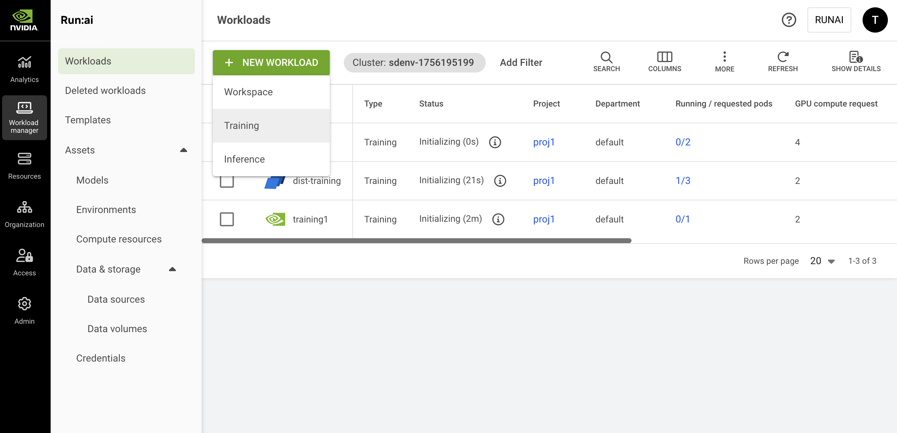

# Train Models Using a Standard Training Workload

This section explains how to create a standard training native workload via the NVIDIA Run:ai UI.

A training workload contains the setup and configuration needed for building your model, including the container, images, data sets, and resource requests, as well as the required tools for the research, all in a single place.

The training workload is assigned to a project and is affected by the project’s quota.

To learn more about the training workload type in NVIDIA Run:ai and determine that it is the most suitable workload type for your goals, see [Workload types and features](../workload-types/native-workloads.md).

<figure><figcaption></figcaption></figure>

## Before You Start

* Make sure you have created a [project](../../platform-management/aiinitiatives/organization/projects.md) or have one created for you.
* If the image you are planning to use is hosted in NGC, make sure you have an NGC account with an active NGC API key. To obtain a key, go to [NGC](https://catalog.ngc.nvidia.com/) → Setup → API Keys, then generate or copy an existing key. In NVIDIA Run:ai, store the key either as a [shared secret](../workload-assets/credentials.md#ngc-api-key) (created by an administrator) or a [user credential](../../settings/user-settings/user-credentials.md) (created under User settings).

## Workload Priority and Preemption
By default, training workloads are assigned a **Low** priority and are **preemptible**. These defaults allow training workloads to use opportunistic compute resources beyond the project’s deserved quota while being scheduled after higher-priority workloads. Preemptible training workloads may be interrupted if those resources are required by higher-priority, non-preemptible workloads.

You can override the defaults by configuring priority and preemptibility. For more details, see [Workload priority and preemption](../../platform-management/runai-scheduler/scheduling/workload-priority-control.md).

## Workload Policies

When creating a new workload, fields and assets may have limitations or defaults. These rules and defaults are derived from a policy your administrator set.

Policies allow you to control, standardize, and simplify the workload submission process. For additional information, see [Policies and rules](../../platform-management/policies/policies-and-rules.md).

The effects of the policy are reflected in the workload creation form:

* Defaults derived from the policy will be displayed automatically for specific fields.
* Disabled actions and permitted value ranges for values will be visibly explained per field.
* Rules and defaults for entire sections (such as environments, compute resources, or data sources) may prevent selection and will appear on the entire library card with an option for additional information via an external modal.

## Submission Form Options
You can create a new workload using either the **Flexible** or **Original** submission form. The Flexible submission form offers greater customization and is the **recommended** method. Within the Flexible form, you have two options:

* **Load from an existing setup** - You can select an existing setup to populate the workload form with predefined values. While the Original submission form also allows you to select an existing setup, with the Flexible submission you can customize any of the populated fields for a one-time configuration. These changes will apply only to this workload and will not modify the original setup. If needed, you can reset the configuration to the original setup at any time.
* **Provide your own settings** - Manually fill in the workload configuration fields. This is a one-time setup that applies only to the current workload and will not be saved for future use.

<Info>

**Note**

* Flexible workload submission is enabled by default. If unavailable, contact your administrator to enable it under **General settings** → Workloads → Flexible workload submission.
* The Original submission form will be deprecated in a future release.

</Info>

## Creating a Standard Training Workload

1. To add a new workload, go to Workload manager → Workloads.
2. Click **+NEW WORKLOAD** and select **Training** from the dropdown menu**.**
3. Within the new training form, select the **cluster** and **project**. To create a new project, click **+NEW PROJECT** and refer to [Projects](../../platform-management/aiinitiatives/organization/projects.md) for a step-by-step guide.
4. Set the training workload architecture as **Standard**, which consists of a single main running process. This workload uses environments that support standard training workloads only.
5. Select one of the following options to launch a workload:
   * **Start from scratch** - Opens the full workload form. You’ll need to configure all required fields. Click **CONTINUE** to proceed.
   * **Template** - Choose a predefined [template](../workload-templates/training-templates/standard-training-templates.md) to populate the workload form. After selecting a template:
     * Click **CREATE TRAINING** to launch immediately using the template settings.
     *   Click **Advanced setup** to open the full workload form with fields populated by the template. You can adjust the predefined configuration values before submitting. Any changes you make will apply only to the workload and will not be saved back to the original template.

         <Info>
<strong>Note</strong>

You cannot create a workload directly from a template if the template does not include all mandatory fields or if an organizational policy restricts the use of certain fields within that template.
</Info>
6. Enter a unique **name** for the workload. If the name already exists in the project, you will be requested to submit a different name.

### Setting Up an Environment

<Info>

**Note**

* NGC catalog is disabled by default. If unavailable, your administrator must enable it under **General settings** → Workloads → NGC catalog.
* To select an image from the NGC private registry**,** your administrator must configure it under **General settings** → Workloads → NGC private registry.

</Info>

<Tabs>

<Tab title="Flexible">

**Load from existing setup**

1. Click the **load** icon. A side pane appears, displaying a list of available environments. Select an environment from the list.
2. Optionally, customize any of the environment’s predefined fields as shown below. The changes will apply to this workload only and will not affect the selected environment.
3. Alternatively, click the **➕** icon in the side pane to create a new environment. For step-by-step instructions, see [Environments](../workload-assets/environments.md).

**Provide your own settings**

Manually configure the settings below as needed. The changes will apply to this workload only.

**Configure environment**

1. Set the **environment image**:
   * Select **Custom image** and add the **Image URL** or update the URL of the existing setup.
   * **Select from the NGC catalog** and then set how to **access the NGC catalog**:
     * **As a guest** - Choose the **image name** and **tag** from the dropdown.
     * **Authenticated** - Configure **access** to NGC and then choose the **image name** and **tag** from the dropdown:
       * Under **Source**, select [**Shared secret**](../workload-assets/credentials.md#ngc-api-key) or [**My credentials**](../../settings/user-settings/user-credentials.md).
       * The **Type** field is fixed to **NGC API key**.
       * Under **Credential name**, select an existing credential from the dropdown. If you select **My credentials**, you can also create a new credential directly from the dropdown. The credential is also saved under **User settings** → Credentials.
   * **Select from the NGC private registry** and then set how to access the registry:
     * Select a **registry** from the dropdown.
     * Under **Source**, select [**Shared secret**](../workload-assets/credentials.md#ngc-api-key) or [**My credentials**](../../settings/user-settings/user-credentials.md).
     * The **Type** field is fixed to **NGC API key**.
     * Under **Credential name**, select an existing credential from the dropdown. If you select **My credentials**, you can also create a new credential directly from the dropdown. The credential is also saved under **User settings** → Credentials.
2. Set the **image pull policy**:
   * Set the **condition for pulling the image**. It is recommended to pull the image only if it's not already present on the host.
   * Set the **credentials for pulling the image**:
     * Under **Source**, select [**Shared secret**](../workload-assets/credentials.md#docker-registry) or [**My credentials**](../../settings/user-settings/user-credentials.md)
     * Under **Type**, select **Docker registry** or **NGC API key**.
     * Under **Credential name**, select an existing credential from the dropdown. If you select **My credentials**, you can also create a new credential directly from the dropdown. The credential is also saved under **User settings** → Credentials.
3. Set the connection for your **tool(s)**. If you are loading from existing setup, the tools are configured as part of the environment.
   * Select the **connection** type:
     * **Auto generate** - A unique URL / port is automatically created for each workload using the environment.
     * **Custom URL** / **Custom port** - Manually define the URL or port. For custom port, make sure to enter a port between `30000` and `32767.` If the node port is already in use, the workload will fail and display an error message.
     * **Load Balancer** - Set the container port. Connection handling is managed by the load balancer. For more information, see [External access to containers](../../installation-and-configuration/configuration/networking/external-access-to-containers.md).
   * Modify who can **access** the tool:
     * By default, **All authenticated users** **and service accounts** is selected giving access to everyone within the organization’s account.
     * For **Specific group(s)**, enter **group names** as they appear in your identity provider. You must be a member of one of the groups listed to have access to the tool.
     * For **Specific user(s) and service account(s)**, enter a valid user email or name. If you remove yourself, you will lose access to the tool.
4. Set the **command and arguments** for the container running the workload. If no command is added, the container will use the image’s default command (entry-point):
   * Modify the existing command or click **+COMMAND & ARGUMENTS** to add a new command.
   * Set multiple arguments separated by spaces, using the following format (e.g.: `--arg1=val1`).
5.  Set the **environment variable(s)**:

    * Modify the existing environment variable(s) or click **+ENVIRONMENT VARIABLE**. The existing environment variables may include instructions to guide you with entering the correct values.
    * You can either select **Custom** to define a value manually, or choose an existing value from [**Shared secret**](../workload-assets/credentials.md), [**My Credentials**](../../settings/user-settings/user-credentials.md), or [**ConfigMap**](../workload-assets/environments.md). If you select **My credentials**, you can also create a new credential directly from the dropdown. The credential is also saved under **User settings** → Credentials.

    Some environment variables are automatically injected by NVIDIA Run:ai. See [Built-in workload environment variables](../workloads.md#built-in-workload-environment-variables) for more details.
6. Enter a path pointing to the **container's working directory**.
7. Set where the UID, GID, and supplementary groups for the container should be taken from. If you select **Custom**, you’ll need to manually enter the **UID,** **GID and** **Supplementary groups values.**
8. Select additional Linux capabilities for the container from the drop-down menu. This grants certain privileges to a container without granting all the root user's privileges.

</Tab>

<Tab title="Original">

1. Select an environment or click **+NEW ENVIRONMENT** to add a new environment to the gallery. For a step-by-step guide on adding environments to the gallery, see [Environments](../workload-assets/environments.md). Once created, the new environment will be automatically selected.
2. Set the connection for your **tool(s)**. If you are loading from existing setup, the tools are configured as part of the environment.
   * Select the connection type - **External URL** or **NodePort**:
     * **Auto generate** - A unique URL / port is automatically created for each workload using the environment.
     * **Custom URL** / **Custom port** - Manually define the URL or port. For custom port, make sure to enter a port between `30000` and `32767.` If the node port is already in use, the workload will fail and display an error message.
   * Optional: Modify who can **access** the tool:
     * By default, **All authenticated users** **and service accounts** is selected giving access to everyone within the organization’s account.
     * For **Specific group(s)**, enter **group names** as they appear in your identity provider. You must be a member of one of the groups listed to have access to the tool.
     * For **Specific user(s) and service account(s)**, enter a valid user email or name. If you remove yourself, you will lose access to the tool.
   * Set the **User ID (UID)**, **Group ID (GID)** and the **Supplementary groups** that can run commands in the container.
3. Optional: Set the **command and arguments** for the container running the workload. If no command is added, the container will use the image’s default command (entry-point):
   * Modify the existing command or click **+COMMAND & ARGUMENTS** to add a new command.
   * Set multiple arguments separated by spaces, using the following format (e.g.: `--arg1=val1`).
4.  Set the **environment variable(s)**:

    * Modify the existing environment variable(s) or click **+ENVIRONMENT VARIABLE**. The existing environment variables may include instructions to guide you with entering the correct values.
    * You can either select **Custom** to define your own variable, or choose from a predefined list of [**Credentials**](../workload-assets/credentials.md) or [**ConfigMaps**](../workload-assets/environments.md).

    Some environment variables are automatically injected by NVIDIA Run:ai. See [Built-in workload environment variables](../workloads.md#built-in-workload-environment-variables) for more details.

</Tab>

</Tabs>

### Setting Up Compute Resources

<Info>

**Note**

GPU memory limit is disabled by default. If unavailable, your administrator must enable it under **General settings** → Resources → GPU resource optimization.

</Info>

<Tabs>

<Tab title="Flexible">

**Load from existing setup**

1. Click the **load** icon. A side pane appears, displaying a list of available compute resources. Select a compute resource from the list.
2. Optionally, customize any of the compute resource's predefined fields as shown below. The changes will apply to this workload only and will not affect the selected compute resource.
3. Alternatively, click the **➕** icon in the side pane to create a new compute resource. For step-by-step instructions, see [Compute resources](../workload-assets/compute-resources.md).

**Provide your own settings**

Manually configure the settings below as needed. The changes will apply to this workload only.

**Configure compute resources**

1. Set the number of **GPU devices** per pod (physical GPUs).
2. Enable **GPU fractioning** to set the GPU memory per device using either a fraction of a GPU device’s memory **(% of device)** or a GPU memory unit **(MB/GB)**:
   * **Request** - The minimum GPU memory allocated per device. Each pod in the workload receives at least this amount per device it uses.
   * **Limit** - The maximum GPU memory allocated per device. Each pod in the workload receives **at most** this amount of GPU memory for each device(s) the pod utilizes. This is disabled by default, to enable see the above note.
3. Set the **CPU resources**
   * Set **CPU compute resources** per pod by choosing the unit (**cores** or **millicores**):
     * **Request** - The minimum amount of CPU compute provisioned per pod. Each running pod receives this amount of CPU compute.
     * **Limit** - The maximum amount of CPU compute a pod can use. Each pod receives **at most** this amount of CPU compute. By default, the limit is set to **Auto** which means that the pod may consume up to the node's maximum available CPU compute resources.
   * Set the **CPU memory per pod** by selecting the unit (**MB** or **GB**):
     * **Request** - The minimum amount of CPU memory provisioned per pod. Each running pod receives this amount of CPU memory.
     * **Limit** - The maximum amount of CPU memory a pod can use. Each pod receives at most this amount of CPU memory. By default, the limit is set to **Auto** which means that the pod may consume up to the node's maximum available CPU memory resources.
4. Set **extended resource(s)**
   * Enable **Increase shared memory size** to allow the shared memory size available to the pod to increase from the default 64MB to the node's total available memory or the CPU memory limit, if set above.
   * Click **+EXTENDED RESOURCES** to add resource/quantity pairs. For more information on how to set extended resources, see the [Extended resources](https://kubernetes.io/docs/tasks/configure-pod-container/extended-resource/) and [Quantity](https://kubernetes.io/docs/reference/kubernetes-api/common-definitions/quantity/) guides.
5. Set the **order of priority** for the **node pools** on which the Scheduler tries to run the workload. When a workload is created, the Scheduler will try to run it on the first node pool on the list. If the node pool doesn't have free resources, the Scheduler will move on to the next one until it finds one that is available:
   * Drag and drop them to change the order, remove unwanted ones, or reset to the default order defined in the project.
   * Click **+NODE POOL** to add a new node pool from the list of node pools that were defined on the cluster. To configure a new node pool and for additional information, see [Node pools](../../platform-management/aiinitiatives/resources/node-pools.md).
6. Select a **node affinity** to schedule the workload on a specific node type. If the administrator added a ‘[node type (affinity)](../../platform-management/policies/scheduling-rules.md#node-type-affinity)’ scheduling rule to the project/department, then this field is mandatory. Otherwise, entering a node type (affinity) is optional. [Nodes must be tagged](../../platform-management/policies/scheduling-rules.md#labelling-nodes-for-node-types-grouping) with a label that matches the node type key and value.
7. Click **+TOLERATION** to allow the workload to be scheduled on a node with a matching taint. Select the **operator** and the **effect**:
   * If you select **Exists**, the effect will be applied if the key exists on the node.
   * If you select **Equals**, the effect will be applied if the key and the value set match the value on the node.

</Tab>

<Tab title="Original">

1. Select a compute resource or click **+NEW COMPUTE RESOURCE** to add a new compute resource to the gallery. For a step-by-step guide on adding compute resources to the gallery, see [Compute resources](../workload-assets/compute-resources.md). Once created, the new compute resource will be automatically selected.
2. Optional: Set the **order of priority** for the **node pools** on which the Scheduler tries to run the workload. When a workload is created, the scheduler will try to run it on the first node pool on the list. If the node pool doesn't have free resources, the Scheduler will move on to the next one until it finds one that is available.
   * Drag and drop them to change the order, remove unwanted ones, or reset to the default order defined in the project.
   * Click **+NODE POOL** to add a new node pool from the list of node pools that were defined on the cluster.\
     To configure a new node pool and for additional information, see [Node pools](../../platform-management/aiinitiatives/resources/node-pools.md).
3. Select a **node affinity** to schedule the workload on a specific node type. If the administrator added a ‘[node type (affinity)](../../platform-management/policies/scheduling-rules.md#node-type-affinity)’ scheduling rule to the project/department, then this field is mandatory. Otherwise, entering a node type (affinity) is optional. [Nodes must be tagged](../../platform-management/policies/scheduling-rules.md#labelling-nodes-for-node-types-grouping) with a label that matches the node type key and value.
4. Optional: Click **+TOLERATION** to allow the workload to be scheduled on a node with a matching taint. Select the **operator** and the **effect.**
   * If you select **Exists**, the effect will be applied if the key exists on the node.
   * If you select **Equals,** the effect will be applied if the key and the value set match the value on the node.

</Tab>

</Tabs>

### Setting Up Data & Storage

<Info>

**Note**

* Data volumes is enabled by default and applies only to flexible workload submission (enabled by default). If unavailable, contact your administrator to enable it under **General Settings** → Workloads → Data volumes.
* If Data volumes is not enabled, **Data & storage** appears as **Data sources** only, and no data volumes will be available.

</Info>

<Tabs>

<Tab title="Flexible">

**Load from existing setup**

1. Click the **load** icon. A side pane appears, displaying a list of available data sources/volumes. Select a data source/volume from the list.
2. Optionally, customize any of the data source's predefined fields as shown below. The changes will apply to this workload only and will not affect the selected data source:
   * **Container path** - Enter the **container path** to set the **data target location**.
   * **ConfigMap** **sub-path** - Specify a **sub-path** (file/key) inside the ConfigMap to mount (for example, `app.properties`). This lets you mount a single file from an existing ConfigMap.
3. Alternatively, click the **➕** icon in the side pane to create a new data source/volume. For step-by-step instructions, see [Data sources](../workload-assets/overview.md) or [Data volumes](../workload-assets/data-volumes.md).

**Configure data sources for a one-time configuration**

<Info>

**Note**

[PVCs](../workload-assets/data-volumes.md), [Secrets](../workload-assets/credentials.md), [ConfigMaps](../workload-assets/environments.md) and [Data volumes](../workload-assets/data-volumes.md) cannot be added as a one-time configuration.

</Info>

1. Click the **➕** icon and choose the data source from the dropdown menu. You can add multiple data sources.
2. Once selected, set the **data origin** according to the required fields and enter the **container path** to set the **data target location**.

The required fields vary by data source. For detailed configuration options and usage guidelines for each data source type, see [Data sources](../workload-assets/overview.md).

**Configure EmptyDir for a one-time configuration**

Use **EmptyDir** to allocate temporary storage that exists only for the lifetime of the workload. The **EmptyDir** volume is ephemeral, the volume and its data is deleted every time the workload’s status changes to “Stopped

1. Set the **size** and **units** to define the maximum storage capacity.
2. Enter the **container path** to set the **data target location**.
3. Select the **storage medium**:
   * **Disk-backed storage** - The data is stored on the node's filesystem, which persists across container restarts but not pod rescheduling, and is slower than memory
   * **Memory-backed storage** - The data is stored in RAM, which provides faster access but is not persistent, and will be lost if the pod restarts

**Configure Volume for a one-time configuration**

Select **Volume** to allocate a storage space to your workspace that is persistent across restarts:

1. Set the **Storage class** to **None** or select an existing storage class from the list. To add new storage classes, and for additional information, see [Kubernetes storage classes](../../installation-and-configuration/configuration/shared-storage.md). If the administrator defined the storage class configuration, the rest of the fields will appear accordingly.
2. Select one or more **access mode(s)** and define the **claim size** and its **units**.
3. Select the **volume mode**:
   1. **Filesystem** (default) - The volume will be mounted as a filesystem, enabling the usage of directories and files.
   2. **Block** - The volume is exposed as a block storage, which can be formatted or used directly by applications without a filesystem.
4. Enter the **container path** to set the **data target location**.
5. Set the volume persistency to **Persistent** if the volume and its data should be deleted when the workspace is deleted or **Ephemeral** if the volume and its data should be deleted every time the workspace’s status changes to “Stopped”.

</Tab>

<Tab title="Original">

1. Optional: Click **+VOLUME** to set the volume needed for your workload. A volume allocates storage space to your workload that is persistent across restarts:
   * Set the **Storage class** to **None** or select an existing storage class from the list. To add new storage classes, and for additional information, see [Kubernetes storage classes](../../installation-and-configuration/configuration/shared-storage.md). If the administrator defined the storage class configuration, the rest of the fields will appear accordingly.
   * Select one or more **access mode(s)** and define the **claim size** and its **units**.
   * Select the **volume mode.** If you select **Filesystem** (default), the volume will be mounted as a filesystem, enabling the usage of directories and files. If you select **Block**, the volume is exposed as a block storage, which can be formatted or used directly by applications without a filesystem.
   * Set the **Container path** with the volume target location.
   * Set the volume persistency to **Persistent** if the volume and its data should be deleted when the workload is deleted or **Ephemeral** if the volume and its data should be deleted every time the workload’s status changes to “Stopped”.
2. Optional: Select an existing **data source**. Modify the data target location if needed.
3. To add a new data source, click **+ NEW DATA SOURCE**. For a step-by-step guide, see [Data sources](../workload-assets/overview.md). Once created, it will be automatically selected.

<Info>

**Note**

If there are connectivity issues with the cluster or problems during data source creation, the data source may not appear in the list.

</Info>

</Tab>

</Tabs>

### Setting Up General Settings

<Info>

**Note**

The following general settings are optional.

</Info>

<Tabs>

<Tab title="Flexible">

1. Set whether the workload may be interrupted by selecting **Preemptible**, **Semi-preemptible**, or **Non-preemptible**:
   * Non-preemptible workloads use the project's available GPU quota and will not be interrupted once they start running.
   * Preemptible workloads may be interrupted if resources are needed for higher-priority workloads.
   * Semi-preemptible workloads guarantee their minimum required replicas run without interruption, while any replicas beyond that minimum behave as preemptible replicas.
2. Set the **workload priority**. Choose the appropriate priority level for the workload. Higher-priority workloads are scheduled before lower-priority ones.
3. Set the **grace period** for workload preemption. This is a buffer that allows a preempted workload to reach a safe checkpoint before it is forcibly preempted. Enter a timeframe between 0 sec and 5 min.
4. Set the **number of runs** the workload must finish to be considered complete. Multiple runs enhance the reliability and validity of the training results.
5. If the number of runs is above 1, enter a value under **Parallelism** to specify how many runs may be scheduled in **parallel**. The value must be less than or equal to the number of runs.
6. Set the **backoff limit** before workload failure. The backoff limit is the maximum number of retry attempts for failed workloads. After reaching the limit, the workload status will change to "Failed." Enter a value between 0 and 100.
7. Set the **timeframe for auto-deletion** after workload completion or failure. The time after which a completed or failed workload is deleted; if this field is set to 0 seconds, the workload will be deleted automatically. This setting does not affect log retention. Log retention is managed separately.
8. Set **annotations(s).** Kubernetes annotations are key-value pairs attached to the workload. They are used for storing additional descriptive metadata to enable documentation, monitoring and automation.
9. Set **labels(s).** Kubernetes labels are key-value pairs attached to the workload. They are used for categorizing to enable querying.

</Tab>

<Tab title="Original">

1. Set the **grace period** for workload preemption. This is a buffer that allows a preempted workload to reach a safe checkpoint before it is forcibly preempted. Enter a timeframe between 0 sec and 5 min.
2. Set the **number of runs** the workload must finish to be considered complete. Multiple runs enhance the reliability and validity of the training results.
3. If the number of runs is above 1, enter a value under **Parallelism** to specify how many runs may be scheduled in **parallel**. The value must be less than or equal to the number of runs.
4. Set the **backoff limit** before workload failure. The backoff limit is the maximum number of retry attempts for failed workloads. After reaching the limit, the workload status will change to "Failed." Enter a value between 0 and 100.
5. Set the **timeframe for auto-deletion** after workload completion or failure. The time after which a completed or failed workload is deleted; if this field is set to 0 seconds, the workload will be deleted automatically. This setting does not affect log retention. Log retention is managed separately.
6. Set **annotations(s).** Kubernetes annotations are key-value pairs attached to the workload. They are used for storing additional descriptive metadata to enable documentation, monitoring and automation.
7. Set **labels(s).** Kubernetes labels are key-value pairs attached to the workload. They are used for categorizing to enable querying.

</Tab>

</Tabs>

### Completing the Workload

1. Before finalizing your workload, review your configurations and make any necessary adjustments.
2. Click **CREATE TRAINING**

## Managing and Monitoring

After the training workload is created, it is added to the [Workloads](../workloads.md) table, where it can be managed and monitored.

## Using CLI

To view the available actions, see the training workload [CLI v2 reference](../../reference/cli/runai/).

## Using API

To view the available actions, see the [Trainings workload](https://run-ai-docs.nvidia.com/api/2.26/workloads/trainings) API reference.
