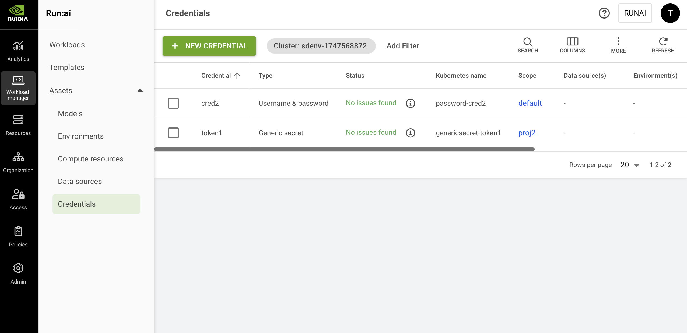

# Credentials

Credentials are [workload assets](./) that simplify the complexities of Kubernetes secrets. They consist of and mask sensitive access information, such as passwords, tokens, and access keys, which are necessary for gaining access to various resources.

Credentials are crucial for the security of AI workloads and the resources they require, as they restrict access to authorized users, verify identities, and ensure secure interactions. By enforcing the protection of sensitive data, credentials help organizations comply with industry regulations, fostering a secure environment overall.

Essentially, credentials enable AI practitioners to access relevant protected resources, such as private data sources and Docker images, thereby streamlining the workload submission process.

## Credentials Table

The Credentials table can be found under **Workload manager** in the NVIDIA Run:ai User interface.

The Credentials table provides a list of all the credentials defined in the platform and allows you to manage them.

<figure><figcaption></figcaption></figure>

The Credentials table comprises the following columns:

| Column          | Description                                                                                                                                                       |
| --------------- | ----------------------------------------------------------------------------------------------------------------------------------------------------------------- |
| Credential      | The name of the credential                                                                                                                                        |
| Description     | A description of the credential                                                                                                                                   |
| Type            | The type of credential, e.g., Docker registry                                                                                                                     |
| Status          | The different lifecycle [phases](../workloads.md#workload-status) and representation of the credential's condition                                                |
| Scope           | The [scope](overview.md#asset-scope) of this compute resource within the organizational tree. Click the name of the scope to view the organizational tree diagram |
| Kubernetes name | The unique name of the credential's Kubernetes name as it appears in the cluster                                                                                  |
| Environment(s)  | The environment(s) that are associated with the credential                                                                                                        |
| Data source(s)  | The private data source(s) that are accessed using the credential                                                                                                 |
| Created by      | The user who created the credential                                                                                                                               |
| Creation time   | The timestamp of when the credential was created                                                                                                                  |
| Cluster         | The cluster with which the credential is associated                                                                                                               |

### Credentials Status

The following table describes the credentials’ condition and whether they were created successfully for the selected [scope](overview.md#asset-scope).

| Status          | Description                                                                                                                        |
| --------------- | ---------------------------------------------------------------------------------------------------------------------------------- |
| No issues found | No issues were found while creating the credential (this status may change while propagating the credential to the selected scope) |
| Issues found    | Issues found while propagating the credential                                                                                      |
| Issues found    | Failed to access the cluster                                                                                                       |
| Creating…       | Credential is being created                                                                                                        |
| Deleting…       | Credential is being deleted                                                                                                        |
| No status       | When the credential's scope is an account, or the current version of the cluster is not up to date, the status cannot be displayed |

### Customizing the Table View

* Filter - Click ADD FILTER, select the column to filter by, and enter the filter values
* Search - Click SEARCH and type the value to search by
* Sort - Click each column header to sort by
* Column selection - Click COLUMNS and select the columns to display in the table
* Download table - Click MORE and then click ‘Download as CSV’. Export to CSV is limited to 20,000 rows.
* Refresh - Click REFRESH to update the table with the latest data

## Adding New Credentials

Creating credentials is limited to [specific roles](overview.md#who-can-create-an-asset).

To add a new credential:

1. Go to the Credentials table
2. Click **+NEW CREDENTIAL**
3. Select the credential type from the list\
   Follow the step-by-step guide for each credential type:

<Accordion title="Docker registry">

**Docker registry**

These credentials allow users to authenticate and pull images from a Docker registry, enabling access to containerized applications and services.

<Note>

**Note**

**Docker registry URL for inference workloads** - For Knative-based inference workloads, Docker Hub credentials must be configured using `https://index.docker.io/v1/` as the registry URL. Credentials configured with `docker.io` result in `401 Unauthorized` errors for Knative-based inference workloads due to differences in how image digests are resolved during image pull.

</Note>

After creating the credential, it is used automatically when pulling images.

1. Select a [**scope**](overview.md#asset-scope).
2. Enter a **name** for the credential. The name must be unique.
3. Optional: Provide a description of the credential
4. Set how the credential is created
   * **Existing secret** (in the cluster)\
     This option applies when the purpose is to create the credential based on an existing secret
     * Select a secret from the list (The list is empty if no secrets were [created in advance](credentials.md#creating-secrets-in-advance))
   * **New secret** (recommended)\
     A new secret is created together with the credential. New secrets are not added to the list of existing secrets.
     * Enter the **username**, **password**, and **Docker registry URL**
5. Click **CREATE CREDENTIAL**

After the credential is created, check the status to monitor proper creation across the selected scope.

</Accordion>

<Accordion title="Generic secret">

**Generic secret**

Generic secrets are a flexible credential type that securely store sensitive information such as API keys, access keys, SSH keys, or configuration data for use within applications and workloads.

The purpose of this credential type is to allow access to restricted data.

1. Select a [**scope**](overview.md#asset-scope)
2. Enter a **name** for the credential. The name must be unique.
3. Optional: Provide a **description** of the credential
4. Set how the credential is created
   * **Existing secret** (in the cluster)\
     This option applies when the purpose is to create the credential based on an existing secret. Select a secret from the list. The list is empty if no secrets were [created in advance](credentials.md#creating-secrets-in-advance).
   * **New secret** (recommended)\
     A new secret is created together with the credential. New secrets are not added to the list of existing secrets.
5. Set the secret format\
   Choose the format that matches your secret type:
   * **Key(s) & value(s)** - A flexible option that consists of multiple key/value pairs and can store various types of sensitive information, such as API keys or configuration data, to be used securely within applications.
   * **Access key** - A unique identifier used to authenticate and authorize access to cloud services or APIs, ensuring secure communication between applications.
   * **Username & password** - Credentials that require a username and corresponding password to access resources, ensuring that only authorized users can log in.
   * **SSH key** - Used to store an SSH key, for example when connecting to Git data sources during workload submission or data source creation.
6. Enter the secret details depending on the selected format:
   * **Key(s) & value(s)** - Enter one or more key/value pairs. Click **+ KEY & VALUE** to add additional pairs.
   * **Access key** - Enter values for **Access key** and **Access secret**
   * **Username & password** - Enter a **Username** and **Password**
   * **SSH key** - Enter the SSH key string in the **SSH key** field
7. Click **CREATE CREDENTIAL**

</Accordion>

<Accordion title="NGC API key">

**NGC API key**

The NGC API key credential is used to securely store the authentication key required for access to NVIDIA's services. To obtain a key, go to [NGC](https://catalog.ngc.nvidia.com/) → Setup → API Key, then generate or copy an existing key.

The purpose of this credential type is to allow access to restricted data.

1. Select a [**scope**](overview.md#asset-scope)
2. Enter a **name** for the credential. The name must be unique.
3. Optional: Provide a **description** of the credential
4. Enter the **NGC API key** for authentication to NGC services
5. Click **CREATE CREDENTIAL**

</Accordion>

## Editing Credentials

To rename a credential:

1. Select the credential from the table
2. Click **Rename** to edit its name and description

## Deleting Credentials

To delete a credential:

1. Select the credential you want to delete
2. Click **DELETE**
3. In the dialog, click **DELETE** to confirm

<Note>

**Note**

Credentials cannot be deleted if they are being used by a workload and template.

</Note>

## Using Credentials

You can use credentials (secrets) in various ways within the system

### Access Private Data Sources

To access private data sources, attach credentials to data sources of the following types: [Git](credentials.md), [S3 Bucket](credentials.md)

### Use Directly Within the Container

To use the secret directly from within the container, you can choose between the following options

1. Get the secret mounted to the file system by using the [Generic secret](credentials.md) data source
2.  Get the secret as an environment variable injected into the container. There are two equivalent ways to inject the environment variable.

    a. By adding it to the Environment asset. b. By adding it ad-hoc as part of the workload.

## Creating Secrets in Advance

Add secrets in advance to be used when creating credentials via the NVIDIA Run:ai UI. Follow the steps below for each required scope:

### **Cluster Scope**

1. Create the secret in the NVIDIA Run:ai namespace (`runai`)
2. To authorize NVIDIA Run:ai to use the secret, label it: `run.ai/cluster-wide: "true"`
3. Label the secret with the correct credential type:
   1. Docker registry - `run.ai/resource: "docker-registry"`
   2. Access key - `run.ai/resource: "access-key"`
   3. Username and password - `run.ai/resource: "password"`
   4. Generic secret - `run.ai/resource: "generic"`

The secret is now displayed for that scope in the list of existing secrets.

### **Department Scope**

1. Create the secret in the NVIDIA Run:ai namespace (`runai`)
2. To authorize NVIDIA Run:ai to use the secret, label it: `run.ai/department: "<department_id>"`
3. Label the secret with the correct credential type:
   1. Docker registry - `run.ai/resource: "docker-registry"`
   2. Access key - `run.ai/resource: "access-key"`
   3. Username and password - `run.ai/resource: "password"`
   4. Generic secret - `run.ai/resource: "generic"`

The secret is now displayed for that scope in the list of existing secrets.

### **Project Scope**

1. Create the secret in the project’s namespace
2. Label the secret with the correct credential type:
   1. Docker registry - `run.ai/resource: "docker-registry"`
   2. Access key - `run.ai/resource: "access-key"`
   3. Username and password - `run.ai/resource: "password"`
   4. Generic secret - `run.ai/resource: "generic"`

## Using CLI

To view the available actions on credentials, see the credential [CLI v2 reference](../../reference/cli/runai/runai_credential.md).

## Using API

To view the available actions, go to the [Credentials](api:main-api:GET/api/v1/asset/credentials) API reference

## Using MCP

The NVIDIA Run:ai MCP server exposes [Credentials](../../agents/tools-reference.md#credentials) tools to manage credentials via natural language:

* `list_credentials` - list safe metadata for shared and user credentials
* `manage_credentials` - create, update, or delete credentials

See [AI Agents](../../agents/overview.md) for setup.
