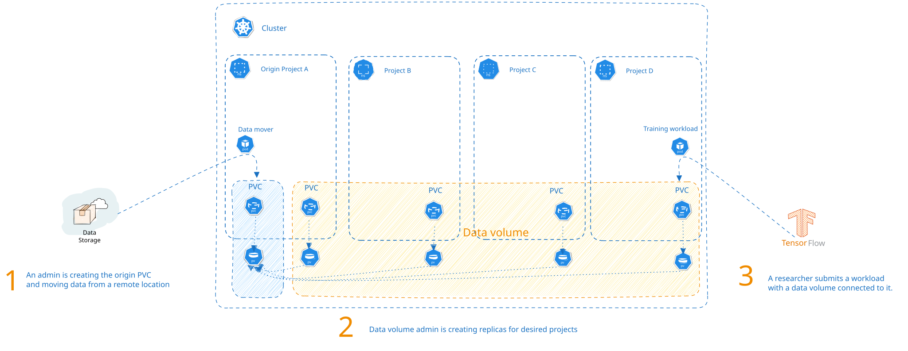
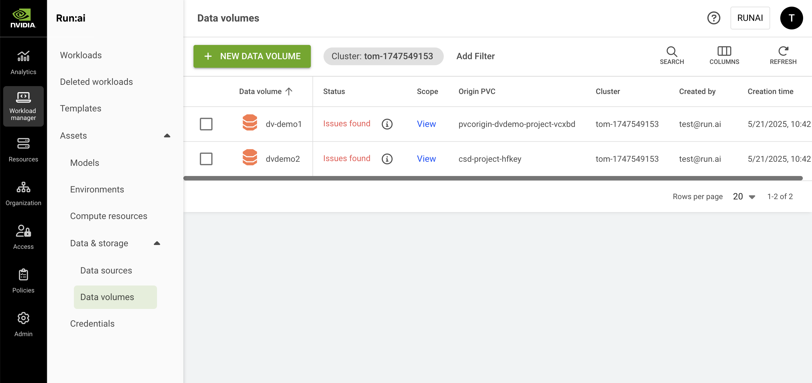

# Data Volumes

Data volumes (DVs) are one type of [workload assets](overview.md). They offer a powerful solution for storing, managing, and sharing AI training data, promoting collaboration, simplifying data access control, and streamlining the AI development lifecycle.

Acting as a central repository for organizational data resources, data volumes can represent datasets or raw data, that is stored in Kubernetes Persistent Volume Claims (PVCs).

Once a data volume is created, it can be shared with additional multiple scopes and easily utilized by AI practitioners when submitting workloads. Shared data volumes are mounted with read-only permissions, ensuring data integrity. Any modifications to the data in a shared DV must be made by writing to the original volume of the PVC used to create the data volume.

When a data volume is shared with additional scopes, NVIDIA Run:ai creates a PVC in each of those scopes. These PVCs are references to the same underlying physical storage (the same PV), so the data itself is not copied or replicated. Sharing a data volume does not consume additional storage capacity.

<Note>

**Note**

Data volumes is enabled by default and applies only to flexible workload submission (enabled by default). If unavailable, contact your administrator to enable it under **General Settings** → Workloads → Data volumes.

</Note>

## Why Use a Data Volume?

1. **Sharing with multiple scopes** - Data volumes can be shared across different scopes in a cluster, including projects, departments. Using data volumes allows for data reuse and collaboration within the organization.
2. **Storage saving** - A single copy of the data is used across multiple [scopes](overview.md#asset-scope). Sharing creates references to the same storage and does not duplicate the data.

## Typical Use Cases

1. **Sharing large datasets** - In large organizations, the data is often stored in a remote location, which can be a barrier for large model training. Even if the data is transferred into the cluster, sharing it easily with multiple users is still challenging. Data volumes can help share the data seamlessly, with maximum security and control.
2. **Sharing data with colleagues** - When sharing training results, generated datasets, or other artifacts with team members is needed, data volumes can help make the data available easily.

## Prerequisites

To create a data volume, you must have a [PVC data source](data-volumes.md) already created. Make sure the PVC includes data before sharing it.

## Data Volumes Table

The data volumes table can be found under **Workload manager** in the NVIDIA Run:ai platform.

The data volumes table provides a list of all the data volumes defined in the platform and allows you to manage them.

<figure><figcaption></figcaption></figure>

The data volumes table comprises the following columns:

| Column         | Description                                                                                                                                          |
| -------------- | ---------------------------------------------------------------------------------------------------------------------------------------------------- |
| Data volume    | The name of the data volume                                                                                                                          |
| Description    | A description of the data volume                                                                                                                     |
| Status         | The different lifecycle [phases](../workloads.md#workload-status) and representation of the data volume condition                                    |
| Scope          | The [scope](overview.md#asset-scope) of the data source within the organizational tree. Click the scope name to view the organizational tree diagram |
| Origin project | The project of the origin PVC                                                                                                                        |
| Origin PVC     | The original PVC from which the data volume was created that points to the same PV                                                                   |
| Cluster        | The cluster that the data volume is associated with                                                                                                  |
| Created by     | The user who created the data volume                                                                                                                 |
| Creation time  | The timestamp for when the data volume was created                                                                                                   |
| Last updated   | The timestamp of when the data volume was last updated                                                                                               |

### Data Volumes Status

The following table describes the data volumes' condition and whether they were created successfully for the selected [scope](overview.md#asset-scope).

| Status          | Description                                                                                                                                                                   |
| --------------- | ----------------------------------------------------------------------------------------------------------------------------------------------------------------------------- |
| No issues found | No issues were found while creating the data volume                                                                                                                           |
| Issues found    | Issues were found while sharing the data volume.                                |
| Creating…       | The data volume is being created                                                                                                                                              |
| Deleting...     | The data volume is being deleted                                                                                                                                              |
| No status / “-” | When the data volume’s scope is an account, the current version of the cluster is not up to date, or the asset is not a cluster-syncing entity, the status can’t be displayed |

### Customizing the Table View

* Filter - Click ADD FILTER, select the column to filter by, and enter the filter values
* Search - Click SEARCH and type the value to search by
* Sort - Click each column header to sort by
* Column selection - Click COLUMNS and select the columns to display in the table
* Refresh - Click REFRESH to update the table with the latest data

## Adding a New Data Volume

To create a new data volume:

1. Click **+NEW DATA VOLUME**
2. Set the **project** where the data is located
3. Set a **PVC** from which to create the data volume
4. Enter a **name** for the data volume. The name must be unique.
5. Optional: Provide a **description** of the data volume
6. Set the [**Scopes**](overview.md#asset-scope) that will be able to mount the data volume
7. Click **CREATE DATA VOLUME**

## Editing a Data Volume

To edit a data volume:

1. Select the data volume you want to edit
2. Click **Edit**
3. Click **SAVE DATA VOLUME**

## Copying a Data Volume

To copy an existing data volume:

1. Select the data volume you want to copy
2. Click **MAKE A COPY**
3. Enter a **name** for the data volume. The name must be unique.
4. Set a new Origin PVC for your data volume, since only one Origin PVC can be used per data volume
5. Click **CREATE DATA VOLUME**

## Deleting a Data Volume

To delete a data volume:

1. Select the data volume you want to delete
2. Click **DELETE**
3. Confirm you want to delete the data volume

<Note>

**Note**

It is not possible to delete a data volume being used by an existing workload.

</Note>

## Using CLI

To view the available actions on data volumes, see the data volume [CLI v2 reference](../../reference/cli/runai/runai_datavolume.md).

## Using API

To view the available actions, go to the [Data volumes](api:main-api:GET/api/v1/datavolumes) API reference.
