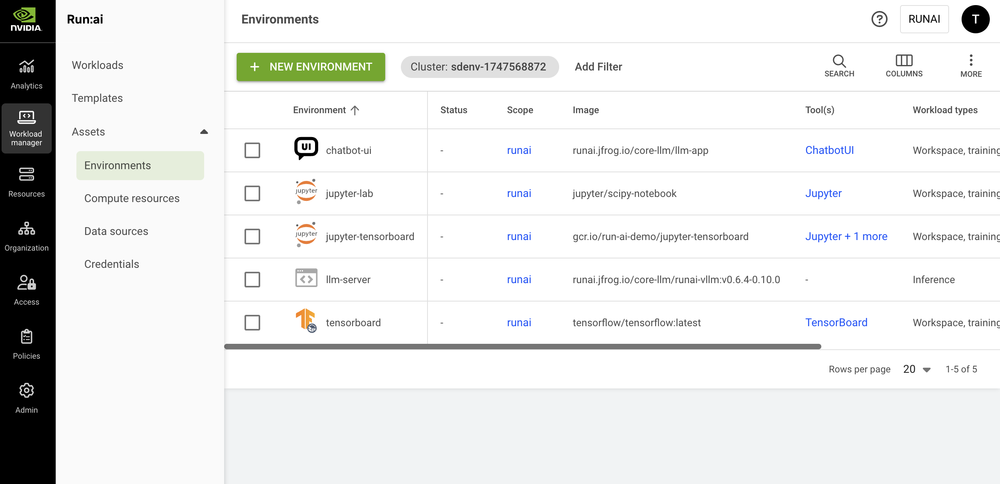

# Environments

Environments are one type of [workload assets](overview.md). An environment consists of a configuration that simplifies how workloads are submitted and can be used by AI practitioners when they submit their workloads.

An environment asset is a preconfigured building block that encapsulates aspects for the workload such as:

* Container image and container configuration
* Tools and connections
* The type of workload it serves

## Environments Table

The Environments table can be found under **Workload manager** in the NVIDIA Run:ai platform.

The Environment table provides a list of all the environment defined in the platform and allows you to manage them.

<figure><figcaption></figcaption></figure>

The Environments table consists of the following columns:

| Column                | Description                                                                                                                                                                              |
| --------------------- | ---------------------------------------------------------------------------------------------------------------------------------------------------------------------------------------- |
| Environment           | The name of the environment                                                                                                                                                              |
| Description           | A description of the environment                                                                                                                                                         |
| Scope                 | The [scope](overview.md#asset-scope) of this environment within the organizational tree. Click the name of the scope to view the organizational tree diagram                             |
| Image                 | The application or service to be run by the workload                                                                                                                                     |
| Workload Architecture | This can be either standard for running workloads on a single node or distributed for running distributed workloads on multiple nodes                                                    |
| Tool(s)               | The tools and connection types the environment exposes                                                                                                                                   |
| Workload(s)           | The list of existing workloads that use the environment                                                                                                                                  |
| Workload types        | The workload types that can use the environment (Workspace/ Training / Inference)                                                                                                        |
| Template(s)           | The list of workload templates that use this environment                                                                                                                                 |
| Created by            | The user who created the environment. By default NVIDIA Run:ai UI comes with [preinstalled environments](environments.md#environments-created-by-nvidia-run-ai) created by NVIDIA Run:ai |
| Creation time         | The timestamp of when the environment was created                                                                                                                                        |
| Last updated          | The timestamp of when the environment was last updated                                                                                                                                   |
| Cluster               | The cluster with which the environment is associated                                                                                                                                     |

### Tools Associated with the Environment

Click one of the values in the tools column to view the list of tools and their connection type.

| Column          | Description                                                                                                                                                                                                      |
| --------------- | ---------------------------------------------------------------------------------------------------------------------------------------------------------------------------------------------------------------- |
| Tool name       | The name of the tool or application AI practitioner can set up within the environment. For more information, see [Integrations](../../installation-and-configuration/configuration/third-party-integrations/supported-integrations.md).                        |
| Connection type | The method by which you can access and interact with the running workload. It's essentially the "doorway" through which you can reach and use the tools the workload provide. (E.g node port, external URL, etc) |

### Workloads Associated with the Environment

Click one of the values in the Workload(s) column to view the list of workloads and their parameters.

| Column   | Description                                                                                                 |
| -------- | ----------------------------------------------------------------------------------------------------------- |
| Workload | The workload that uses the environment                                                                      |
| Type     | The workload type (Workspace/Training/Inference)                                                            |
| Status   | Represents the workload lifecycle. See the full list of [workload status](../workloads.md#workload-status)) |

### Customizing the Table View

* Filter - Click ADD FILTER, select the column to filter by, and enter the filter values
* Search - Click SEARCH and type the value to search by
* Sort - Click each column header to sort by
* Column selection - Click COLUMNS and select the columns to display in the table
* Download table - Click MORE and then Click Download as CSV. Export to CSV is limited to 20,000 rows.

## Environments Created by NVIDIA Run:ai

When installing NVIDIA Run:ai, you automatically get the environments created by NVIDIA Run:ai to ease up the onboarding process and support different use cases out of the box. These environments are created at the [scope](overview.md#asset-scope) of the account.

<Note>

**Note**

The environments listed below are available based on your cluster settings. Some environments, such as vscode and rstudio, are only available in clusters with [host-based routing](../../installation-and-configuration/configuration/networking/external-access-to-containers.md#host-based-routing).

</Note>

| Environment                                                                                     | Image                                              | Description                                                                                                                                                                            |
| ----------------------------------------------------------------------------------------------- | -------------------------------------------------- | -------------------------------------------------------------------------------------------------------------------------------------------------------------------------------------- |
| gpt2 | `ghcr.io/huggingface/text-generation-inference:3.3.6-intel-cpu` | A lightweight GPT-2 text generation server that runs on CPU, useful for trying out inference workloads |
| huggingface-chat-ui | `ghcr.io/run-ai/chat-ui-db:0.20` | A chat interface for interacting with LLMs, using unique subdomains for each workspace. Requires wildcard DNS support |
| jupyter-scipy | `jupyter/scipy-notebook`                           | An interactive development environment for Jupyter notebooks, code, and data visualization                                                                                             |
| jupyter-tensorboard                                                                             | `nvcr.io/nvidia/pytorch:26.09-py3`                 | An integrated combination of the interactive Jupyter development environment and TensorFlow's visualization toolkit for monitoring and analyzing ML models                             |
| llm-server                                                                                      | `vllm/vllm-openai:v0.6.4`                          | A vLLM-based server that hosts and serves large language models for inference, enabling API-based access to AI models                                                                  |
| openwebui | `ghcr.io/open-webui/open-webui:v0.6.42` | A feature-rich web interface for LLM interactions with RAG support, model management, and user authentication. Supports OpenAI API compatible endpoints |
| rstudio                                                                                         | `rocker/rstudio`                                 | An integrated development environment (IDE) for R, commonly used for statistical computing and data analysis                                                                           |
| tensorboard-tensorflow | `tensorflow/tensorflow:2.20.0`                     | A visualization toolkit for TensorFlow that helps users monitor and analyze ML models, displaying various metrics and model architecture                                               |
| vscode                                                                                          | `ghcr.io/coder/code-server`                        | A fast, lightweight code editor with powerful features like intelligent code completion, debugging, Git integration, and extensions, ideal for web development, data science, and more |

## Adding a New Environment

<Note>

**Note**

* NGC catalog is disabled by default. If unavailable, your administrator must enable it under **General settings** → Workloads → NGC catalog.
* To select an image from the NGC private registry**,** your administrator must configure it under **General settings** → Workloads → NGC private registry.

</Note>

Environment creation is limited to [specific roles](overview.md#who-can-create-an-asset)

To add a new environment:

1. Go to the Environments table
2. Click **+NEW ENVIRONMENT**
3. Select under which cluster to create the environment
4. Select a [scope](overview.md#asset-scope)
5. Enter a **name** for the environment. The name must be unique.
6. Optional: Provide a **description** of the essence of the environment
7. Set the **environment image**:
   * Select **Custom image** and enter the **Image URL**. If a token or secret is required to pull the image, it is possible to create it via [user credentials](../../settings/user-settings/user-credentials.md) of type docker registry. These credentials are automatically used once the image is pulled (which happens when the workload is submitted)
   * **Select from the NGC catalog** and choose the **image name** and **tag** from the dropdown.
   * **Select from the NGC private registry** and then set how to access the registry:
     * Select a **registry** from the dropdown.
     * Under **Source**, select [**Shared secret**](credentials.md#ngc-api-key).
     * The **Type** field is fixed to **NGC API key**.
     * Under **Credential name**, select an existing credential from the dropdown.
8. Set the **image pull policy** - the condition for when to pull the image from the registry
9. Set the workload architecture:
   * **Standard**\
     Only standard workloads can use the environment. A standard workload consists of a single process.
   * **Distributed**\
     Only distributed workloads can use the environment. A distributed workload consists of multiple processes working together. These processes can run on different nodes.
     * Select a framework from the list.
10. Set the workload type:
    * **Workspace**
    * **Training**
    * **Inference**
      * When inference is selected, define the **endpoint** of the model by providing both the protocol and the container’s serving port
11. Optional: Set the connection for your **tool(s)**. The tools must be configured in the image. When submitting a workload using the environment, it is possible to connect to these tools
    * Select the tool from the list (the available tools varies from IDE, experiment tracking, and more, including a custom tool for your choice)
    * Select the connection type
      * **External URL**
        * **Auto generate**\
          A unique URL is automatically created for each workload using the environment
        * **Custom URL**\
          The URL is set manually
      * **Node port**
        * **Auto generate**\
          A unique port is automatically exposed for each workload using the environment
        * **Custom URL**\
          Set the port manually
      * Set the **container port**
12. Optional: Set a **command and arguments** for the container running the pod
    * When no command is added, the default command of the image is used (the image entrypoint)
    * The command can be modified while submitting a workload using the environment
    * The argument(s) can be modified while submitting a workload using the environment
13. Optional: **Set the environment variable(s)**
    * Click **+ENVIRONMENT VARIABLE**
    * Enter a **name**
    * Select the **source** for the environment variable
      * **Custom**
        * Enter a **value**
        * Leave **empty**
        * Add **instructions** for the expected value if any
      * **Credentials** - Select an existing credential as the environment variable
        * Select a **credential name**\
          To add new credentials to the credentials list, and for additional information, see [Credentials](credentials.md).
        * Select a **secret key**
      * **ConfigMap** - Select a predefined ConfigMap
        * Select a **ConfigMap name**\
          To create a ConfigMap in your cluster, see [Creating ConfigMaps in advance](environments.md).
        * Enter a **ConfigMap key**
    * The environment variables can be modified and new variables can be added while submitting a workload using the environment
14. Optional: Set the container’s **working directory** to define where the container’s process starts running. When left empty, the default directory is used.
15. Optional: Set where the UID, GID and supplementary groups are taken from, this can be:
    * **From the image**
    * **From the IdP token** (only available in an SSO installations)
    * **Custom** (manually set) - decide whether the submitter can modify these value upon submission.
      * Set the **User ID (UID)**, **Group ID (GID)** and the supplementary groups that can run commands in the container
        * Enter **UID**
        * Enter **GID**
        * Add **Supplementary groups** (multiple groups can be added, separated by commas)
        * Disable **Allow the values above to be modified within the workload** if you want the above values to be used as the default
16. Optional: Select **Linux capabilities** - Grant certain privileges to a container without granting all the privileges of the root user.
17. Click **CREATE ENVIRONMENT**

<Note>

**Note**

It is also possible to add environments directly when creating a specific [workspace](../using-workspaces/running-workspace.md), [training](../using-training/train-models.md) or [inference](../using-inference/nvidia-run-ai-inference-overview.md) workload.

</Note>

## Editing an Environment

To edit an existing environment:

1. Select the environment you want to edit
2. Click **Edit**
3. Update the environment and click **SAVE ENVIRONMENT**

<Note>

**Note**

* The already bound workload that is using this asset will not be affected.
* llm-server and chatbot-ui environments cannot be edited.

</Note>

## Copying an Environment

To copy an existing environment:

1. Select the environment you want to copy
2. Click **MAKE A COPY**
3. Enter a **name** for the environment. The name must be unique.
4. Update the environment and click **CREATE ENVIRONMENT**

## Deleting an Environment

To delete an environment:

1. Select the environment you want to delete
2. Click **DELETE**
3. On the dialog, click **DELETE** to confirm

<Note>

**Note**

The already bound workload that is using this asset will not be affected.

</Note>

## Using CLI

To view the available actions on environments, see the environment [CLI v2 reference](../../reference/cli/runai/runai_environment.md).

## Using API

Go to the [Environment](api:main-api:GET/api/v1/asset/environment) API reference to view the available actions
