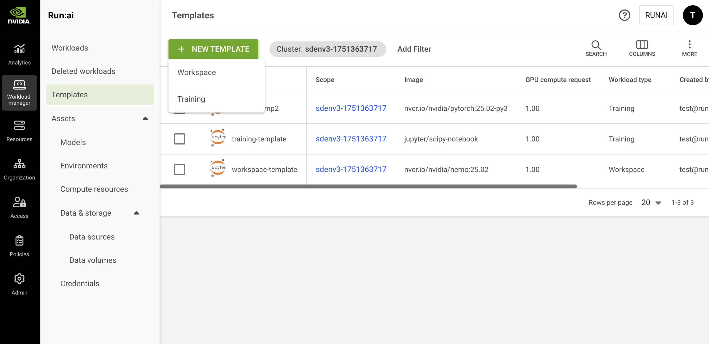

# Workload Templates

A workload template is a reusable setup that defines all the required configuration fields for submitting a workload. Templates simplify the submission process by allowing users to predefine settings. Researchers can quickly submit workloads using a saved template or adjust the values before submission as needed.

<Note>

**Note**

* Flexible workload templates is enabled by default and applies only to flexible workload submission (enabled by default). If unavailable, contact your administrator to enable it under **General settings** → Workloads → Flexible workload templates.
* Templates (legacy) is deprecated and will be removed in a future release. See [Workspace Templates (Legacy)](workspace-templates/workspace-templates-legacy.md) for more details.

</Note>

## Templates Table

The Templates table can be found under **Workload manager** in the NVIDIA Run:ai User Interface.

The Templates table provides a list of all the templates defined in the platform, and allows you to manage them.

<figure><figcaption></figcaption></figure>

The Templates table consists of the following columns:

| Column                | Description                                                                                                                                                                                                                        |
| --------------------- | ---------------------------------------------------------------------------------------------------------------------------------------------------------------------------------------------------------------------------------- |
| Template              | The name of the template                                                                                                                                                                                                           |
| Description           | A description of the template                                                                                                                                                                                                      |
| Scope                 | The scope to which the subject has access. Click the name of the scope to see the scope and its subordinates                                                                                                                       |
| Image                 | The application or service to be run by the workload                                                                                                                                                                               |
| GPU compute request   | The amount of GPU devices requested                                                                                                                                                                                                |
| Workload type         | The workload types that can use the template (workspace/ standard training/ distributed training)                                                                                                                                  |
| Workload architecture | 
Standard or distributed training:
<ul><li>Standard - A single-process workload that runs on a single node</li><li>Distributed - A multi-process workload where processes coordinate across nodes (e.g., using MPI)</li></ul> |
| Created by            | The subject that created the template                                                                                                                                                                                              |
| Creation time         | The timestamp for when the template was created                                                                                                                                                                                    |
| Last updated          | The timestamp of when the template was last updated                                                                                                                                                                                |
| Cluster               | The cluster name containing the template                                                                                                                                                                                           |

### Customizing the Table View

* Filter - Click ADD FILTER, select the column to filter by, and enter the filter values
* Search - Click SEARCH and type the value to search by
* Sort - Click each column header to sort by
* Column selection - Click COLUMNS and select the columns to display in the table
* Download table - Click MORE and then click Download as CSV. Export to CSV is limited to 20,000 rows.
* Refresh (optional) - Click REFRESH to update the table with the latest data
* Show/Hide details (optional) - Click to view additional information on the selected row

## Templates Created by NVIDIA Run:ai 

When installing NVIDIA Run:ai, you automatically get the templates created by NVIDIA Run:ai to ease up the onboarding process and support different use cases out of the box. These templates are created at the [scope](../workload-assets/overview.md#asset-scope) of the account.

| Template | Image | Description |
| --- | --- | --- |
| bio-nemo-four-gpus | `nvcr.io/nvidia/clara/bionemo-framework:2.6.3` | This template is designed for training workloads using NVIDIA’s BioNeMo framework. It runs the `nvcr.io/nvidia/clara/bionemo-framework:2.6.3` image and requests 4 GPUs, making it suitable for large-scale biomolecular modeling tasks. |
| jupyter-lab-one-gpu | `jupyter/scipy-notebook` | This template provides a preemptible workspace environment based on the JupyterLab SciPy notebook image (`jupyter/scipy-notebook`). It is configured to run with 1 GPU, giving users an interactive environment for experimentation and development. |
| nemo-four-gpus | `nvcr.io/nvidia/nemo:25.07` | A training template for NVIDIA NeMo, a framework for training and deploying LLMs and generative AI. It uses the `nvcr.io/nvidia/nemo:25.07` image with 4 GPUs, making it suitable for advanced AI model development. |
| pytorch-one-gpu | `nvcr.io/nvidia/pytorch:25.06-py3` | This template supports training workloads using PyTorch. It runs the `nvcr.io/nvidia/pytorch:25.06-py3` image and requests 1 GPU, making it well-suited for single-GPU model development and testing. |

## Adding a New Template

To create a new template:

1. Click **+NEW TEMPLATE**
2. Select a workload type - Follow the links below to view the step-by-step guide for each workload type:
   * [Workspace](workspace-templates/README.md) - Used for data preparation and model-building tasks.
   * [Training](../using-training/train-models.md) - Used for standard training or distributed training tasks of all sorts
   * [Inference](inference-templates/nvidia-nim-inference-templates.md) - Used for inference and serving tasks
3. Click **CREATE TEMPLATE**

## Editing a Template

To edit an existing template:

1. Select the template you want to update
2. Click **EDIT**
3. Edit the template and click **SAVE TEMPLATE**

## Copying a Template

To copy an existing template:

1. Select the template you want to copy
2. Click **MAKE A COPY**
3. Enter a **name** for the template. The name must be unique.
4. Update the template and click **CREATE TEMPLATE**

## Deleting a Template

To delete a template:

1. Select the template you want to delete
2. Click **DELETE**
3. Confirm you want to delete the template

## Migrating Legacy Templates

If you previously created templates before the introduction of flexible workload templates, these templates are automatically migrated. Your legacy templates will appear in the new grid and will be separated by workload type - **Workspace** and **Training**.

<Note>

**Note**

You will not lose your existing templates. All legacy templates remain available and can be viewed by toggling **Flexible workload templates** off. Contact your administrator to disable it under **General settings** → Workloads → Flexible workload templates.

</Note>

## Using APIs

Go to the [Workload templates](api:main-api:GET/api/v1/workload-templates) API reference to view the available actions.
