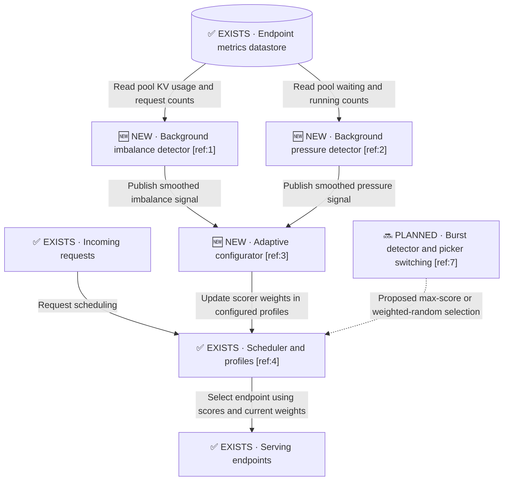

# Nir already working in progress

**In-progress implementation: [Nir’s adaptive-with-pressure branch](https://github.com/nirrozenbaum/gateway-api-inference-extension/tree/adaptive-with-pressure).**

## TL;DR (the whole thing in 3 lines)

- Nir Rozenbaum and Maroon Ayoub proposed adaptive inference routing and report implementing and benchmarking background imbalance detection with dynamic scorer weights.
- We found the code in Nir's GAIE fork: `adaptive-routing`, followed by `adaptive-with-pressure`; some supporting changes already merged upstream.
- Nir's code changes scorer weights in background cycles. The extended branch also measures pressure, although its effect on weights is neutral with the runner defaults.

Snapshot: **5 October 2026**. This note consolidates the supplied document, Nir's message and diagram, and read-only GitHub inspection. It is a research note, not shipped-product documentation or a completed code review.

## Evidence and background

| Evidence | What it establishes | Limits |
|---|---|---|
| Nir's supplied message | Nir says he had proposed the idea, implemented parts, and presented it at KubeCon EU in Amsterdam. He says the GAIE-to-llm-d transition discouraged further integration, the complete work did not enter main, and it is being evaluated in Dynamo. | Reported by Nir; the talk, migration history, and Dynamo evaluation were not independently verified. |
| [Inference Gateway - Adaptive Routing](https://docs.google.com/document/d/1NFfIz-BdUUOJrfErD2pfCizgncsWOYgFak8Z_HaP7e4/edit) | Authors: Nir Rozenbaum and Maroon Ayoub; contributor: Kellen Swain; document date: 4 March 2026. Describes the design and reports initial benchmarks. | The Google Doc could not be fetched directly. Analysis used the supplied document text; charts were absent from that text. |
| Supplied architecture diagram | Background detectors feed an adaptive configurator that updates scheduler configuration; request routing continues through the scheduler. | The diagram does not by itself establish implementation completeness. |
| Nir's public fork and source files | Concrete detector and weight-adaptation code exists. | No build, tests, deployment, or benchmark reproduction was performed in this investigation. |
| Upstream issues and PRs | Public design discussion and merged prerequisite changes exist. | Prerequisite merges do not establish that the whole adaptive controller shipped. |

## Where the implementation lives

Repository: [nirrozenbaum/gateway-api-inference-extension](https://github.com/nirrozenbaum/gateway-api-inference-extension).

| Branch | Verified revision | Contents |
|---|---|---|
| [adaptive-routing](https://github.com/nirrozenbaum/gateway-api-inference-extension/tree/adaptive-routing) | `0e7ca5e3d0ede4f9b7acbaed2ebcc28d0c6bf545` | Imbalance detector and adaptive configurator files. |
| [adaptive-with-pressure](https://github.com/nirrozenbaum/gateway-api-inference-extension/tree/adaptive-with-pressure) | `6c0f8d8496b56d68c30369520f3c4477adf8cd42` | Adds pressure detection, observability, and experimental deployment/benchmark files. |

The [branch comparison](https://github.com/nirrozenbaum/gateway-api-inference-extension/compare/adaptive-routing...adaptive-with-pressure) showed the pressure branch **4 commits ahead and 0 behind** the base branch. The additional commits were:

| Commit | Message |
|---|---|
| `849ed2b92ed39e4aceb33f91e20983eced57a2d7` | adaptive with pressure detector |
| `f8f5f1321d0a7fabf51cf895451dddec909bedc2` | add metrics |
| `a0cc98d321b7656226bed46696e250163074cfe7` | more updates |
| `6c0f8d8496b56d68c30369520f3c4477adf8cd42` | metrics |

The detailed code observations below refer to the pressure branch at the pinned revision. The presence of files on the base branch was verified, but its complete implementation was not separately reviewed.

## Architecture and intended behavior



The adaptive computation runs periodically alongside request handling. Rectangles represent components or actors; the cylinder represents stored metrics. ✅ EXISTS means baseline machinery; 🆕 NEW means added by Nir's experimental work, not necessarily merged upstream; 🔜 PLANNED means described but not established as implemented.

**Pseudocode**

```text
1. Periodically read metrics for endpoints in the pool.
2. Measure uneven load and the fraction of requests waiting.
3. Smooth each measurement using its previous value.
4. Calculate the desired distribution and affinity weight budgets.
5. Update scorer weights proportionally within each category.
6. Let requests use the profiles with their current weights.
```

The document's stated goals are deterministic and explainable adaptation, no added per-request adaptive computation, and no changes to the request execution path. These are design goals; they are not proof of zero runtime cost. Per-request adaptation and ML-based or predictive scheduling are explicitly outside the initial design.

## Verified behavior in the pressure branch

### Imbalance detection

The [imbalance detector][imbalance] reads all pods returned by the datastore using `AllPodsPredicate`. It is pool-scoped rather than scoped to the candidates of a particular request.

- Inputs are KV-cache utilization and assigned requests, where assigned requests are **running plus waiting** requests.
- Zero or one endpoint produces a zero imbalance signal.
- Fewer than **5 total assigned requests** produces a zero signal to suppress low-traffic noise.
- It computes normalized coefficients of variation for KV utilization and assigned requests, then takes the **minimum** of those two values as the raw signal.
- The coefficient calculation uses `stat.MeanVariance`; the normalization divides by `sqrt(N - 1)` and caps the result at 1. This records the implementation, not an independent validation of its statistical properties.
- Each cycle stores **0.1 × previous signal + 0.9 × new signal**. Signal access is protected by a read/write mutex.

Taking the minimum means the actual implementation is more specific than the document's broad description: uneven queue/request counts alone do not guarantee a strong imbalance signal if KV utilization remains even.

### Pressure detection

The [pressure detector][pressure] reads waiting and running request counts across the same datastore population.

Its raw signal is:

`total waiting / (total waiting + total running)`

It returns zero below the same 5-request minimum and uses the same smoothing. This measures the queued fraction, not mean queue depth or hardware capacity.

### Weight adaptation

The [adaptive configurator][configurator] groups scorers into **Distribution** and **Affinity**, preserving the original weight proportions within each category.

| Quantity | Implementation |
|---|---|
| Imbalance mapping | Logistic sigmoid with configurable midpoint and steepness |
| Pressure-adjusted maximum | `distributionMax - pressure × (distributionMax - conservativeMax)` |
| Distribution budget | `distributionMin + sigmoid(imbalance) × (pressureAdjustedMax - distributionMin)` |
| Affinity budget | `1 - distributionBudget` |
| Individual scorer weight | Original scorer weight multiplied by its category budget divided by the category's original weight sum |

The configurator iterates over the configured profiles and calls `UpdateScorersWeights`. Its constructor initially applies the minimum distribution budget. Subsequent cycles apply the sigmoid calculation; a zero imbalance signal does not make a logistic sigmoid exactly zero.

**Pressure behavior:** when `conservativeMax` is lower than `distributionMax`, increasing pressure reduces the upper distribution budget and preserves more affinity. However, the inspected runner defaults make both maxima **1**, so pressure has **no effect on weights under those defaults**. Whether Nir's benchmark deployments overrode that setting remains unverified.

### Wiring and configuration

The [runner][runner] creates the imbalance detector, pressure detector, and configurator as manager runnables, using the metrics refresh interval for all three. They run separately; their samples are not established here as an atomic snapshot from one coordinated cycle.

| Environment variable | Runner default |
|---|---|
| `ENABLE_EXPERIMENTAL_ADAPTIVE_CONFIGURATOR` | `false` |
| `ADAPTIVE_CONFIGURATOR_DISTRIBUTION_MIN_WEIGHT` | `0.2` |
| `ADAPTIVE_CONFIGURATOR_DISTRIBUTION_MAX_WEIGHT` | `1` |
| `ADAPTIVE_CONFIGURATOR_CONSERVATIVE_MAX_WEIGHT` | `1` |
| `ADAPTIVE_CONFIGURATOR_SIGMOID_S0` | `0.6` |
| `ADAPTIVE_CONFIGURATOR_SIGMOID_K` | `6` |

These are experimental branch settings, not verified current llm-d or Dynamo product settings. Some nearby runner comments describe different values; the table follows the actual constants.

### What remains experimental

| Area | Evidence and limitation |
|---|---|
| Configuration validation | The inspected [configuration constructor][configuration] contains a TODO for validating invariants. |
| Endpoint access | Detector source explicitly calls datastore access temporary and anticipates a data-layer endpoint source. |
| Metric freshness | The inspected detector calculation functions do not explicitly check metric timestamps. End-to-end stale-data handling was not traced. |
| Stability controls | Smoothing is implemented in the inspected detectors. The document discusses dwell time and hysteresis, but those mechanisms were not found in these detector/configurator functions. |
| Burst detection | The document says it was not implemented at the time of the reported benchmarks. No burst-named implementation file appeared in the inspected branch trees. |
| Picker switching | Planned in the document; the inspected adaptive configurator updates weights, not pickers. |
| Tests and runtime | Source was read only. Test coverage, build success, synchronization details, and deployment readiness have not been comprehensively assessed. |

## Upstream discussion and merged prerequisites

| Reference | Verified relevance |
|---|---|
| [GAIE issue #1992](https://github.com/kubernetes-sigs/gateway-api-inference-extension/issues/1992) | Proposes dynamic adaptation of active scorers and/or weights to balance cache locality against load distribution. |
| [GAIE PR #2119](https://github.com/kubernetes-sigs/gateway-api-inference-extension/pull/2119) | Merged. Adds scorer preference categories for affinity versus distribution; explicitly described as a prerequisite for adaptive weights. |
| [GAIE PR #2207](https://github.com/kubernetes-sigs/gateway-api-inference-extension/pull/2207) | Merged. Changes scorer weight type from integer to floating point; explicitly linked to adaptive configuration and issue #1992. |

Issue #1992 also contains discussion of alternative approaches: multi-armed bandits, or selecting groups of distributing versus concentrating scorers instead of adjusting each scorer's weight. It links to [llm-d issue #298](https://github.com/llm-d/llm-d-inference-scheduler/issues/298) for additional context; that issue was not read in this investigation.

Nir's statement that the complete work did not land in main is consistent with finding experimental branches and merged prerequisites. We have not established a complete history of all subsequent upstream integration.

## Benchmarks and presentation claims

These are **reported results from Nir's document**, not independently reproduced results.

| Experiment | Reported setup or result | Evidence limit |
|---|---|---|
| Hotspot workload | GuideLLM; 8 A100 GPUs; 8 endpoints, each serving a Llama 8B model on one GPU. Create a hotspot and increase concurrent requests. Reports substantial improvement over static default weights. | Pasted text did not include charts, exact result values, complete settings, or raw measurements. |
| llm-d intelligent-routing benchmark | Uses the [llm-d benchmark guide configuration](https://github.com/llm-d/llm-d/blob/main/guides/benchmark/inference_scheduling_guide_template.yaml). Reports similar or slightly improved performance relative to default EPP. | Referenced benchmark configuration was not independently inspected and results were not reproduced. |
| Weighted-random picker under bursts | Document cites approximately 80% improvement from llm-d benchmarking. | The performance metric and full conditions are not provided in the pasted text. This is separate from Nir's implemented imbalance/weight-adaptation benchmarks. |
| KubeCon presentation | Nir says he presented the work at KubeCon EU in Amsterdam; the supplied image is branded KubeCon + CloudNativeCon Europe 2026. | Recording, talk title, and complete slides were not located. |

The document says initial benchmarks used imbalance detection and adaptive weights, with burst detection and picker adaptation not yet implemented. It does not establish that the later pressure branch or its current defaults produced those results.

## Dynamo connection

Nir says the work is being evaluated in Dynamo. The precise evaluation branch, owners, and results remain unknown.

Search also found [Dynamo PR #14596](https://github.com/ai-dynamo/dynamo/pull/14596), authored by `ishandhanani`, open when inspected. Its description proposes adaptive cache/load weights using an imbalance sigmoid and a pressure constraint. It updates inside an existing picker at most once per 100 ms and explicitly says it has no background detectors. The PR reports no GPU or end-to-end serving benchmark.

This is a **related lead, not a verified port or continuation of Nir's work**. Its architecture differs, and no provenance link to Nir was established. The search also found the closed [PR #14531](https://github.com/ai-dynamo/dynamo/pull/14531), titled “feat(router): add adaptive worker-selection policy example”; its implementation was not inspected.

## Open items

This is the single list of remaining investigation questions.

1. Confirm with Nir which branch and commit he considers the latest, and which revision/configuration produced each benchmark.
2. Obtain benchmark charts, raw results, traffic definitions, and exact parameter settings, especially the pressure cap.
3. Identify the actual Dynamo evaluation branch and establish whether PR #14596 is related.
4. Review tests, metric freshness, configuration validation, synchronization, and endpoint eligibility before proposing reuse.
5. Confirm whether dwell time, hysteresis, burst detection, or picker switching exists in another branch or later implementation.
6. Check compatibility with current llm-d interfaces and whether newer upstream work supersedes these branches.
7. Locate the presentation recording or slides if further design context is needed.

## Code references

These links are pinned to the inspected pressure-branch revision so later branch updates do not silently change the evidence.

| Ref | Location | Purpose |
|---|---|---|
| 1 | [imbalance_detector.go][imbalance] | Pool imbalance computation and signal smoothing |
| 2 | [pressure_detector.go][pressure] | Queued-fraction computation and signal smoothing |
| 3 | [adaptive_configurator.go][configurator] | Category budgets, sigmoid policy, and weight updates |
| 4 | [runner.go][runner] | Enable flag, defaults, and background-component registration |
| 5 | [adaptive_configurator_config.go][configuration] | Configuration fields and validation TODO |
| 6 | [consts.go][constants] | Minimum-request gate and smoothing coefficient |
| 7 | [Original design document](https://docs.google.com/document/d/1NFfIz-BdUUOJrfErD2pfCizgncsWOYgFak8Z_HaP7e4/edit) | Planned burst detector and picker adaptation; read through the supplied document text |

The branch also contains `adaptive_configurator_profile_data.go` and `hack/adaptive-metrics.sh`; their presence was verified, but they were not read in detail. The branch comparison includes GuideLLM and deployment manifests, which were not executed or reviewed as a reproducible benchmark setup.

## 🔧 If you only do one thing

Start with the pinned [adaptive-with-pressure implementation](https://github.com/nirrozenbaum/gateway-api-inference-extension/tree/6c0f8d8496b56d68c30369520f3c4477adf8cd42), then confirm with Nir which benchmark configuration belongs to it.

## 🧠 Remember it as

Background detectors measure pool conditions; the configurator periodically retunes routing weights.

[imbalance]: https://github.com/nirrozenbaum/gateway-api-inference-extension/blob/6c0f8d8496b56d68c30369520f3c4477adf8cd42/pkg/epp/asyncdetector/imbalance_detector.go
[pressure]: https://github.com/nirrozenbaum/gateway-api-inference-extension/blob/6c0f8d8496b56d68c30369520f3c4477adf8cd42/pkg/epp/asyncdetector/pressure_detector.go
[configurator]: https://github.com/nirrozenbaum/gateway-api-inference-extension/blob/6c0f8d8496b56d68c30369520f3c4477adf8cd42/pkg/epp/scheduling/adaptive_configurator.go
[runner]: https://github.com/nirrozenbaum/gateway-api-inference-extension/blob/6c0f8d8496b56d68c30369520f3c4477adf8cd42/cmd/epp/runner/runner.go
[configuration]: https://github.com/nirrozenbaum/gateway-api-inference-extension/blob/6c0f8d8496b56d68c30369520f3c4477adf8cd42/pkg/epp/scheduling/adaptive_configurator_config.go
[constants]: https://github.com/nirrozenbaum/gateway-api-inference-extension/blob/6c0f8d8496b56d68c30369520f3c4477adf8cd42/pkg/epp/asyncdetector/consts.go
