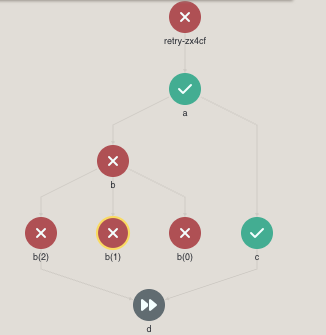
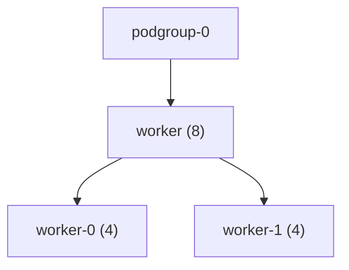
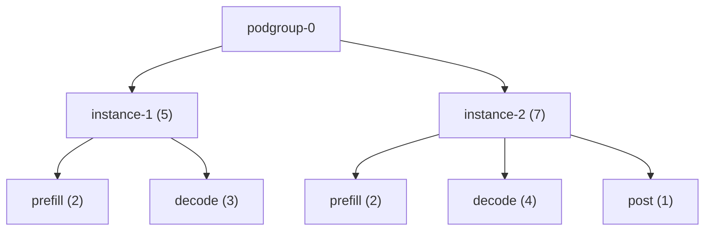
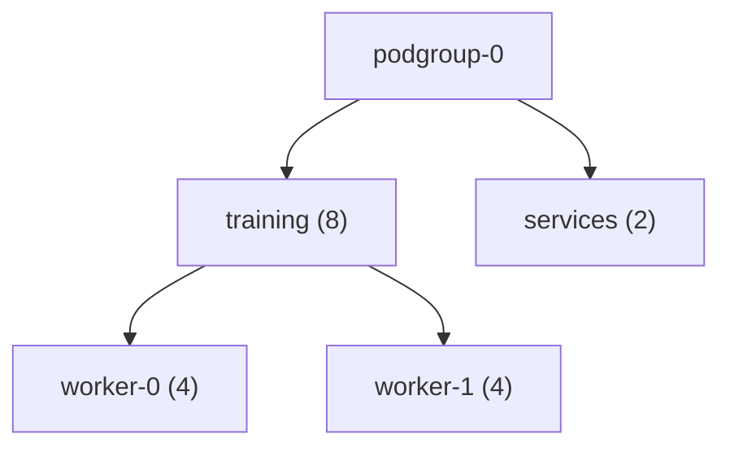
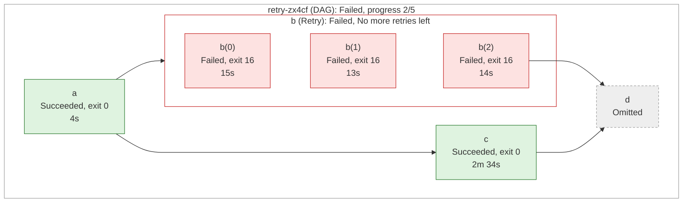
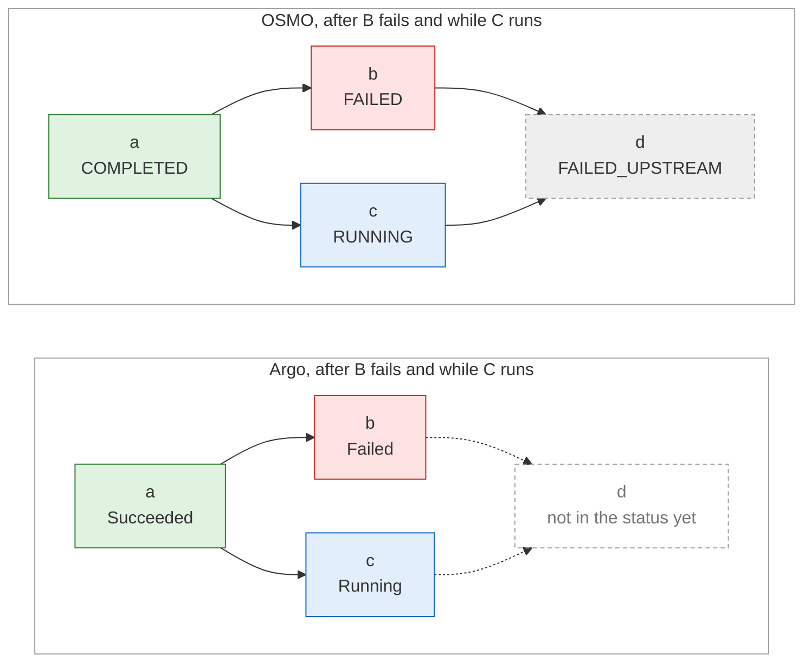

# OSMO to Run:ai Workflows

[TOC]

## Overview

OSMO is NVIDIA's workflow orchestration platform for Physical AI. It can run on the same cluster as Run:ai and schedule workflow tasks with Run:ai's KAI scheduler. In that setup, Run:ai remains the owner of projects and quotas (see [OSMO and Run:ai Side by Side](https://docs.google.com/document/d/1oQBrlSJcxpsUyZzkPRkL5Gz_mjLB4F6PtnKJT9bDoQc/edit?tab=t.0#heading=h.g9sqg78htdgt)).

Run:ai has no native workflow type. Users can submit an Argo Workflow through Run:ai's any-workload submission today, but then:
- they have to write raw Argo YAML by hand, and be responsible for creating the PodGroups, Services and other resources the workflow needs;
- Run:ai sees the whole workflow as one workload, so per-task status, logs and failures are visible only in the Argo UI or with kubectl.

We would like to use OSMO as the reference for what a workflow system must support. Its capabilities would become our requirements checklist, even if we don't adopt its spec language or use its tools.

The OSMO team's evaluation ([Absorbing OSMO Into Run:ai](https://docs.google.com/document/d/1oQBrlSJcxpsUyZzkPRkL5Gz_mjLB4F6PtnKJT9bDoQc/edit?tab=t.8t99d897yg89#heading=h.a4dh5zaqtypm)) concluded that ***OSMO workflows can be expressed as Argo Workflows***. This document builds on that conclusion and lays out the technical path: a native Run:ai `workflow` workload type that Run:ai should translate into one Argo Workflow.

This document focuses on four areas:

1. ***Workflow submission API***: A native API for submitting workflows. The API should resemble the other native submission APIs, but tailored to what is specific to workflows: groups of tasks, dependencies between groups, and data passed between tasks.
2. ***Workflow status***: Per-task and workflow progress and status tracking. Workflow tracking should be integrated with the existing workloads info API. Per-task status can be a sub-resource of this API.
3. ***PodGroup management***: Needed for groups of tasks that must be gang-scheduled (all tasks start together, or none do), as discussed in [PodGroup Management](#podgroup-management).
4. ***Workflow operations***: Restarting and canceling a workflow, and keeping its logs after it ends, as discussed in [Workflow Operations](#workflow-operations).


## References

| Document/Artifact            | URL                                                          |
| ---------------------------- | ------------------------------------------------------------ |
| OSMO Repository              | https://github.com/NVIDIA/OSMO                               |
| OSMO and Run:ai Side by Side | https://docs.google.com/document/d/1oQBrlSJcxpsUyZzkPRkL5Gz_mjLB4F6PtnKJT9bDoQc/edit?tab=t.0#heading=h.g9sqg78htdgt |
| Absorbing OSMO Into Run:ai   | https://docs.google.com/document/d/1oQBrlSJcxpsUyZzkPRkL5Gz_mjLB4F6PtnKJT9bDoQc/edit?tab=t.8t99d897yg89#heading=h.a4dh5zaqtypm |
| Argo Workflow Spec reference | https://argo-workflows.readthedocs.io/en/release-4.1/fields/#workflowspec |

## Workflow Submission API

### Metadata

The workload metadata remains the same as for the other native workload types:

```yaml
# POST /api/v1/workflows
name: wf
useGivenNameAsPrefix: true
projectId: "4500001"
clusterId: "{{clusterId}}"
```

### Spec Structure

The existing native workload types have a fixed spec: most fields sit in one flat list, and only compute, security and storage are sub-sections. The distributed types have more than one spec: distributed training has one for the master and one for the workers, and distributed inference has one for the leader and one for the workers.

The workflow spec has two major changes:

* It contains a dynamic set of tasks, divided into one or more groups. Dependencies are declared between groups.
* Some elements, such as compute and storage, are shared between tasks. To avoid repeating them, they are declared once next to the groups, and tasks reference them by name.

The overall structure is:

```yaml
spec:
  groups:
  - name: group-a
    tasks:
    - name: task-a1
      computeRef: one-gpu
      storageRef:
      - name: pvc-a
        type: pvc
        mountPath: /usr/data
      ...
    - name: task-a2
      computeRef: cpu-only
      ...
  - name: group-b
    dependsOn: [group-a]
    tasks:
    - name: task-b1
      ...
  compute:
  - name: one-gpu
    ...
  - name: cpu-only
    ...
  storage:
    pvc:
    - name: pvc-a
      ...
    - name: pvc-b
      ...
    s3:
    - name: s3-a
      ...
```

### Spec Examples

#### Single Task

In this example there is a single task. The example is not practical, as a single task can run as a workspace or training workload, but it demonstrates the minimal possible workflow.

***OSMO Workflow***

```yaml
workflow:
  name: hello-osmo
  tasks:
  - name: hello
    image: ubuntu:24.04
    command: ["echo"]
    args: ["Hello OSMO!"]
  resources:
    default:
      cpu: 1
      memory: 1Gi
```

***Run:ai Workflow***

Note that group is mandatory even if there is only a single group. This is needed not only for simplicity of the definition but also to comply with policy and other Run:ai mechanisms that expect relatively rigid spec structure.

```yaml
spec:
  groups:
  - name: hello
    tasks:
    - image: ubuntu:24.04  # in single task group, the task name can be taken from the group name by default.
      command: echo
      args: "Hello OSMO!"
      computeRef: default  # can be omitted if we decide "default" is the default profile
  compute:
  - name: default
    cpuCoreRequest: 1
    cpuCoreLimit: 1
    cpuMemoryRequest: 1Gi
    cpuMemoryLimit: 1Gi
```

***Argo Workflow***

```yaml
spec:
  entrypoint: main
  templates:
  - name: main                   # spec.groups
    dag:
      tasks:
      - name: hello
        template: hello
  - name: hello                  # groups[hello].tasks[hello]
    container:
      image: ubuntu:24.04
      command: [echo]
      args: ["Hello OSMO!"]
      resources:                 # computeRef: default
        requests: {cpu: "1", memory: 1Gi}
        limits:   {cpu: "1", memory: 1Gi}
```

Note that in Argo, each task's template carries its own copy of the resources, so a profile shared by ten tasks appears ten times in the Workflow. The Run:ai form defines the profile once (in the compute section) and the tasks reference it by name. This is one of the benefits of a native Run:ai workflow over writing Argo YAML.

#### Sequence of Two Tasks

In this example there are two tasks, A and B, where B depends on A.

***OSMO Workflow***

```yaml
workflow:
  name: order-only
  resources:
    default:
      ...
  tasks:
  - name: a
    image: ubuntu:24.04
    command: [echo]
    args: ["Hello from task a!"]
  - name: b
    image: ubuntu:24.04
    command: [echo]
    args: ["Hello from task b!"]
    inputs:
    - task: a
```

***Run:ai Workflow***

```yaml
spec:
  groups:
  - name: a
    tasks:
    - image: ubuntu:24.04
      command: echo
      args: "Hello from task a!"
  - name: b
    dependsOn: [a]
    tasks:
    - image: ubuntu:24.04
      command: echo
      args: "Hello from task b!"
  compute:
  - name: default
    ...
```

***Argo Workflow***

```yaml
spec:
  entrypoint: main
  templates:
  - name: main
    dag:
      tasks:
      - name: a
        template: echo-a
      - name: b
        template: echo-b
        dependencies: [a]
  - name: echo-a
    container:
      image: ubuntu:24.04
      command: [echo]
      args: ["Hello from task a!"]
  - name: echo-b
    container:
      image: ubuntu:24.04
      command: [echo]
      args: ["Hello from task b!"]
```

#### Input/Output Chain

In this example task A writes into a file that will be used by task B. Task B creates an output file as well.

***OSMO Workflow***

```yaml
workflow:
  name: handoff
  tasks:
  - name: a
    image: ubuntu:24.04
    command: [bash, -c]
    args: ["echo 'Hello from task A' > {{output}}/hello.txt"]
  - name: b
    image: ubuntu:24.04
    command: [bash, -c]
    args: ["echo 'This is what A said:'; cat {{input:0}}/hello.txt; echo 'Goodbye from task B' > {{output}}/goodbye.txt"]
    inputs:
    - task: a
```

The interesting thing here is that OSMO automatically uploads each task's output folder to its workflow data store, which in the quick-start is a LocalStack S3 instance:

```bash
$ kubectl get pods -n osmo | grep s3
localstack-s3-59cd94cfdb-g2gtl                1/1     Running   0               23h
```

OSMO CLI has option to list/download the files:

```bash
$ osmo data list s3://osmo/workflows/handoff-1/ --recursive --no-pager
workflows/handoff-1/a/hello.txt
workflows/handoff-1/b/goodbye.txt
...
```

Using AWS CLI to show the content of the files:

```bash
$ kubectl -n osmo port-forward service/localstack-s3 4566:4566
$ export AWS_ACCESS_KEY_ID=test AWS_SECRET_ACCESS_KEY=test AWS_DEFAULT_REGION=us-east-1
$ aws --endpoint-url http://127.0.0.1:4566 s3 cp s3://osmo/workflows/handoff-1/a/hello.txt -
Hello from task A
$ aws --endpoint-url http://127.0.0.1:4566 s3 cp s3://osmo/workflows/handoff-1/b/goodbye.txt -
Goodbye from task B
```

##### *Run:ai Supported Storage*

In Run:ai, sharing data between tasks is not limited to S3: NFS and PVC (based on access mode) also qualify.

Additionally, non-sharable storage can be supported to serve a task's own use, such as code, configuration, credentials and scratch space.

The following table summarizes the supported datasources. For S3, there are two options, discussed in [S3 Through goofys](#s3-through-goofys) and [S3 by Copy](#s3-by-copy).

| Storage type | Can be used for inter-task data sharing | Argo translation                                             | Per-workflow directory                                       |
| ------------ | --------------------------------------- | ------------------------------------------------------------ | ------------------------------------------------------------ |
| S3 (goofys)  | Yes                                     | `emptyDir` volume and a goofys sidecar                       | goofys mounts `<bucket>:{{workflow.name}}`                   |
| S3 (copy)    | Yes                                     | Argo S3 input artifact, downloaded before the task starts, and output artifact, uploaded after it ends | A directory per task, `{{workflow.name}}/<task>/`, in the artifacts' keys |
| NFS          | Yes                                     | `nfs` volume                                                 | `subPath: "{{workflow.name}}"` on each mount                 |
| PVC          | Yes, limited by the access mode (below) | `persistentVolumeClaim` volume, or `volumeClaimTemplates` for a new PVC per workflow | A new PVC per workflow, or `subPath` on an existing PVC      |
| Host path    | No, the directory is on the node.       | `hostPath` volume                                            | -                                                            |
| Data volume  | No, mounted read-only                   | `persistentVolumeClaim` volume, read-only                    | -                                                            |
| EmptyDir     | No, deleted with the pod                | `emptyDir` volume                                            | -                                                            |
| Git          | No, each task clones its own copy       | Argo git input artifact                                      | -                                                            |
| ConfigMap    | No, mounted read-only                   | `configMap` volume                                           | -                                                            |
| Secret       | No, mounted read-only                   | `secret` volume                                              | -                                                            |

*I checked each translation on an EKS cluster running Argo v4.1, except NFS (no NFS server was available), data volumes (a PVC underneath) and S3 by copy.*

##### *S3 Through goofys*

***Run:ai Workflow***

Same as for Run:ai's existing native workloads, S3 storage is mounted as a file system with `goofys`. To emulate the OSMO behavior, multiple tasks need to mount the same S3 storage.

Note that the mounted path does not function as a full file system: a file is uploaded only when it is closed, and appending to a file or rewriting part of it isn't supported. 

```yaml
spec:
  groups:
  - name: a
    tasks:
    - image: ubuntu:24.04  # for single task we may allow to remove the task name and use the group name as the task name
      command: bash -c
      args: ["echo 'Hello from task A' > /mnt/data/hello.txt"]
      storageRef:
      - name: local-s3
        type: s3
        mountPath: /mnt/data
  - name: b
    dependsOn: [a]
    tasks:
    - image: ubuntu:24.04
      command: bash -c
      args: ["echo 'This is what A said:'; cat /mnt/data/hello.txt; echo 'Goodbye from task B' > /mnt/data/goodbye.txt"]
      storageRef:
      - name: local-s3
        type: s3
        mountPath: /mnt/data
  compute:
  - name: default
    ...
  storage:
    s3:
    - accessKeySecret: localstack-s3   # contains { AccessKeyId: test, SecretKey: test }
      bucket: osmo
      name: local-s3
      url: http://localstack-s3.osmo.svc.cluster.local:4566
      directorySeparation: perWorkflow # or none
```

The storage section in the top level of the spec should hold only sharable storage. Per-task storage should be defined as part of the task's own spec.

Note two suggested changes to the Run:ai API:

1. The mount path is typically a parameter of the `storage` section itself. We suggest allowing each task to specify its mount point. For backward compatibility, it will also be possible to specify a default mount point in the storage section, which each task can override in its `storageRef` section.
2. Directory separation per-workflow. Run:ai's S3 storage mounts the whole bucket, so in the example above both tasks write to the bucket's root, and can overwrite the files of another workflow. OSMO avoids this by giving each task its own folder (`workflows/<workflow-id>/<task>/`). We can add a `directorySeparation` parameter requesting a dedicated directory for the current workflow by utilizing `goofys` ability to mount sub-directory of a bucket (see Argo Workflow for concrete example). All tasks of a workflow share its directory, so avoiding file name clashes between tasks is the researcher's responsibility; a researcher who wants per-task separation can have each task write to its own sub-directory. Adding `directorySeparation: perTask` is also an option, but it makes things more complicated for one task reading files of another task, therefore it is not recommended.

***Argo Workflow***

```yaml
spec:
  entrypoint: main
  templates:
  - name: main
    dag:
      tasks:
      - name: a
        template: a
      - name: b
        template: b
        dependencies: [a]

  - name: a
    volumes:
    - name: local-s3
      emptyDir: {}
    initContainers:
    - name: s3-fs-local-s3                   # goofys sidecar
      image: <s3FileSystemImage>             # Run:ai cluster setting
      restartPolicy: Always                  # native sidecar: up before main, down after it
      securityContext: {privileged: true}
      command: [goofys, -f, -o, allow_other, --dir-mode, "0777", --file-mode, "0777",
                --endpoint, "http://localstack-s3.osmo.svc.cluster.local:4566",
                "osmo:{{workflow.name}}",    # directorySeparation: perWorkflow; "osmo" with none
                /mnt/data]
      env:
      - name: AWS_ACCESS_KEY_ID
        valueFrom: {secretKeyRef: {name: localstack-s3, key: AccessKeyId}}
      - name: AWS_SECRET_ACCESS_KEY
        valueFrom: {secretKeyRef: {name: localstack-s3, key: SecretKey}}
      volumeMounts:
      - {name: local-s3, mountPath: /mnt/data, mountPropagation: Bidirectional}
    container:
      image: ubuntu:24.04
      command: [bash, -c]
      args: ["echo 'Hello from task A' > /mnt/data/hello.txt"]
      volumeMounts:
      - {name: local-s3, mountPath: /mnt/data, mountPropagation: HostToContainer}

  - name: b
    volumes:
    - name: local-s3
      emptyDir: {}
    initContainers:
    - name: s3-fs-local-s3                   # same sidecar as in task a
      image: <s3FileSystemImage>
      restartPolicy: Always
      securityContext: {privileged: true}
      command: [goofys, -f, -o, allow_other, --dir-mode, "0777", --file-mode, "0777",
                --endpoint, "http://localstack-s3.osmo.svc.cluster.local:4566",
                "osmo:{{workflow.name}}", /mnt/data]
      env:
      - name: AWS_ACCESS_KEY_ID
        valueFrom: {secretKeyRef: {name: localstack-s3, key: AccessKeyId}}
      - name: AWS_SECRET_ACCESS_KEY
        valueFrom: {secretKeyRef: {name: localstack-s3, key: SecretKey}}
      volumeMounts:
      - {name: local-s3, mountPath: /mnt/data, mountPropagation: Bidirectional}
    container:
      image: ubuntu:24.04
      command: [bash, -c]
      args: ["echo 'This is what A said:'; cat /mnt/data/hello.txt; echo 'Goodbye from task B' > /mnt/data/goodbye.txt"]
      volumeMounts:
      - {name: local-s3, mountPath: /mnt/data, mountPropagation: HostToContainer}
```

In the Run:ai form, the bucket is declared once and each task mounts it in three lines. In Argo, every task carries its own copy of the sidecar, about 20 lines per mount.

The files are created in the workflow's folder in the S3 repository (`handoff-s3-qmf4c` is the workflow name):

```bash
$ aws --endpoint-url http://127.0.0.1:4566 s3 ls s3://osmo/handoff-s3-qmf4c/
2026-10-22 14:51:30         20 goodbye.txt
2026-10-22 14:50:43         18 hello.txt
$ aws --endpoint-url http://127.0.0.1:4566 s3 cp s3://osmo/handoff-s3-qmf4c/hello.txt -
Hello from task A
$ aws --endpoint-url http://127.0.0.1:4566 s3 cp s3://osmo/handoff-s3-qmf4c/goodbye.txt -
Goodbye from task B
```

##### *S3 by Copy*

Instead of a goofys mount, in the S3 by copy approach the task downloads data from S3 before the main container starts, and uploads its output artifact to S3 after the main container ends. This mimics OSMO's own model: OSMO downloads a task's inputs before it runs, and uploads its outputs after it ends.

Compared to goofys:

- There is no privileged sidecar, and the task works on a local file system, so appending to a file and rewriting part of it work.
- The task needs local disk for the data (`ephemeralStorageRequest`), the download delays the start of the main container, and outputs reach S3 only when the task ends.

There are two ways to express S3 by copy in the native spec: 

* One path for both the download and the upload, which needs a single new field.
* Two separate paths for downloads and uploads, which is more flexible and closer to OSMO. 

Our suggestion goes with separate paths, but note that the simpler one-path approach is also possible.

***Run:ai Workflow***

This is the [Input/Output Chain](#inputoutput-chain) example with copying instead of mounting. A goofys reference has only a `mountPath`, while a copy reference has `outputs` and `inputs`: `outputs` is the path that is uploaded after the task ends, and `inputs` lists what to download before the task starts. Each task uploads to its own directory, and each input names the task whose directory it downloads:

```yaml
spec:
  groups:
  - name: a
    tasks:
    - image: ubuntu:24.04
      command: bash -c
      args: ["echo 'Hello from task A' > /mnt/out/hello.txt"]
      storageRef:
      - name: local-s3
        type: s3
        outputs:                       # [new] uploaded after the task ends
          mountPath: /mnt/out          # uploaded to <workflow>/a/
  - name: b
    dependsOn: [a]
    tasks:
    - image: ubuntu:24.04
      command: bash -c
      args: ["echo 'This is what A said:'; cat /mnt/in/a/hello.txt; echo 'Goodbye from task B' > /mnt/out/goodbye.txt"]
      storageRef:
      - name: local-s3
        type: s3
        outputs:
          mountPath: /mnt/out          # uploaded to <workflow>/b/
        inputs:                        # [new] downloaded before the task starts
        - task: a                      # <workflow>/a/ under local-s3
          mountPath: /mnt/in/a
        - workflow: handoff-1          # an earlier workflow's output (default: this workflow)
          task: a                      # handoff-1/a/
          mountPath: /mnt/in/old-a
  compute:
  - name: default
    ...
  storage:
    s3:
    - accessKeySecret: localstack-s3   # contains { AccessKeyId: test, SecretKey: test }
      bucket: osmo
      name: local-s3
      url: http://localstack-s3.osmo.svc.cluster.local:4566
```

The storage item is the same as for goofys. The composer builds every key, so each task gets its own directory, `<workflow>/<task>/`, as in OSMO's `workflows/<workflow-id>/<task>/`. A task doesn't need to know where another task's files are, because its input names the task, and it reads an earlier workflow's outputs the same way, by naming that workflow. Naturally, there is also no need for the `directorySeparation` parameter in the spec.

***Argo Workflow***

Each of `inputs` becomes an S3 input artifact with the key of the task it names, and `outputs` becomes an S3 output artifact with the task's own key. The output path is an `emptyDir` volume, because Argo's docs say output artifacts should be on a volume. Argo gives input artifacts a volume of their own.

```yaml
spec:
  entrypoint: main
  templates:
  - name: main
    dag:
      tasks:
      - name: a
        template: a
      - name: b
        template: b
        dependencies: [a]

  - name: a
    volumes:
    - name: local-s3-out
      emptyDir: {}
    outputs:
      artifacts:
      - name: local-s3-out
        path: /mnt/out                                         # outputs.mountPath
        archive: {none: {}}                                    # store the files as they are, not as one .tgz
        s3:
          endpoint: localstack-s3.osmo.svc.cluster.local:4566  # url, without the scheme
          insecure: true                                       # url is http
          bucket: osmo
          key: "{{workflow.name}}/a/"                          # the task's own directory; must end with "/"
          accessKeySecret: {name: localstack-s3, key: AccessKeyId}
          secretKeySecret: {name: localstack-s3, key: SecretKey}
    container:
      image: ubuntu:24.04
      command: [bash, -c]
      args: ["echo 'Hello from task A' > /mnt/out/hello.txt"]
      volumeMounts:
      - {name: local-s3-out, mountPath: /mnt/out}

  - name: b
    volumes:
    - name: local-s3-out
      emptyDir: {}
    inputs:
      artifacts:
      - name: local-s3-a
        path: /mnt/in/a                                        # inputs[0].mountPath
        s3:
          # endpoint, insecure, bucket and credentials as in task a
          key: "{{workflow.name}}/a/"
      - name: local-s3-old-a
        path: /mnt/in/old-a
        s3:
          # endpoint, insecure, bucket and credentials as in task a
          key: "handoff-1/a/"
    outputs:
      artifacts:
      - name: local-s3-out
        path: /mnt/out
        archive: {none: {}}
        s3:
          # endpoint, insecure, bucket and credentials as in task a
          key: "{{workflow.name}}/b/"
    container:
      image: ubuntu:24.04
      command: [bash, -c]
      args: ["echo 'This is what A said:'; cat /mnt/in/a/hello.txt; echo 'Goodbye from task B' > /mnt/out/goodbye.txt"]
      volumeMounts:
      - {name: local-s3-out, mountPath: /mnt/out}
```

The fields of Run:ai's S3 storage and of the storage reference map to the artifacts' fields:

| Run:ai | Argo S3 artifact |
| --- | --- |
| `url` | `endpoint` without the scheme, and `insecure: true` for `http` |
| `bucket` | `bucket` |
| `accessKeySecret`, `secretKeyOfAccessKeyId`, `secretKeyOfSecretKey` | `accessKeySecret` and `secretKeySecret`, each with the Secret's name and key |
| `storageRef[].outputs.mountPath` | the output artifact's `path`, with the key `{{workflow.name}}/<task>/` |
| `storageRef[].inputs[].task`, `workflow` | the input artifact's key, `<workflow>/<task>/` |
| `storageRef[].inputs[].mountPath` | the input artifact's `path` |

This matches OSMO's `inputs` and its `{{input:N}}` and `{{output}}` paths. Argo's default artifact GC strategy is `Never`, so the files stay in S3 after the workflow ends, as they do with goofys.

Left for the design:

- Replicas and copies. The replicas of a task would upload to the same key and overwrite each other's files, so the key needs the replica's index, for example `<task>-<index>/`, and an input from a replicated task gets all of them.
- A task that writes nothing uploads nothing, so an input that names it finds no files. Whether such an input fails the task, or is `optional`, is to be decided and tested.
- Whether Argo uploads the outputs of a task that fails is to be tested.

##### *PVC*

***Run:ai Workflow***

The access mode decides which tasks can use it together:

- `readWriteMany` (for example EFS, or a storage class backed by NFS): tasks on any nodes read and write at the same time, as with NFS.
- `readWriteOnce` (for example EBS `gp2`): the volume is attached to one node at a time. Tasks that run one after another can share it, but a task that starts while a task on another node holds the volume waits until the volume is released. Zonal block storage adds another limit: every task that mounts the volume must run in the volume's availability zone.
- `readOnlyMany`: many nodes can mount it, but only for reading. It fits an input dataset, not task outputs.

If the workflow asks Run:ai to create the PVC (`existingPvc: false` without a `claimName`), each run will get its own claim, so no directory separation will be needed. With `ephemeral: true` the claim will be deleted when the workflow ends, which fits intermediate files that only the next task needs. The composer should translate this to Argo's `volumeClaimTemplates`, and set `spec.volumeClaimGC.strategy: OnWorkflowCompletion`, so that Argo deletes the claim when the workflow ends, whether it succeeded or failed. Argo's default, `OnWorkflowSuccess`, keeps the claims of a failed workflow until the Workflow itself is deleted. `volumeClaimGC` applies to every claim created from `volumeClaimTemplates` and to nothing else, so only ephemeral claims should be created that way. Existing claims, mounted as `persistentVolumeClaim` volumes, aren't affected.

```yaml
spec:
  groups:
    # no change, except for storage name and type
  compute:
    # no change
  storage:
    pvc:
    - name: results
      existingPvc: true
      claimName: handoff-results
      directorySeparation: perWorkflow # or none
```

***Argo Workflow***

```yaml
spec:
  entrypoint: main
  volumes:
  - name: results
    persistentVolumeClaim:
      claimName: handoff-results
  templates:
  - name: main
    dag:
      tasks:
      - name: a
        template: a
      - name: b
        template: b
        dependencies: [a]

  - name: a
    container:
      image: ubuntu:24.04
      command: [bash, -c]
      args: ["echo 'Hello from task A' > /mnt/data/hello.txt"]
      volumeMounts:
      - name: results
        mountPath: /mnt/data
        subPath: "{{workflow.name}}"

  - name: b
    container:
      image: ubuntu:24.04
      command: [bash, -c]
      args: ["echo 'This is what A said:'; cat /mnt/data/hello.txt; echo 'Goodbye from task B' > /mnt/data/goodbye.txt"]
      volumeMounts:
      - name: results
        mountPath: /mnt/data
        subPath: "{{workflow.name}}"
```

Unlike S3, an existing PVC is declared once in Argo too (`spec.volumes`), and each template adds only a mount with the `subPath`.

Each run writes to its own folder in the PVC (`handoff-pvc-wpwmg` is the workflow name). Listing it from a temporary pod that mounts `handoff-results` at `/mnt/results` we can see the files:

```bash
$ ls /mnt/results
handoff-7gb6s
handoff-pvc-wpwmg
lost+found
$ ls /mnt/results/handoff-pvc-wpwmg
goodbye.txt
hello.txt
$ cat /mnt/results/handoff-pvc-wpwmg/hello.txt
Hello from task A
$ cat /mnt/results/handoff-pvc-wpwmg/goodbye.txt
Goodbye from task B
```

#### Parallel Groups, Multiple Resource Profiles

In this example the dependencies graph is more complex:

```
    a
   / \
  b   c  # two tasks (each in its own group) that run in parallel
   \ /
    d
```

Task A runs first, B and C run in parallel after it, and D runs after both.

Each task is in its own group, so B and C are scheduled independently: each starts as soon as A ends and there are sufficient resources for them to run.

This example also uses multiple resource profiles.

***OSMO Workflow***

```yaml
workflow:
  name: fan-out-in
  resources:
    default:
      cpu: 1
      memory: 1Gi
    large:
      cpu: 2
      memory: 2Gi
  tasks:
  - name: a
    image: ubuntu:24.04
    command: ["bash", "-c"]
    args: ["echo start a; sleep 10; echo done a"]
  - name: b
    resource: large
    image: ubuntu:24.04
    command: ["bash", "-c"]
    args: ["echo start b; sleep 30; echo done b"]
    inputs:
    - task: a
  - name: c
    image: ubuntu:24.04
    command: ["bash", "-c"]
    args: ["echo start c; sleep 30; echo done c"]
    inputs:
    - task: a
  - name: d
    image: ubuntu:24.04
    command: ["bash", "-c"]
    args: ["echo start d; sleep 10; echo done d"]
    inputs:
    - task: b
    - task: c
```

With a flat `tasks` list, OSMO puts each task in its own group and the `inputs` sets the order. Task B uses the `large` resource spec and the other tasks use `default`. In the run (`fan-out-in-1`), OSMO released B and C together as soon as A ended:

| Task | Released | Started  | Ended    |
| ---- | -------- | -------- | -------- |
| A    | 17:48:51 | 17:49:00 | 17:49:17 |
| B    | 17:49:17 | 17:49:26 | 17:50:07 |
| C    | 17:49:17 | 17:49:48 | 17:50:27 |
| D    | 17:50:27 | 17:50:37 | 17:50:59 |

Task C started 22 seconds after B because it landed on a node that first had to pull OSMO's init and client images. If B and C need to start together, they can be put in the same group, and define a group barrier which force them to start their commands at the same moment, see [Group Barrier](#group-barrier) for further discussion.

***Run:ai Workflow***

```yaml
spec:
  groups:
  - name: a
    tasks:
    - image: ubuntu:24.04
      command: bash -c
      args: ["echo start a; sleep 10; echo done a"]
  - name: b
    dependsOn: [a]
    tasks:
    - image: ubuntu:24.04
      computeRef: large   # the other tasks use default
      command: bash -c
      args: ["echo start b; sleep 30; echo done b"]
  - name: c
    dependsOn: [a]
    tasks:
    - image: ubuntu:24.04
      command: bash -c
      args: ["echo start c; sleep 30; echo done c"]
  - name: d
    dependsOn: [b, c]
    tasks:
    - image: ubuntu:24.04
      command: bash -c
      args: ["echo start d; sleep 10; echo done d"]

  compute:
  - name: default
    cpuCoreRequest: 1
    cpuCoreLimit: 1
    cpuMemoryRequest: 1Gi
    cpuMemoryLimit: 1Gi
  - name: large
    cpuCoreRequest: 2
    cpuCoreLimit: 2
    cpuMemoryRequest: 2Gi
    cpuMemoryLimit: 2Gi
```

***Argo Workflow***

Recall from [Single Task](#single-task) that in Argo, each template has its own copy of its profile's resources.

```yaml
spec:
  entrypoint: main
  templates:
  - name: main
    dag:
      tasks:
      - name: a
        template: a
      - name: b
        template: b
        dependencies: [a]
      - name: c
        template: c
        dependencies: [a]
      - name: d
        template: d
        dependencies: [b, c]

  - name: a
    container:
      image: ubuntu:24.04
      command: [bash, -c]
      args: ["echo start a; sleep 10; echo done a"]
      resources:                 # computeRef: default
        requests: {cpu: "1", memory: 1Gi}
        limits:   {cpu: "1", memory: 1Gi}

  - name: b
    container:
      image: ubuntu:24.04
      command: [bash, -c]
      args: ["echo start b; sleep 30; echo done b"]
      resources:                 # computeRef: large
        requests: {cpu: "2", memory: 2Gi}
        limits:   {cpu: "2", memory: 2Gi}

  - name: c
    container:
      # similar to a or b

  - name: d
    container:
      # similar to a or b
```

In the run, B and C started in the same second after A ended, and D started after both:

```bash
$ kubectl -n argo get pods -l workflows.argoproj.io/workflow=fan-out-in-9qtzv --sort-by=.status.startTime -o custom-columns=...
NAME                           CPU   STARTED                FINISHED
fan-out-in-9qtzv-a-848894535   1     2026-10-22T17:48:56Z   2026-10-22T17:49:08Z
fan-out-in-9qtzv-b-865672154   2     2026-10-22T17:49:15Z   2026-10-22T17:49:45Z
fan-out-in-9qtzv-c-882449773   1     2026-10-22T17:49:15Z   2026-10-22T17:49:46Z
fan-out-in-9qtzv-d-765006440   1     2026-10-22T17:49:57Z   2026-10-22T17:50:08Z
```

#### Multiple Tasks In a Group

This example features a group that contains two tasks.

***OSMO Workflow***

```yaml
workflow:
  name: parallel-gang
  resources:
    default:
      cpu: 1
      memory: 1Gi
  groups:
  - name: pair
    tasks:
    - name: a
      lead: true     # OSMO requires one task per group to be the lead.
      image: ubuntu:24.04
      command: ["bash", "-c"]
      args: ["echo start a; sleep 30; echo done a"]
    - name: b
      image: ubuntu:24.04
      command: ["bash", "-c"]
      args: ["echo start b; sleep 30; echo done b"]
```

The two tasks run together in a single PodGroup:

```bash
$ kubectl get podgroup -A
NAMESPACE    NAME                                              AGE
default      9e1fa89add9a40db9a87a71fc16fb4ff                  44s

$ osmo task list
User       Workflow ID       Task   Status    Pool      Priority   Node                           Start Time
========================================================================================================================
testuser   parallel-gang-2   b      RUNNING   default   NORMAL     ip-10-0-139-144.ec2.internal   Oct 22, 2026 16:56 IDT
testuser   parallel-gang-2   a      RUNNING   default   NORMAL     ip-10-0-93-171.ec2.internal    Oct 22, 2026 16:56 IDT
```

The ***lead*** decides three things for its group:

- **When the group ends**. When the lead finishes, OSMO ends the group. The tasks still running get the lead's status with the message "Lead task finished", and OSMO stops them. Tasks that already finished keep their own status.
- **The group's result**. By default (`ignoreNonleadStatus: true`) the group's result is the lead's result, and failures of other tasks are ignored.
- **Restarts**. If the lead is rescheduled, the other tasks in the group are restarted with it.

***Run:ai Workflow***

The main difference from the [Sequence of Two Tasks](#sequence-of-two-tasks) example is that both tasks are in the same group, with no `dependsOn` between them (recall that `dependsOn` is a group parameter, not a task parameter).

Unlike OSMO, Argo does not mandate a leader task. Instead, we can implement two approaches:

* A group with no leader task: the group ends when all its tasks end, and fails if any task fails. That's plain Argo DAG behavior.
* A group with a `leader`: when the leader ends, the group ends and the other tasks are stopped. Argo has no built-in equivalent for `leader`, so the composer should emulate it (see Argo Workflow below).

```yaml
spec:
  groups:
  - name: pair
    leader: a          # optional; without it the group ends when all tasks end
    tasks:
    - name: a
      image: ubuntu:24.04
      command: bash -c
      args: ["echo start a; sleep 30; echo done a"]
    - name: b
      image: ubuntu:24.04
      command: bash -c
      args: ["echo start b; sleep 30; echo done b"]
  compute:
  - name: default
    ...
```

***Argo Workflow***

To support the optional `leader`, the composer can emulate it with two settings:

* `daemon: true` on the non-lead tasks: Argo stops daemons when their DAG ends, so the group ends when the lead ends.
* `continueOn` on the non-lead tasks makes the group's result follow the lead only, like OSMO's default `ignoreNonleadStatus: true`.

Without a leader, the Workflow will be the same, minus `daemon: true` and `continueOn`.

As for creating the PodGroup, there are two approaches (see [PodGroup Management](#podgroup-management)):

1. `workloadRunner` plugin.
2. A resource-creation task (supported by Argo). In this approach, the workflow's service account will need permission to create PodGroups.

This example uses the second approach: a dedicated task creates the PodGroup. Each task's pod joins the PodGroup through two annotations and is scheduled by the KAI scheduler:

```yaml
spec:
  serviceAccountName: argo-workflow               # must be allowed to create PodGroups
  entrypoint: main
  templates:
  - name: main
    dag:
      tasks:
      - name: pair
        template: pair

  - name: pair                                    # groups[pair]
    dag:
      tasks:
      - name: podgroup
        template: pair-podgroup
      - name: a
        template: a
        dependencies: [podgroup]
      - name: b
        template: b
        dependencies: [podgroup]
        continueOn: {failed: true, error: true}   # the group's result follows the lead

  - name: pair-podgroup
    resource:
      action: create
      setOwnerReference: true                     # deleted with the Workflow
      manifest: |
        apiVersion: scheduling.run.ai/v2alpha2
        kind: PodGroup
        metadata:
          name: "{{workflow.name}}-pair"
        spec:
          minMember: 2                            # number of tasks in the group
          queue: my-queue                         # the project's queue
          priorityClassName: low                  # spec.priorityClass
          preemptibility: preemptible             # spec.preemptibility

  - name: a                                       # lead: no daemon
    schedulerName: runai-scheduler
    metadata:
      annotations:
        kai.scheduler/skip-podgrouper: "true"     # no automatic PodGroup per pod
        pod-group-name: "{{workflow.name}}-pair"
    container:
      image: ubuntu:24.04
      command: [bash, -c]
      args: ["echo start a; sleep 30; echo done a"]

  - name: b
    daemon: true                                  # stopped when the lead ends
    schedulerName: runai-scheduler
    metadata:
      annotations:
        kai.scheduler/skip-podgrouper: "true"
        pod-group-name: "{{workflow.name}}-pair"
    container:
      image: ubuntu:24.04
      command: [bash, -c]
      args: ["echo start b; sleep 30; echo done b"]
```

The two pods ran in one PodGroup and started in the same second (the PodGroup step itself is an ordinary pod):

```bash
$ kubectl -n argo get podgroup parallel-gang-tkmnq-pair -o custom-columns=NAME:.metadata.name,MIN-MEMBER:.spec.minMember,QUEUE:.spec.queue
NAME                       MIN-MEMBER   QUEUE
parallel-gang-tkmnq-pair   2            my-queue

$ kubectl -n argo get pods -l workflows.argoproj.io/workflow=parallel-gang-tkmnq -o custom-columns=...
NAME                                           SCHEDULER           POD-GROUP                  STARTED                FINISHED
parallel-gang-tkmnq-a-1704858869               runai-scheduler     parallel-gang-tkmnq-pair   2026-10-22T13:58:33Z   2026-10-22T13:59:03Z
parallel-gang-tkmnq-b-1654526012               runai-scheduler     parallel-gang-tkmnq-pair   2026-10-22T13:58:33Z   2026-10-22T13:59:03Z
parallel-gang-tkmnq-pair-podgroup-3686532272   default-scheduler   <none>                     2026-10-22T13:58:18Z   2026-10-22T13:58:19Z
```

One side effect matters for per-task status, see [Groups With a Leader](#groups-with-a-leader) for further discussion.

The PodGroup is owned by the Workflow, so it is deleted with the Workflow rather than when the group ends.

As we will discuss in [Inter-Task Communication](#inter-task-communication), OSMO not only creates a PodGroup behind the scenes, it also creates a Service for the tasks of the same group to communicate.

#### Inter-Task Communication

In this example two tasks of the same group communicate with each other.

***OSMO Workflow***

```yaml
workflow:
  name: group-comm
  groups:
  - name: pair
    tasks:
    - name: server
      image: alpine:3.18
      command: ["sh", "-c"]
      args: ["while true; do echo hello from server | nc -l -p 24831; done"]
    - name: client
      lead: true
      image: alpine:3.18
      command: ["sh", "-c"]
      args: ["until msg=$(nc {{host:server}} 24831); do sleep 1; done; echo \"client received: $msg\""]
```

The client reaches the server through the `{{host:server}}` placeholder (referred to as "token" in OSMO docs), which OSMO replaces with the server pod's DNS name.

Note that the client is the lead because the group should end only after the client received the message from the server and logged it. The server loops forever, so it can't be the lead.

```bash
$ osmo workflow submit osmo-group-comm.yaml
Workflow submit successful.
Workflow ID        - group-comm-1
$ osmo workflow logs group-comm-1 | grep received
2026/10/22 18:27:58 [client] client received: hello from server
```

In addition to the PodGroup, OSMO creates a headless Service for each group that has multiple tasks. The DNS names behind `{{host:...}}` come from this Service:

```bash
$ kubectl get service -n default
NAME                                    TYPE        CLUSTER-IP   EXTERNAL-IP   PORT(S)   AGE
osmo-41fbe208cb5c467ea7de8d7fe8787850   ClusterIP   None         <none>        <none>    12s
```

***Run:ai Workflow***

Nothing much changes in the Run:ai workflow. The creation of the necessary Service will be done behind the scenes, the same way we demonstrated PodGroup creation. The composer should create it for every group with more than one task, as OSMO does, so the spec needs no field for it.

Instead of OSMO's `{{host:server}}` placeholder, each task will get one environment variable per other task in its group, `RUNAI_HOST_<TASK>` (the task name in upper case, with dashes replaced by underscores), holding that task's DNS name.

```yaml
spec:
  groups:
  - name: pair
    leader: client
    tasks:
    - name: server
      image: alpine:3.18
      command: sh -c
      args: ["while true; do echo hello from server | nc -l -p 24831; done"]
    - name: client
      image: alpine:3.18
      command: sh -c
      args: ["until msg=$(nc $RUNAI_HOST_SERVER 24831); do sleep 1; done; echo \"client received: $msg\""]
  compute:
  - name: default
    ...
```

***Argo Workflow***

Note the dependency of the group tasks on both the PodGroup and the Service creation. The workflow's service account will need permission to create Services as well as PodGroups.

```yaml
spec:
  serviceAccountName: argo-workflow
  entrypoint: main
  templates:
  - name: main
    dag:
      tasks:
      - name: pair
        template: pair

  - name: pair
    dag:
      tasks:
      - name: podgroup
        template: pair-podgroup
      - name: service
        template: pair-service
      - name: server
        template: server
        dependencies: [podgroup, service]
        continueOn: {failed: true, error: true}
      - name: client
        template: client
        dependencies: [podgroup, service]

  - name: pair-podgroup
    resource:
      # similar to the previous example

  - name: pair-service
    resource:
      action: create
      setOwnerReference: true
      manifest: |
        apiVersion: v1
        kind: Service
        metadata:
          name: "{{workflow.name}}-pair"
        spec:
          clusterIP: None
          selector:
            workflows.argoproj.io/workflow: "{{workflow.name}}"  # see explanation below
            workflow-group: pair

  - name: server
    daemon: true
    schedulerName: runai-scheduler
    podSpecPatch: '{"hostname": "server", "subdomain": "{{workflow.name}}-pair"}'
    metadata:
      labels:
        workflow-group: pair  # this one is needed to match the service
      annotations:
        kai.scheduler/skip-podgrouper: "true"
        pod-group-name: "{{workflow.name}}-pair"
    container:
      image: alpine:3.18
      command: [sh, -c]
      args: ["while true; do echo hello from server | nc -l -p 24831; done"]
      env:
      - name: RUNAI_HOST_CLIENT
        value: "client.{{workflow.name}}-pair"

  - name: client
    schedulerName: runai-scheduler
    podSpecPatch: '{"hostname": "client", "subdomain": "{{workflow.name}}-pair"}'
    metadata:
      labels:
        workflow-group: pair  # this one is needed to match the service
      annotations:
        kai.scheduler/skip-podgrouper: "true"
        pod-group-name: "{{workflow.name}}-pair"
    container:
      image: alpine:3.18
      command: [sh, -c]
      args: ["until msg=$(nc $RUNAI_HOST_SERVER 24831); do sleep 1; done; echo \"client received: $msg\""]
      env:
      - name: RUNAI_HOST_SERVER
        value: "server.{{workflow.name}}-pair"
```

The `RUNAI_HOST_*` values have the form `<hostname>.<subdomain>`, for example `server.{{workflow.name}}-pair`. Kubernetes DNS creates such a per-pod name only when the pod sets `hostname` and sets `subdomain` to the name of a headless Service that selects it. Without them, the Service name resolves to all the pods of the group, and each pod's hostname is its generated name, which the other tasks can't know in advance. Argo templates have no `hostname` and `subdomain` fields, so the composer should set them through `podSpecPatch`. OSMO does the same, using the task's UUID as the hostname.

Argo puts the label `workflows.argoproj.io/workflow: <workflow name>` on every pod it creates. The Service selects on it together with `workflow-group`, so it matches only the pods of this group in this workflow run.

In the run, both task pods got their hostname and subdomain, and joined the PodGroup:

```bash
$ kubectl -n argo get service group-comm-rtrpm-pair
NAME                    TYPE        CLUSTER-IP   EXTERNAL-IP   PORT(S)   AGE
group-comm-rtrpm-pair   ClusterIP   None         <none>        <none>    85m

$ kubectl -n argo get pods -l workflows.argoproj.io/workflow=group-comm-rtrpm -o custom-columns=...
NAME                                      HOSTNAME   SUBDOMAIN               POD-GROUP
group-comm-rtrpm-client-4017073786        client     group-comm-rtrpm-pair   group-comm-rtrpm-pair
group-comm-rtrpm-pair-podgroup-63444883   <none>     <none>                  <none>
group-comm-rtrpm-pair-service-548375840   <none>     <none>                  <none>
group-comm-rtrpm-server-304773878         server     group-comm-rtrpm-pair   group-comm-rtrpm-pair
```

The name resolves only after the server pod is ready and the Service's endpoints are updated, which is why the client retries. It logged `nc: bad address` four times before receiving the message:

```bash
$ kubectl -n argo logs group-comm-rtrpm-client-4017073786 -c main | grep -v argo=true
nc: bad address 'server.group-comm-rtrpm-pair'
nc: bad address 'server.group-comm-rtrpm-pair'
nc: bad address 'server.group-comm-rtrpm-pair'
nc: bad address 'server.group-comm-rtrpm-pair'
client received: hello from server
```

When the client ended, Argo stopped the server (exit code 143) and reported it as Succeeded.

##### *External Access to Running Tasks*

OSMO's spec has no fields for exposing a task's ports. Users reach any running task of a workflow on demand from the CLI, with `exec`, `port-forward` (TCP and UDP) and `rsync`. Run:ai can offer the same on-demand access by targeting the task's pod, so we can leave `ports` and `exposedUrls` out of the spec for now.

One gap: Kubernetes port-forward supports only TCP, while OSMO users forward UDP for the Isaac Sim livestream, NVIDIA's robotic simulator.

#### Failure and Retry

This example reuses the graph of the [Parallel Groups, Multiple Resource Profiles](#parallel-groups-multiple-resource-profiles) example (A, then B and C in parallel, then D) to show two things: what happens to the rest of the workflow when a task fails, and how a task's exit code decides whether it is retried, failed or completed.

Task B always exits with code 16. It asks to be retried on codes 11 to 20 and to be marked as completed on codes 1 to 3, so it is retried until it reaches the retry limit, and then fails. Task C runs in parallel with B and succeeds. It sleeps long enough to still be running when B fails for the last time.

***OSMO Workflow***

```yaml
workflow:
  name: retry
  tasks:
  - name: a
    image: ubuntu:24.04
    command: ["bash", "-c"]
    args: ["echo done a"]
  - name: b
    image: ubuntu:24.04
    command: ["bash", "-c"]
    args: ["echo start b; sleep 10; exit 16"]
    exitActions:
      RESCHEDULE: 11-20
      COMPLETE: 1-3
    inputs:
    - task: a
  - name: c
    image: ubuntu:24.04
    command: ["bash", "-c"]
    args: ["echo start c; sleep 10; echo done c"]
    inputs:
    - task: a
  - name: d
    image: ubuntu:24.04
    command: ["bash", "-c"]
    args: ["echo done d"]
    inputs:
    - task: b
    - task: c
```

OSMO decides the status of a finished task by its exit code, using the task's `exitActions`: `COMPLETE` marks the task as completed, `FAIL` marks it as failed, and `RESCHEDULE` runs a new copy of the task. Codes not listed keep the default: 0 completes the task and any other code fails it. OSMO's lifecycle page also mentions a `RESTART` action, but the code rejects it.

The number of retries is not part of the spec. It is capped by the admin setting `max_retry_per_task`, which defaults to 0, so `RESCHEDULE` has no effect until an admin raises it. For this run (`retry-3`) we set `max_retry_per_task` to 2, so B ran three times: the first two attempts ended as RESCHEDULED, and the third as FAILED with the message "No exit action applied due to retry limit 2".

```bash
$ osmo workflow query retry-3 --verbose
...
Task Name   Retry ID   Start Time               Status
===============================================================
b           2          Oct 25, 2026 11:20 IST   FAILED
b           1          Oct 25, 2026 11:19 IST   RESCHEDULED
b           0          Oct 25, 2026 11:19 IST   RESCHEDULED
d           0          -                        FAILED_UPSTREAM
a           0          Oct 25, 2026 11:18 IST   COMPLETED
c           0          Oct 25, 2026 11:19 IST   COMPLETED
```

When B fails, OSMO marks D as FAILED_UPSTREAM without starting it. C keeps running, because a failed group doesn't stop its sibling groups. In the run, B's last attempt failed at 09:20:28 UTC and D was marked FAILED_UPSTREAM a second later, while C ran until 09:21:51. The workflow ended as FAILED when C completed.

***Run:ai Workflow***

Run:ai's training and workspace specs already have `backoffLimit`, but it is a plain count of retries, with no condition on the exit code. The workflow will need a `retry` section per task, with the limit and the exit codes that trigger a retry. No Run:ai type can mark a task as completed on a non-zero exit code either, so the workflow will also need a `successExitCodes` list per task, with the same ranges as `onExitCodes`:

```yaml
spec:
  groups:
  - name: a
    tasks:
    - image: ubuntu:24.04
      command: bash -c
      args: ["echo done a"]
  - name: b
    dependsOn: [a]
    tasks:
    - image: ubuntu:24.04
      command: bash -c
      args: ["echo start b; sleep 10; exit 16"]
      retry:
        limit: 2               # OSMO: the admin's max_retry_per_task
        onExitCodes:           # OSMO: exitActions.RESCHEDULE
        - from: 11             # multiple ranges can be given
          to: 20
      successExitCodes:        # OSMO: exitActions.COMPLETE
      - from: 1
        to: 3
  - name: c
    dependsOn: [a]
    tasks:
    - image: ubuntu:24.04
      command: bash -c
      args: ["echo start c; sleep 10; echo done c"]
  - name: d
    dependsOn: [b, c]
    tasks:
    - image: ubuntu:24.04
      command: bash -c
      args: ["echo done d"]
  compute:
  - name: default
    ...
```

Unlike OSMO, the limit can be set in the spec, with a default of 0 that the composer should apply. This gives more flexibility on the result.

***Argo Workflow***

The composer should translate `retry` to Argo's `retryStrategy`: `limit` maps directly, and `onExitCodes` becomes an `expression` on the exit code of the last attempt. Argo passes `lastRetry.exitCode` as a string, hence `asInt`.

```yaml
spec:
  entrypoint: main
  templates:
  - name: main
    dag:
      tasks:
      - name: a
        template: a
      - name: b
        template: b
        dependencies: [a]
      - name: c
        template: c
        dependencies: [a]
      - name: d
        template: d
        dependencies: [b, c]

  - name: a
    container:
      image: ubuntu:24.04
      command: [bash, -c]
      args: ["echo done a"]

  - name: b                                     # no field for successExitCodes
    retryStrategy:
      limit: 2                                  # retry.limit
      expression: "asInt(lastRetry.exitCode) >= 11 && asInt(lastRetry.exitCode) <= 20"   # retry.onExitCodes
    container:
      image: ubuntu:24.04
      command: [bash, -c]
      args: ["echo start b; sleep 10; exit 16"]

  - name: c
    container:
      # similar to a or b

  - name: d
    container:
      # similar to a or b
```

When `expression` is set and `retryPolicy` isn't, Argo uses the `Always` policy, so the expression alone decides which attempts are retried. Each attempt runs in a new pod whose name contains an increasing counter:



When B fails, Argo also keeps C running. In the Argo run (`retry-zx4cf`, whose status is shown in [Workflow Status](#workflow-status)), B's last attempt failed at 16:29:50 and C ran until 16:31:27. Argo marked D as Omitted after C ended, at 16:31:37, and the workflow ended as Failed.

Argo has no equivalent of `successExitCodes`: it marks a task as Failed on any non-zero exit code. We checked it with a variant of this example in which C exits with code 3 and has `COMPLETE: 1-3` in OSMO. OSMO marked C as COMPLETED ("Exit Action: COMPLETE the task for exit code 3"), while Argo marked it as Failed ("Error (exit code 3)"). The composer should provide a way to treat the listed codes as success, see [Group SuccessExitCodes](#group-successexitcodes).

See also [Workflow Status](#workflow-status) for further discussion about the OSMO versus Argo returned status.

#### Group Topology

Topology-aware placement is done by KAI based on the `PodGroup` spec.

***In Run:ai***

PodGroups that are created by KAI `PodGrouper` use the annotations of the workload to inject the topology fields into the PodGroup. Here is an example of a distributed `PyTorchJob`.

```yaml
apiVersion: kubeflow.org/v1
kind: PyTorchJob
metadata:
  ...
  annotations:
    kai.scheduler/topology: my-topo
    kai.scheduler/topology-required-placement: topology.kubernetes.io/zone
    kai.scheduler/topology-preferred-placement: topology.kubernetes.io/rack
spec:
  pytorchReplicaSpecs:
    Worker:
      replicas: 8
      template:
        metadata:
          annotations:
            kai.scheduler/segment-size: "4"
            kai.scheduler/segment-topology-required-placement: topology.kubernetes.io/rack
            kai.scheduler/segment-topology-preferred-placement: kubernetes.io/hostname
        spec:
          ...
```

This results in a PodGroup with the following spec:

```yaml
spec:
  ...
  topologyConstraint:            # from the PyTorchJob annotations
    topology: my-topo
    requiredTopologyLevel: topology.kubernetes.io/zone
    preferredTopologyLevel: topology.kubernetes.io/rack
  subGroups:
  - name: worker                 # parent of the segments
    minSubGroup: 2               # number of segments = 8 replicas / 4 workers per segment

  - name: worker-0               # workers 0 to 3
    parent: worker
    minMember: 4                 # segment-size
    topologyConstraint:          # from the Worker annotations
      topology: my-topo
      requiredTopologyLevel: topology.kubernetes.io/rack
      preferredTopologyLevel: kubernetes.io/hostname

  - name: worker-1               # workers 4 to 7
    parent: worker
    minMember: 4
    topologyConstraint:
      topology: my-topo
      requiredTopologyLevel: topology.kubernetes.io/rack
      preferredTopologyLevel: kubernetes.io/hostname
```

The 8 replicas were divided into two subgroups of 4 (=segment size) members each, creating a ***balanced*** tree of 3 levels: the root, `worker`, and finally `worker-N` (N=0..1).



***In OSMO***

Unlike the Run:ai example, where the number of levels is pre-determined and the subgroups are calculated as replicas / segment-size to form a balanced tree, in OSMO, the workflow has more control over the shape of the tree: both the number of levels and the size of each subgroup can be determined by the workflow spec.

Consider the following tree, for example:



It can be created by the following spec:

```yaml
workflow:
  name: disaggregated-inference
  resources:
    instance-1-prefill:
      gpu: 7
      topology:
      - key: gpu-clique       # nvidia.com/gpu.clique
        group: prefill
      - key: spine            # topology.kubernetes.io/spine
        group: instance-1
      - key: zone             # topology.kubernetes.io/zone
        group: workflow-group
    instance-1-decode:
      gpu: 3
      topology:
      - key: gpu-clique
        group: decode
      - key: spine
        group: instance-1
      - key: zone
        group: workflow-group
    instance-2-prefill:
      gpu: 2
      topology:
      - key: gpu-clique
        group: prefill
      - key: spine
        group: instance-2
      - key: zone
        group: workflow-group
    instance-2-decode:
      gpu: 4
      topology:
      - key: gpu-clique
        group: decode
      - key: spine
        group: instance-2
      - key: zone
        group: workflow-group
    instance-2-post:
      gpu: 1
      topology:
      - key: gpu-clique
        group: post
      - key: spine
        group: instance-2
      - key: zone
        group: workflow-group
  groups:
  - name: group1
    tasks:
    - name: instance1-prefill1
      lead: true
      resource: instance-1-prefill
      ...
    - name: instance1-prefill2
      resource: instance-1-prefill
      ...
    - name: instance1-decode1
      resource: instance-1-decode
      ...
    - name: instance1-decode2
      resource: instance-1-decode
      ...
    - name: instance1-decode3
      resource: instance-1-decode
      ...
    - name: instance2-prefill1
      resource: instance-2-prefill
      ...
    - name: instance2-prefill2
      resource: instance-2-prefill
      ...
    - name: instance2-decode1
      resource: instance-2-decode
      ...
    - name: instance2-decode2
      resource: instance-2-decode
      ...
    - name: instance2-decode3
      resource: instance-2-decode
      ...
    - name: instance2-decode4
      resource: instance-2-decode
      ...
    - name: instance2-post1
      resource: instance-2-post
      ...
```

The PodGroup that OSMO creates has the following spec:

```yaml
spec:
  ...
  topologyConstraint:
    topology: osmo-pool-<namespace>-<pool>-topology
    requiredTopologyLevel: topology.kubernetes.io/zone
  subGroups:
  - name: workflow-group-instance-1
    minMember: 5
    topologyConstraint:
      topology: osmo-pool-<namespace>-<pool>-topology
      requiredTopologyLevel: topology.kubernetes.io/spine
  - name: workflow-group-instance-1-prefill
    parent: workflow-group-instance-1
    minMember: 2
    topologyConstraint:
      topology: osmo-pool-<namespace>-<pool>-topology
      requiredTopologyLevel: nvidia.com/gpu.clique
  - name: workflow-group-instance-1-decode
    parent: workflow-group-instance-1
    minMember: 3
    topologyConstraint:
      topology: osmo-pool-<namespace>-<pool>-topology
      requiredTopologyLevel: nvidia.com/gpu.clique
  - name: workflow-group-instance-2
    minMember: 7
    topologyConstraint:
      topology: osmo-pool-<namespace>-<pool>-topology
      requiredTopologyLevel: topology.kubernetes.io/spine
  - name: workflow-group-instance-2-prefill
    parent: workflow-group-instance-2
    minMember: 2
    topologyConstraint:
      topology: osmo-pool-<namespace>-<pool>-topology
      requiredTopologyLevel: nvidia.com/gpu.clique
  - name: workflow-group-instance-2-decode
    parent: workflow-group-instance-2
    minMember: 4
    topologyConstraint:
      topology: osmo-pool-<namespace>-<pool>-topology
      requiredTopologyLevel: nvidia.com/gpu.clique
  - name: workflow-group-instance-2-post
    parent: workflow-group-instance-2
    minMember: 1
    topologyConstraint:
      topology: osmo-pool-<namespace>-<pool>-topology
      requiredTopologyLevel: nvidia.com/gpu.clique
```

Note that the 12 tasks form an ***unbalanced*** tree of 3 levels, with 2, 3, 2, 4 and 1 members in the leaves. Each subgroup's name joins the group names on its path, so the two `prefill` groups are different subgroups.

OSMO sets `minMember` on the mid-level subgroups (`instance-1` and `instance-2`). KAI v0.18 rejects this when the PodGroup is created and expects `minSubGroup` instead (OSMO installs KAI v0.15.3).

***Run:ai Suggested Approach***

OSMO puts the topology as part of the resources definition, even though these are two separate things. In Run:ai workflows, it would be better to make the topology a separate field of the group, rather than part of a compute profile. The benefits of keeping them apart:

- Keeping them apart lets tasks in different subgroups share a compute profile. In the OSMO example above, each leaf needs its own resource spec.
- OSMO derives the tree from the levels of each task, so all the tasks must list the same keys, all the leaves are at the same depth, and when two tasks disagree on a level's `requirementType`, the first task decides without a warning. A field on the group describes the tree once.
- In the existing Run:ai workloads, the topology is already separated from the compute section (it is derived from the workload annotations and the workers-per-segment field, not from the compute section).

OSMO workflows can still be converted, since the tree can be derived from the resource specs the same way OSMO builds the PodGroup.

To build the tree from the recent OSMO example in Run:ai, the following spec can be provided:

```yaml
spec:
  groups:
  - name: group-a
    topology:
      name: my-topo                     # optional, see below
      required: topology.kubernetes.io/zone
      preferred: topology.kubernetes.io/rack
      subGroups:
      - name: instance-1
        topology:
          required: topology.kubernetes.io/spine
      - name: instance-1-prefill
        parent: instance-1
        topology:
          required: nvidia.com/gpu.clique
      - name: instance-1-decode
        parent: instance-1
        topology:
          required: nvidia.com/gpu.clique
      - name: instance-2
        topology:
          required: topology.kubernetes.io/spine
      - name: instance-2-prefill
        parent: instance-2
        topology:
          required: nvidia.com/gpu.clique
      - name: instance-2-decode
        parent: instance-2
        topology:
          required: nvidia.com/gpu.clique
      - name: instance-2-post
        parent: instance-2
        topology:
          required: nvidia.com/gpu.clique
    tasks:
    - name: instance1-prefill1
      topologyRef: instance-1-prefill
      ...
    - name: instance1-prefill2
      topologyRef: instance-1-prefill
      ...
    - name: instance1-decode1
      topologyRef: instance-1-decode
      ...
    - name: instance1-decode2
      topologyRef: instance-1-decode
      ...
    - name: instance1-decode3
      topologyRef: instance-1-decode
      ...
    - name: instance2-prefill1
      topologyRef: instance-2-prefill
      ...
    - name: instance2-prefill2
      topologyRef: instance-2-prefill
      ...
    - name: instance2-decode1
      topologyRef: instance-2-decode
      ...
    - name: instance2-decode2
      topologyRef: instance-2-decode
      ...
    - name: instance2-decode3
      topologyRef: instance-2-decode
      ...
    - name: instance2-decode4
      topologyRef: instance-2-decode
      ...
    - name: instance2-post1
      topologyRef: instance-2-post
      ...
```

Each subgroup has its own `topology` with `required` and `preferred` levels, and a subgroup without `parent` is directly under the top group. Each task joins a leaf subgroup through `topologyRef`, and a task with `replicas` puts all its replicas there, unless it has segments (see Tasks With Replicas below). If a group has `subGroups`, every task must have a `topologyRef`, since KAI doesn't schedule a pod whose subgroup isn't in the PodGroup.

The topology `name` is optional: by default the composer should use the network topology of the group's node pool, as the control plane does for distributed workloads, and the subgroups should use the same topology. The examples assume that `my-topo` has the zone, spine, rack, clique and hostname levels, from top to bottom.

The composer should create the following PodGroup, and label each pod with its task's `topologyRef` (`kai.scheduler/subgroup-name`):

```yaml
spec:
  ...
  topologyConstraint:                  # from groups[].topology
    topology: my-topo
    requiredTopologyLevel: topology.kubernetes.io/zone
    preferredTopologyLevel: topology.kubernetes.io/rack
  subGroups:
  - name: instance-1
    minSubGroup: 2                     # number of child subgroups
    topologyConstraint:
      topology: my-topo
      requiredTopologyLevel: topology.kubernetes.io/spine
  - name: instance-1-prefill
    parent: instance-1
    minMember: 2                       # number of pods that reference it
    topologyConstraint:
      topology: my-topo
      requiredTopologyLevel: nvidia.com/gpu.clique
  - name: instance-1-decode
    parent: instance-1
    minMember: 3
    topologyConstraint:
      topology: my-topo
      requiredTopologyLevel: nvidia.com/gpu.clique
  - name: instance-2
    minSubGroup: 3
    topologyConstraint:
      topology: my-topo
      requiredTopologyLevel: topology.kubernetes.io/spine
  - name: instance-2-prefill
    parent: instance-2
    minMember: 2
    topologyConstraint:
      topology: my-topo
      requiredTopologyLevel: nvidia.com/gpu.clique
  - name: instance-2-decode
    parent: instance-2
    minMember: 4
    topologyConstraint:
      topology: my-topo
      requiredTopologyLevel: nvidia.com/gpu.clique
  - name: instance-2-post
    parent: instance-2
    minMember: 1
    topologyConstraint:
      topology: my-topo
      requiredTopologyLevel: nvidia.com/gpu.clique
```

Unlike OSMO, the mid-level subgroups get `minSubGroup` and only the leaves get `minMember`, as KAI v0.18 requires, and each level can have both a required and a preferred level. The composer can reject a level that isn't in the topology, a `preferred` level that isn't below the `required` one, and a `topologyRef` to a subgroup that has children.

***Tasks With Replicas***

A task with `replicas` puts all its replicas in its `topologyRef` subgroup, or in the root if the group has no `subGroups`. To split them into segments, as Run:ai does for PyTorch workers, the task can add `segmentSize` and `segmentTopology`:

```yaml
spec:
  groups:
  - name: train
    topology:
      name: my-topo
      required: topology.kubernetes.io/zone
      preferred: topology.kubernetes.io/rack
    tasks:
    - name: worker
      replicas: 8
      segmentSize: 4
      segmentTopology:
        required: topology.kubernetes.io/rack
        preferred: kubernetes.io/hostname
      ...
```

The composer should create the same PodGroup that KAI's pod-grouper creates for the PyTorchJob in [In Run:ai](#group-topology): a subgroup named after the task (`worker`) with `minSubGroup: 2`, and the segments `worker-0` and `worker-1`, each with `minMember: 4` and the segment topology. Replica `i` belongs to segment `i / segmentSize`, so the composer should label its pod with `kai.scheduler/subgroup-name: worker-<i / segmentSize>`. The composer knows both numbers, so it can list each replica's index and segment in `withItems` (not tested yet).

A few more rules:

- Like Run:ai's workers-per-segment, `segmentSize` must be more than 1 and at most `replicas`. If `replicas` isn't a multiple of `segmentSize`, the last segment is smaller, as in KAI's pod-grouper.
- If the task has a `topologyRef`, its segments go under that subgroup, which then has children, so no other task can reference it.
- The composer can reject a segment name, such as `worker-0`, that is already the name of another subgroup.
- If the group has no `subGroups`, the composer should still give each of its other tasks a subgroup named after the task, since KAI doesn't schedule a pod without a subgroup once the PodGroup has subgroups. KAI does the same for the PyTorch master.

***Combined Example***

A group can mix a task with segments and tasks without replicas. In the following tree, the 8 replicas of `worker` are split into two segments under `training`, while the single-pod tasks `evaluator` and `data-server` share the `services` leaf, one level higher:



It can be created by the following spec:

```yaml
spec:
  groups:
  - name: train
    topology:
      name: my-topo
      required: topology.kubernetes.io/zone
      subGroups:
      - name: training
        topology:
          required: topology.kubernetes.io/spine
      - name: services
        topology:
          required: topology.kubernetes.io/rack
    tasks:
    - name: worker
      replicas: 8
      topologyRef: training
      segmentSize: 4
      segmentTopology:
        required: nvidia.com/gpu.clique
      ...
    - name: evaluator
      topologyRef: services
      ...
    - name: data-server
      topologyRef: services
      ...
```

The composer should create the following PodGroup:

```yaml
spec:
  ...
  topologyConstraint:
    topology: my-topo
    requiredTopologyLevel: topology.kubernetes.io/zone
  subGroups:
  - name: training
    minSubGroup: 2                     # number of segments
    topologyConstraint:
      topology: my-topo
      requiredTopologyLevel: topology.kubernetes.io/spine
  - name: worker-0
    parent: training
    minMember: 4                       # segmentSize
    topologyConstraint:
      topology: my-topo
      requiredTopologyLevel: nvidia.com/gpu.clique
  - name: worker-1
    parent: training
    minMember: 4
    topologyConstraint:
      topology: my-topo
      requiredTopologyLevel: nvidia.com/gpu.clique
  - name: services
    minMember: 2                       # evaluator and data-server
    topologyConstraint:
      topology: my-topo
      requiredTopologyLevel: topology.kubernetes.io/rack
```

The spec declares `training` as a leaf, but the segments of `worker` become its children, so it gets `minSubGroup` instead of `minMember`. The pods of `worker` are labeled `worker-0` or `worker-1` by replica index, and the pods of `evaluator` and `data-server` are labeled `services`. Without `subGroups` and `topologyRef`, the composer should instead put the segments under a `worker` subgroup, as in the previous example, and give `evaluator` and `data-server` their own subgroups under the root, each with `minMember: 1`.

### Gaps/Issues

#### Group Barrier

OSMO's `barrier` is a group option, on by default, used only in groups with more than one task. It makes all the tasks of the group start their command at the same moment. The PodGroup only places the pods together: each pod still pulls its image and downloads its inputs at its own pace, so without a barrier a task can start well before the others and wait for them, for example to connect to them, while holding its GPUs.

OSMO implements the barrier in its control container. After a task downloads its inputs, its `osmo-ctrl` reports to OSMO's logger service and waits. The logger counts the reports in Redis, and when every task of the group has reported, it tells them all to start. A task that is restarted inside the group passes the barrier again.

An init container can't do the same, for two reasons.

1. A pod stays Pending until its init containers finish, so init containers that wait for the other pods to run would wait forever.
1. And the main container's image is pulled only after the init containers finish, preventing the tasks from starting together.

A possible solution is to write some sort of wrapper that will:

1. Listen on a fixed port for as long as the task runs.

2. Wait until it can connect to that port on every other task of the group, using the `RUNAI_HOST_*` names. The group's headless Service will need `publishNotReadyAddresses: true`, so that the names resolve before the pods are ready.

3. Run the task's original command.

Since every task keeps listening, the task that reaches the barrier last still finds all the others.

The importance of this feature needs to be verified with the OSMO team. If it's a requirement, the design will need to address it.

#### Group SuccessExitCodes

In OSMO, there is an option to specify `exitActions.COMPLETE`. Such an option does not exist in Argo. Argo marks a task Failed on any non-zero exit code, so we need a way to treat the listed codes as success.

One possible solution is to utilize the wrapper suggested in [Group Barrier](#group-barrier), with one more step: after the task's command ends, exit with 0 if the command exited with one of the listed codes, and otherwise with the command's code. This gap will have to be resolved in the design.

#### Replicas and Host Names

A task with `replicas` becomes several pods from one template (`withSequence`). Each replica's pod needs its own hostname, for example with the replica index (`{{item}}`) in `podSpecPatch`. But `RUNAI_HOST_<TASK>` holds a single name, while such a task has one per replica, so the design will need to define how the other tasks find each replica.

#### Group Failure Policy

With `ignoreNonleadStatus: false` (`failurePolicy: AnyTask`), OSMO fails a group as soon as any of its tasks fails: it marks the group's tasks as FAILED ("Task <name> Failed.") and stops the pods that are still running (`jobs.py` in OSMO's source). Argo doesn't stop them. Without `continueOn`, the group's DAG fails, but only after the tasks that are still running end, because Argo doesn't end a DAG while any of its tasks runs, and `failFast` doesn't change that. In a group with a leader, the other tasks are daemons, which Argo stops only when the DAG ends, so the group keeps running, with its GPUs, until the leader ends. This is from Argo's source, not tested.

KAI's stale gang eviction would stop such a group about a minute after the task fails (see [PodGroup Management](#podgroup-management)), but the composer turns it off, since it breaks the default policy. Possible solutions:
- Keep the eviction on for `AnyTask` groups, with a short grace period. It ends the group close to OSMO's behavior, but the evicted tasks end in Error, which the preemption retry of `terminateAfterPreemption: false` would retry, and KAI doesn't evict a group in which a task has already succeeded.
- A Run:ai cluster component watches the Workflow's status, and when a task of an `AnyTask` group fails, deletes the group's other pods.

This gap will have to be resolved in the design.

#### Templates and Apps

OSMO workflow specs are Jinja templates. A spec can declare variables with defaults in `default-values`, use them anywhere in the spec (`{{ variable }}`), and use Jinja's `for` and `if`. Users override the variables at submission, with `--set` and `--set-string`. An OSMO app is such a template stored in OSMO with versions, which users list and submit with their own values (`osmo app submit <app>:<version> --set ...`).

Run:ai covers part of it. Run:ai stores templates for its other workload types (Experimental in the API), each in a project, department or cluster scope, and a submission with a `templateId` combines the template's values with the fields given in the request. A workflow template type can follow the same model, but:
- Overrides are by field. A value can replace a whole field, for example a task's `args`, but it can't be substituted inside a string, as `{{ epochs }}` can in OSMO. In a workflow, an override would also have to find its field in a list, by the name of the group or task.
- Run:ai templates have no versions.
- Jinja's `for` and `if` have no equivalent. Loops that create identical tasks are covered by `tasks[].replicas` and `groups[].copies` (see [General Fields](#general-fields)), but other loops and conditions aren't.

A cheaper option is to render the Jinja template in the CLI before submitting it, which covers only CLI users. If Run:ai adds `{{ }}` variables, it must render them before the composer, because Argo substitutes `{{...}}` in the strings of the Workflow, and rejects a tag with one of its own prefixes, such as `workflow.` or `inputs.`, that it can't resolve.

This gap will have to be resolved in the design.

## Workflow Status

### Overview

Argo records the status of every task in the Workflow's `status.nodes`, so synchronizing it to the control plane will let Run:ai track the progress of each task in detail. This is the status of the Argo run of the [Failure and Retry](#failure-and-retry) example (`retry-zx4cf`):

```yaml
status:
  artifactGCStatus:
    notSpecified: true
  artifactRepositoryRef:
    artifactRepository: {}
    default: true
  conditions:
  - status: "False"
    type: PodRunning
  - status: "True"
    type: Completed
  finishedAt: "2026-10-24T16:31:37Z"
  nodes:
    retry-zx4cf:
      children:
      - retry-zx4cf-4205353618
      displayName: retry-zx4cf
      finishedAt: "2026-10-24T16:31:37Z"
      id: retry-zx4cf
      name: retry-zx4cf
      outboundNodes:
      - retry-zx4cf-4155020761
      phase: Failed
      progress: 2/5
      resourcesDuration:
        cpu: 36
        memory: 373
      startedAt: "2026-10-24T16:28:42Z"
      templateName: main
      templateScope: local/retry-zx4cf
      type: DAG
    retry-zx4cf-1022612799:
      boundaryID: retry-zx4cf
      displayName: b(1)
      finishedAt: "2026-10-24T16:29:26Z"
      hostNodeName: ip-10-0-177-141.ec2.internal
      id: retry-zx4cf-1022612799
      message: 'main: Error (exit code 16)'
      name: retry-zx4cf.b(1)
      nodeFlag:
        retried: true
      outputs:
        exitCode: "16"
      phase: Failed
      progress: 0/1
      resourcesDuration:
        cpu: 2
        memory: 23
      startedAt: "2026-10-24T16:29:13Z"
      taskResultSynced: true
      templateName: b
      templateScope: local/retry-zx4cf
      type: Pod
    retry-zx4cf-1626754178:
      boundaryID: retry-zx4cf
      displayName: b(0)
      finishedAt: "2026-10-24T16:29:08Z"
      hostNodeName: ip-10-0-177-141.ec2.internal
      id: retry-zx4cf-1626754178
      message: 'main: Error (exit code 16)'
      name: retry-zx4cf.b(0)
      nodeFlag:
        retried: true
      outputs:
        exitCode: "16"
      phase: Failed
      progress: 0/1
      resourcesDuration:
        cpu: 2
        memory: 23
      startedAt: "2026-10-24T16:28:53Z"
      taskResultSynced: true
      templateName: b
      templateScope: local/retry-zx4cf
      type: Pod
    retry-zx4cf-3170589316:
      boundaryID: retry-zx4cf
      children:
      - retry-zx4cf-4155020761
      displayName: b(2)
      finishedAt: "2026-10-24T16:29:50Z"
      hostNodeName: ip-10-0-177-141.ec2.internal
      id: retry-zx4cf-3170589316
      message: 'main: Error (exit code 16)'
      name: retry-zx4cf.b(2)
      nodeFlag:
        retried: true
      outputs:
        exitCode: "16"
      phase: Failed
      progress: 0/1
      resourcesDuration:
        cpu: 2
        memory: 23
      startedAt: "2026-10-24T16:29:36Z"
      taskResultSynced: true
      templateName: b
      templateScope: local/retry-zx4cf
      type: Pod
    retry-zx4cf-4155020761:
      boundaryID: retry-zx4cf
      displayName: d
      finishedAt: "2026-10-24T16:31:37Z"
      id: retry-zx4cf-4155020761
      message: 'omitted: depends condition not met'
      name: retry-zx4cf.d
      nodeFlag: {}
      phase: Omitted
      startedAt: "2026-10-24T16:31:37Z"
      templateName: d
      templateScope: local/retry-zx4cf
      type: Skipped
    retry-zx4cf-4171798380:
      boundaryID: retry-zx4cf
      children:
      - retry-zx4cf-4155020761
      displayName: c
      finishedAt: "2026-10-24T16:31:27Z"
      hostNodeName: ip-10-0-177-141.ec2.internal
      id: retry-zx4cf-4171798380
      name: retry-zx4cf.c
      outputs:
        exitCode: "0"
      phase: Succeeded
      progress: 1/1
      resourcesDuration:
        cpu: 30
        memory: 301
      startedAt: "2026-10-24T16:28:53Z"
      taskResultSynced: true
      templateName: c
      templateScope: local/retry-zx4cf
      type: Pod
    retry-zx4cf-4188575999:
      boundaryID: retry-zx4cf
      children:
      - retry-zx4cf-1626754178
      - retry-zx4cf-1022612799
      - retry-zx4cf-3170589316
      displayName: b
      finishedAt: "2026-10-24T16:29:56Z"
      id: retry-zx4cf-4188575999
      message: No more retries left
      name: retry-zx4cf.b
      outputs:
        exitCode: "16"
      phase: Failed
      progress: 0/3
      resourcesDuration:
        cpu: 6
        memory: 69
      startedAt: "2026-10-24T16:28:53Z"
      templateName: b
      templateScope: local/retry-zx4cf
      type: Retry
    retry-zx4cf-4205353618:
      boundaryID: retry-zx4cf
      children:
      - retry-zx4cf-4171798380
      - retry-zx4cf-4188575999
      displayName: a
      finishedAt: "2026-10-24T16:28:46Z"
      hostNodeName: ip-10-0-177-141.ec2.internal
      id: retry-zx4cf-4205353618
      name: retry-zx4cf.a
      outputs:
        exitCode: "0"
      phase: Succeeded
      progress: 1/1
      resourcesDuration:
        cpu: 0
        memory: 3
      startedAt: "2026-10-24T16:28:42Z"
      taskResultSynced: true
      templateName: a
      templateScope: local/retry-zx4cf
      type: Pod
  phase: Failed
  progress: 2/5
  resourcesDuration:
    cpu: 36
    memory: 373
  startedAt: "2026-10-24T16:28:42Z"
```

Each entry in `nodes` is a node of the workflow's graph, and its `type` says what the node is:

- `DAG`: the workflow's main template. Its `progress` (2/5) is the number of pods that succeeded out of all the pods.
- `Pod`: one run of a task: A, C, and each attempt of B (`b(0)`, `b(1)`, `b(2)`).
- `Retry`: a task with a `retryStrategy`, here B. Its children are the attempts, and its `message` says why it stopped ("No more retries left").
- `Skipped`: a task that didn't run, here D, with the phase Omitted.

For each node, the status gives its `phase` and `message`, its exit code (`outputs.exitCode`), its start and finish times, the Kubernetes node it ran on (`hostNodeName`), and Argo's estimate of the CPU and memory it used (`resourcesDuration`). A task can also report its own progress, for example 50/100, by writing it to the file named in `ARGO_PROGRESS_FILE`. Argo copies it into the node's `progress` about once a minute.

The `children` of each node point to the nodes that run after it, or to the attempts of a Retry node, so the graph can be drawn from the status alone (the durations are `finishedAt` minus `startedAt`):



There are a few differences between the task statuses of OSMO and Argo, which are discussed in the following sections. For each of them, it should be a product decision whether Run:ai adopts Argo's behavior or provides a workaround that keeps OSMO's behavior.

### Retry Attempts

In the [Failure and Retry](#failure-and-retry) example, these are the reported statuses for the tasks:

| Task     | OSMO                           | Argo                                                 |
| -------- | ------------------------------ | ---------------------------------------------------- |
| A        | COMPLETED                      | Succeeded                                            |
| B        | RESCHEDULED twice, then FAILED | Failed after three attempts ("No more retries left") |
| C        | COMPLETED                      | Succeeded                                            |
| D        | FAILED_UPSTREAM                | Omitted                                              |
| Workflow | FAILED                         | Failed                                               |

OSMO lists each attempt of B as a row of the task, with its Retry ID: the first two attempts are RESCHEDULED, and only the last one is FAILED. Argo adds a Retry node for B (Failed, "No more retries left"), with a Pod node for each attempt, `b(0)` to `b(2)`, and marks every attempt as Failed with exit code 16.

The difference is mostly a matter of nuance: both report the same attempts and the same final result, and differ only in how they name the attempts that were retried.

### Skipped Downstream Tasks

Also in the [Failure and Retry](#failure-and-retry) example, D depends on both B and C, so once B fails, D will never run. OSMO and Argo both skip D, but they report it at different times:

- **OSMO** marks D as FAILED_UPSTREAM as soon as B fails, while C is still running.
- **Argo** adds D to the status only after C finishes too, as Omitted ("omitted: depends condition not met"). Until then, D doesn't appear in the status at all.

This is what each of them reports after B fails and while C is still running:



Run:ai has the workflow's graph from the spec, and a group runs only when all the groups in its `dependsOn` succeed. So, to keep OSMO's behavior, Run:ai can mark D as failed upstream as soon as B fails, without waiting for Argo. It can also show Argo's Omitted with the same status, so users can tell a task that was skipped because of an upstream failure from a task that failed. However, architecturally Run:ai should be very minimalistic in altering Argo's status decisions.

### Success on a Non-Zero Exit Code

OSMO marks a task as COMPLETED when its exit code is in its `exitActions.COMPLETE`, and keeps the exit code. Argo marks it as Failed. In the variant of the [Failure and Retry](#failure-and-retry) example, OSMO reported C as COMPLETED with exit code 3, and Argo as Failed ("Error (exit code 3)").

This is left for the design, together with the [Group SuccessExitCodes](#group-successexitcodes) gap. Note that if a wrapper exits with 0 for the listed codes, Argo will report the task as Succeeded with exit code 0, so the original exit code will need another way to reach Run:ai's status.

### Groups With a Leader

When the leader of a group ends, OSMO gives the tasks still running the leader's status, with the message "Lead task finished", and the tasks that already ended keep their own status. In Argo, the other tasks of the group are daemons (see [Multiple Tasks In a Group](#multiple-tasks-in-a-group)), and Argo reports them differently:

- A daemon that Argo stops when the leader ends is marked Succeeded, whatever the leader's status, and has no exit code in the status.
- A daemon that exits on its own is marked Failed, even with exit code 0, because Argo expects a daemon to run until it stops it. In that example both tasks sleep 30 seconds, so B finished just before Argo would have stopped it, and Argo marked B as Failed.

Suggested solution: to keep OSMO's behavior, Run:ai can tell the two cases apart from Argo's status alone. A daemon with no exit code was stopped, so it gets the leader's status, and a daemon with an exit code ended on its own, so its exit code decides its status.

### Preemption

This case hasn't been tested yet. According to OSMO's source, OSMO detects a preemption from the pod's condition with the reason `PreemptionByScheduler`, which KAI sets before it evicts the pod, and marks the task as FAILED_PREEMPTED with exit code 3006. In Argo, we expect the attempt to end in the Error phase with the message "pod deleted", the same as for any pod deleted outside Argo, so Argo's status alone can't tell a preemption from other deletions. This is unverified: Argo's code gives this message only when the pod is gone before the controller sees its final state, so the attempt may also end as Failed with the container's exit code.

To retry a preempted task, the composer can add a `retryStrategy` that retries attempts ending in Error (see `terminateAfterPreemption` in [General Fields](#general-fields)). If a preempted attempt ends as Failed instead, this retry misses it. OSMO reschedules a preempted task only through an exit action for exit code 3006, in the task's `exitActions` or the pool's `default_exit_actions`, capped by `max_retry_per_task`. By default the pool has no exit actions and the limit is 0, so a preempted task isn't rescheduled, although OSMO's docs say it is.

How Run:ai will detect a preemption, and the retry limit of a preempted task that has no `retry`, are left for the design.

### Retry of a Multi-Task Group

This case hasn't been tested yet. OSMO restarts the whole group when `ignoreNonleadStatus` is false. In Argo, that would be a `retryStrategy` on the group's DAG template, and the group's PodGroup would have to accept the new pods. This is left for the design.

### Large Workflows

Argo keeps the whole workflow, spec and status, in one Kubernetes object, which etcd limits to about 1 MB. When the status of the tasks gets too large, Argo compresses `status.nodes` into `status.compressedNodes`, so Run:ai's status sync must read both. If the object is still too large, Argo can move the status to a database (node status offloading), and leaves both fields empty. Run:ai should keep offloading disabled, or read the database. Without it, Argo fails the workflow ("offload node status is not supported").

The spec counts toward the limit too, and the composer repeats the storage mounts and the goofys sidecar in the template of every task that uses them. Using `withSequence` for replicas and copies, and `spec.templateDefaults` for what all the templates share, keeps the spec smaller, but a workflow with hundreds of tasks, as OSMO's Jinja loops can create, may still not fit. OSMO keeps workflows in its own database and has no such limit. This is from Argo's docs, not tested.

## PodGroup Management

The tasks of a group with more than one task must be gang-scheduled, so their pods need one shared PodGroup. KAI's pod-grouper can't create it for Argo pods: it gives each pod its own PodGroup. So the composer should create the group's PodGroup, and mark the group's pods to skip the pod-grouper and join it, as the [Multiple Tasks In a Group](#multiple-tasks-in-a-group) example shows.

There are two options for creating the PodGroups:

1. **A WorkloadRunner plugin.** The composer can add an instruction for a new plugin, the way it adds PVCs for the storage plugin. The WorkloadRunner controller runs its plugins before it applies the Workflow, so the PodGroups exist before Argo creates any pod. But the plugin creates every PodGroup when the workflow is submitted, so the PodGroup of a group that starts later has zero pods until the group starts. KRM's pod-group-assigner, which sets each PodGroup's node pool and queue, treats a PodGroup with no pods as an error ("didn't find any pods for pod group") and retries it every 2 seconds. This retry is also the only way it notices the pods when they arrive, so the pod-group-assigner will need a change to wait for the pods without an error. KRM is a separate open-source repository, so the change will need an upstream PR and a release.
2. **Argo `resource` tasks.** The composer can add an Argo task that creates the group's PodGroup, and make the group's tasks depend on it, as in the [Multiple Tasks In a Group](#multiple-tasks-in-a-group) example. Each PodGroup is created just before its group starts, so it never waits without pods, and `setOwnerReference` deletes it with the Workflow. The costs are a short-lived pod for each resource task, an extra node in the workflow's status. An issue with this approach: the workflow's serviceAccount (or the default serviceAccount, if no serviceAccount specified) needs permission for creating PodGroups (I have tested it).

A group with more than one task also needs a headless Service, so its tasks can reach each other (see [Inter-Task Communication](#inter-task-communication)). With Argo `resource` tasks, the composer can create it the same way as the PodGroup, as that example shows. With a WorkloadRunner plugin, the existing networking plugin can't create it, because it allows at most one Service per workload and is built for external access, so the new plugin would have to create the Services too. This favors the Argo `resource` tasks.

KAI also evicts a gang group that stays below its `minMember`. A PodGroup is stale when it has running pods, fewer of them than its `minMember`, and none of its pods has succeeded. After a grace period (60 seconds by default in Run:ai), KAI evicts all the group's running pods. This breaks OSMO's default group behavior (`ignoreNonleadStatus: true`), in which a non-lead task that fails doesn't affect the group, and the other tasks keep running while a task is rescheduled. Here, KAI would evict the leader a minute after a non-lead task fails, and would evict a group whose task is retried if the new pod doesn't start within the grace period. OSMO avoids this by turning stale gang eviction off in its KAI installation (`stalegangeviction.enabled: false` in the `kai-values.yaml` that its deployment guides use). Turning it off for the whole cluster would change it for Run:ai's other gang-scheduled workloads too, so the composer should instead set `stalenessGracePeriod` on each PodGroup it creates. A negative value turns the eviction off for that PodGroup (`stalenessGracePeriod: "-1s"`). This is from KAI's source (v0.18.2), not tested. See also [Group Failure Policy](#group-failure-policy).

## Workflow Operations

OSMO users manage a workflow after submitting it with OSMO's CLI. This chapter covers the operations that have no Run:ai equivalent yet. Most of the others map to existing Run:ai operations or to the task's pod: `query` and `events` to the workload's status and events, `exec` and `port-forward` to the task's pod (see [External Access to Running Tasks](#external-access-to-running-tasks)), and `validate` to Run:ai's validation of the request.

### Restart of a Failed Workflow

OSMO can restart a failed workflow (`osmo workflow restart`). It creates a new workflow from the same spec, with only the groups that didn't complete, and points the inputs that came from completed groups to the outputs of the original workflow (`<workflow-id>:<task>`). A restarted group runs as a whole, including its tasks that succeeded in the first run (`restart_workflow` in OSMO's `workflow_service.py`).

Run:ai has no restart action, and Argo has no spec field for it. There are two ways to provide it:

1. **Retry in place.** Argo's CLI and server retry a failed Workflow by rewriting its status: they reset the failed tasks and the tasks that depend on them, keep the tasks that succeeded, and delete the pods of the reset tasks (`FormulateRetryWorkflow` in Argo's `workflow/util` package). Run:ai doesn't install the Argo server, so its cluster component would have to vendor this code. For a group with more than one task, the restart must reset all the group's tasks (`restartSuccessful` with a node selector), as OSMO does, because a task retried alone waits for a PodGroup that expects the whole group, and is never scheduled. The group's PodGroup task must not be reset, so that the PodGroup isn't created a second time. The workflow keeps its name, so its per-workflow directory still has the outputs of the completed groups. But the workload goes from Failed back to Running, while Failed is a final phase in Run:ai today.
2. **A new workflow**, as OSMO does. The composer drops the completed groups and the dependencies on them. With `directorySeparation: perWorkflow`, the new workflow gets a new directory, so the composer has to also mount the original workflow's directory, or name the directory after the first workflow of the restart chain. With [S3 by Copy](#s3-by-copy), the composer can instead name the original workflow in the inputs that read from the completed groups (`inputs[].workflow`).

Neither was tested. This gap will have to be resolved in the design, including whether a restart is the same workload or a new one.

### Cancel

OSMO cancels a queued or running workflow (`osmo workflow cancel`): it stops the workflow's pods and keeps the workflow, with its status (FAILED_CANCELED) and its logs. Run:ai has no such action. Deleting a workflow removes its pods, and their logs with them, and the workload moves to Run:ai's deleted workloads, which are kept for a limited time. Suspending it deletes the pods too, but keeps the workload so it can be resumed.

Argo can stop a Workflow and keep it: `spec.shutdown: Terminate` stops the running pods, ends the workflow as Failed, and keeps the Workflow and its pods, so their status and logs stay available. A stop action for workflows, translated to `shutdown: Terminate`, would match OSMO's cancel. This is left for the design.

### Logs After the Workflow Ends

OSMO uploads a workflow's logs to its log storage (S3) when the workflow ends (`migrate_logs` in OSMO's `jobs.py`), so they last longer than the workflow's pods. Run:ai reads logs from the pods, so a task's logs last only as long as its pod. Argo keeps the pods until the Workflow is deleted (unless `podGC` is set), and `autoDeletionTimeAfterCompletionSeconds` deletes the Workflow. Argo can archive each task's logs (`archiveLogs`), but only to an Argo artifact repository, which the composer doesn't need otherwise. Keeping logs needs an artifact repository for logs, Run:ai's own log collection, or the cluster's log aggregation, if the customer runs one. This is left for the design.

## Fields Translation

This chapter lists the fields of the Run:ai workflow spec, and how the composer should translate each of them to Argo. The list is a superset of the fields of Run:ai's existing workload types and of the OSMO fields we want to support.

- **Run:ai field** is the field's path in the workflow spec: `spec.` for the whole workflow, `groups[].` for a group and `tasks[].` for a task. Existing Run:ai fields keep their names and schemas, also when they move to another level (for example `spec.environmentVariables` or `groups[].nodePools`). **[new]** marks a field we will add to the API, mostly for an OSMO capability.
- **OSMO** is the equivalent OSMO field, submit option or admin setting, or "—" if there is none.
- **Argo** is how the composer should translate the field (Argo v4.1). Template fields are relative to the task's template in `spec.templates[]`. **Not supported** marks a Run:ai field that has no translation, so the composer should reject it in a workflow. **Dropped** marks an OSMO capability we don't plan to support.

### General Fields

| Run:ai field | OSMO | Argo |
| --- | --- | --- |
| ***Workflow*** | | |
| `spec.groups[]` **[new]** | `groups`, or `tasks` (one group per task) | The `main` DAG, with one DAG task per group |
| `spec.compute[]` **[new]**: a list of named compute profiles, each with the fields of the `compute` section of other native workloads | `resources.<name>` | Inlined into the `container.resources` of each task that references it, see [Compute and Placement](#compute-and-placement) |
| `spec.storage`, with the existing item schemas of the sharable types (`s3`, `nfs`, `pvc`) | the workflow data store (admin setting) | See [Storage](#storage) |
| `spec.priorityClass` | `priority` (submit option: HIGH, NORMAL, LOW) | `spec.podPriorityClassName`, which KAI copies into the PodGroups it creates (single-task groups), and `priorityClassName` on the PodGroups we create for gang groups. |
| `spec.preemptibility` | `priority` (only LOW is preemptible) | The label `kai.scheduler/preemptibility` in `spec.podMetadata`, which KAI copies into the PodGroups it creates (single-task groups), and `preemptibility` on the PodGroups we create for gang groups. |
| `spec.category` | — | The label `run.ai/category` in the Workflow's `metadata.labels`, as Run:ai sets it on the top-level object of other types. Without it, Run:ai uses the default category of the `Workflow` kind. |
| `spec.nodePools` | `pool`, as a set of nodes | Serves as the default for `groups[].nodePools` |
| `spec.labels`, `spec.annotations` | `labels` | `metadata.labels` and `spec.podMetadata` |
| `spec.environmentVariables` | `--set-env` (submit option) | Added to every task's `container.env` |
| `spec.runTimeoutSeconds` **[new]**, with a group override | `timeout.exec_timeout` | `activeDeadlineSeconds` on each template of the group |
| `spec.pendingTimeoutSeconds` **[new]**, with a group override | `timeout.queue_timeout` | `pendingTimeout` on each template of the group |
| `spec.autoDeletionTimeAfterCompletionSeconds` | — | `spec.ttlStrategy.secondsAfterCompletion` |
| ***Group*** | | |
| `groups[].name` **[new]** | `groups[].name` | The group's DAG task and DAG template |
| `groups[].dependsOn` **[new]** | implied by `inputs[].task` | `dependencies` of the group's task in `main` |
| `groups[].leader` **[new]** | `lead` (on the task) | `daemon: true` and `continueOn` on the other tasks of the group (see [Multiple Tasks In a Group](#multiple-tasks-in-a-group)). |
| `groups[].failurePolicy` **[new]**: `Leader` or `AnyTask` | `ignoreNonleadStatus` | `Leader`: `continueOn` on the other tasks. `AnyTask`: no `continueOn`, but the group isn't stopped when a task fails, see [Group Failure Policy](#group-failure-policy). For both, a negative `stalenessGracePeriod` on the group's PodGroup, see [PodGroup Management](#podgroup-management) |
| `groups[].barrier` **[TBD]** | `barrier` | To be designed, see [Group Barrier](#group-barrier) |
| `groups[].nodePools` | `pool` | The annotation `runai-nodepools` and node affinity on each template, as for other types. Note that this is a group field and not a task field, as KAI gives each PodGroup a single node pool, taken from its first pod, so all the tasks of a group run in the same node pool. Tasks that need different node pools must be in different groups. |
| `groups[].restartPolicy` (`RecreateGroupOnPodRestart` in distributed inference) | `ignoreNonleadStatus: false` with `RESCHEDULE` | `retryStrategy` on the group's DAG template (to be checked, see [Retry of a Multi-Task Group](#retry-of-a-multi-task-group)) |
| `groups[].topology` **[new]** (`name`, `required`, `preferred`, and `subGroups[]` with `name`, `parent` and `topology`) | `topology` in a resource spec (`key`, `group`, `requirementType`) | The `topologyConstraint` and `subGroups` of the group's PodGroup, see [Group Topology](#group-topology) |
| `groups[].copies` **[new]** (name TBD) | Jinja loops that create identical tasks in a flat `tasks` list, one group per task | `withSequence` on the group's task in `main`, so each copy is scheduled on its own. The copy's index is passed to its tasks, for example as `RUNAI_GROUP_INDEX` **[new]**, and a group with more than one task gets a PodGroup and a Service per copy, with the index in their names. The groups that depend on it wait for all the copies. Not tested |
| `RUNAI_HOST_<TASK>` environment variables **[new]**, injected | `{{host:<task>}}` | `podSpecPatch` with hostname and subdomain, and the group's headless Service |
| ***Task*** | | |
| `tasks[].name` **[new]** | `name` | The task's template |
| `image` | `image` | `container.image` |
| `imagePullSecrets[]` (`name`, `userCredential`) | registry credentials, applied automatically | Merged from all tasks into `spec.imagePullSecrets` (**Argo has no per-template field**). A `userCredential` refers to the copy of the user credential that Run:ai creates for the workflow, as for other types |
| `imagePullPolicy` | — | `container.imagePullPolicy` |
| `command`, `args` (strings) | `command`, `args` (lists) | `container.command`, `container.args`, split into lists as for other types |
| `workingDir` | — | `container.workingDir` |
| `environmentVariables` with `value`, `configMap` or `podFieldRef` | `environment` | `container.env` with `value`, `configMapKeyRef` or `fieldRef` |
| `environmentVariables[].secret` (`name`, `key`) | `credentials: {<credential>: {<ENV>: <key>}}` | `container.env[].valueFrom.secretKeyRef` |
| `environmentVariables[].userCredential` (`name`, `key`) | `credentials: {<credential>: {<ENV>: <key>}}` | `container.env[].valueFrom.secretKeyRef` to the copy of the user credential that Run:ai creates for the workflow, as for other types |
| — | credential values of 8 characters or more are masked in the logs OSMO serves | **Dropped** for now: Run:ai and Argo don't mask logs, so a credential that a task prints can be read by anyone who can view the workflow's logs, for as long as the pod exists (Argo keeps pods until the Workflow is deleted, unless `podGC` is set) and in any downloaded or aggregated copy. Open decision for product, with security review: document that tasks must not print credentials, or mask the values in Run:ai's log views, as OSMO does in its own log service. See [Dropped OSMO Capabilities](osmo-to-runai-gaps.md#dropped-osmo-capabilities) |
| `labels`, `annotations` | — | Template `metadata` |
| `stdin`, `tty` | — | `container.stdin`, `container.tty` |
| `probes.readiness` | — | `container.readinessProbe` |
| `terminationGracePeriodSeconds` | — | `podSpecPatch` |
| `createHomeDir` | — | An `emptyDir` mounted at `/home/runai-home`, and `HOME` set to it in `container.env` unless the task sets `HOME`, as for other types |
| `tasks[].retry` **[new]** | `exitActions.RESCHEDULE`, admin `max_retry_per_task` | `retryStrategy` with `limit` and an `expression` on `lastRetry.exitCode` |
| `tasks[].successExitCodes` **[new]** | `exitActions.COMPLETE` | See [Group SuccessExitCodes](#group-successexitcodes) |
| `terminateAfterPreemption` | an exit action that reschedules exit code 3006, capped by `max_retry_per_task` | `false` (the default): a `retryStrategy` on each template that runs the task again when it ends in Error, which is how we expect Argo to mark a task whose pod KAI preempts (`expression: lastRetry.status == "Error"`, added to the task's `retry` condition). Not tested: a preempted attempt may also end as Failed, which this retry misses. `true`: nothing to translate, since Argo doesn't retry a task that ends in Error by default. See [Preemption](#preemption) |
| `backoffLimit` | — | **Not supported**: replaced by `retry`, which can be limited to exit codes |
| `restartPolicy` | — | **Not supported**: Argo pods always use `Never`, and a retry runs in a new pod |
| `tasks[].replicas` **[new]** (like `numWorkers` and `workers`) | Jinja loops that create identical tasks inside a group | One template instance per replica (`withSequence`), all in the group's PodGroup. For loops in a flat `tasks` list, see `groups[].copies` |
| `tasks[].segmentSize`, `tasks[].segmentTopology` **[new]** (like workers-per-segment) | — | One subgroup per segment in the group's PodGroup, and the segment's subgroup in each replica's `kai.scheduler/subgroup-name` label, through `withItems` instead of `withSequence`. See [Group Topology](#group-topology) |
| `tasks[].files` **[new]** | `files` | `inputs.artifacts[].raw`; binary files (`base64`) through a Secret volume |
| `ports`, `exposedUrls` | — | **Not supported**: See [External Access to Running Tasks](#external-access-to-running-tasks) |
| `relatedUrls` | — | No field: kept in Run:ai for the UI |
| — | `kpis` | **Dropped**: it isn't documented, and OSMO only uploads the files without reading them. A task can write such files to its storage (`storageRef`) |
| `completions`, `parallelism` | — | **Not supported**: training only (hyperparameter optimization) |
| `tasks[].computeRef` **[new]** | `resources.<name>` and `resource` | Inlined into each task's `container.resources` |
| `tasks[].topologyRef` **[new]** | the `group` names in the task's resource spec | The label `kai.scheduler/subgroup-name` in the template's `metadata.labels`, and the task's pods count in the subgroup's `minMember`. A task with segments puts them under the subgroup instead, see [Group Topology](#group-topology) |
| `tasks[].storageRef` **[new]** | the workflow data store (admin setting) | A mount of the shared storage on the task's template, see [Storage](#storage) |
| `tasks[].storage`, with the existing item schemas of the non-sharable types (`hostPath`, `git`, `dataVolume`, `emptyDirVolume`, `configMapVolume`, `secretVolume`) | `volumeMounts`, `credentials` with a path | A volume and mount on the task's template only, see [Storage](#storage) |

### Compute and Placement

| Run:ai field | OSMO | Argo |
| --- | --- | --- |
| `spec.compute[].cpuCoreRequest`, `cpuCoreLimit` | `cpu` | `resources.requests.cpu`, `resources.limits.cpu` |
| `spec.compute[].cpuMemoryRequest`, `cpuMemoryLimit` | `memory` | `resources.requests.memory`, `resources.limits.memory` |
| `spec.compute[].ephemeralStorageRequest` **[new]** | `storage` | `ephemeral-storage` in `resources.requests` and `resources.limits` |
| `spec.compute[].gpuDevicesRequest` | `gpu` | `resources.limits["nvidia.com/gpu"]` |
| `spec.compute[].gpuRequestType`, `gpuPortionRequest`, `gpuPortionLimit`, `gpuMemoryRequest`, `gpuMemoryLimit`, `gpuMemoryPortionRequest`, `gpuMemoryPortionLimit` | — | The same pod annotations as for other types (such as `gpu-fraction`), plus `gpu-fraction-container-name: main`. Without it, KAI gives the fraction to the pod's first container, which in an Argo pod is Argo's `wait` container. Tested with `gpu-fraction: "0.5"` in a project namespace |
| `spec.compute[].gpuComputeMode` | — | The annotation `nvidia.com/container.main.gpu-compute.mode` |
| `spec.compute[].extendedResources` | — | `resources.limits[<resource>]` |
| `spec.compute[].largeShmRequest` | admin `default_mounts` | A memory-backed `emptyDir` mounted at `/dev/shm` |
| `tasks[].nodeAffinityRequired` | `platform` (its node selector), `nodesExcluded` | Template `affinity.nodeAffinity`, with the task's expressions added to each node-pool term. `nodesExcluded` becomes `kubernetes.io/hostname NotIn` |
| `tasks[].tolerations` | `platform` (its tolerations) | Template `tolerations` |
| `tasks[].podAffinity` | — | Template `affinity.podAffinity`, matching the workflow's pods |
| `tasks[].nodeType` (deprecated) | — | **Not supported**: replaced by `nodeAffinityRequired` |

An OSMO platform is a named set of node selectors and tolerations that the admin defines inside a pool. Run:ai has no such set inside a node pool, so each task will use `nodeAffinityRequired` and `tolerations`. Since OSMO puts the platform in the resource spec, we could also allow these two fields in a compute profile, so tasks on the same hardware don't repeat them.

### Storage

Storage is covered in the [Input/Output Chain](#inputoutput-chain) example and its [Run:ai Supported Storage](#runai-supported-storage) table. Sharable storage is declared once in `spec.storage`, and each task that uses it mounts it through `storageRef`. Non-sharable storage is declared in the `storage` of the task that uses it.

| Run:ai field | OSMO | Argo |
| --- | --- | --- |
| ***Shared storage*** | | |
| `spec.storage.<type>[]`, with the existing item schemas of the sharable types (`s3`, `nfs`, `pvc`) | the workflow data store (admin setting) | Per type, see the [Run:ai Supported Storage](#runai-supported-storage) table, on the template of each task that references it in `storageRef` |
| `spec.storage.<type>[].directorySeparation` **[new]** | each task's folder in the data store | goofys mounts `<bucket>:{{workflow.name}}`, or `subPath: "{{workflow.name}}"` on each mount |
| `spec.storage.pvc[]` with `claimInfo` and `ephemeral` | — | `spec.volumeClaimTemplates`, with `spec.volumeClaimGC.strategy: OnWorkflowCompletion`, so the claims are deleted when the workflow ends, whether it succeeded or failed |
| `spec.storage.s3[].accessKeySecret`, `secretKeyOfAccessKeyId`, `secretKeyOfSecretKey` | data credentials, applied automatically to matching URLs | `env` of the goofys sidecar, from `secretKeyRef` |
| `tasks[].storageRef[].outputs` **[new]** (option, S3 only): `mountPath` | `outputs`, `{{output}}` | An S3 output artifact instead of the goofys mount, uploaded after the task ends to the task's own key, `{{workflow.name}}/<task>/`, see [S3 by Copy](#s3-by-copy). Not tested |
| `tasks[].storageRef[].inputs[]` **[new]** (option, S3 only): `task`, `workflow` and `mountPath` | `inputs[].task`, `{{input:N}}` | An S3 input artifact per input, downloaded before the task starts, with the key `<workflow>/<task>/`, see [S3 by Copy](#s3-by-copy). Not tested |
| `tasks[].storageRef` to a storage with `directorySeparation: none` | `inputs[].task: <workflow>:<task>` (an earlier workflow's output) | A mount of the storage's root, from which the task reads the earlier workflow's directory, named after that workflow. A PVC that Run:ai creates for each run can't be read this way |
| ***Task storage*** | | |
| `tasks[].storage.<type>[]`, with the existing item schemas of the non-sharable types (`hostPath`, `git`, `dataVolume`, `emptyDirVolume`, `configMapVolume`, `secretVolume`) | see below | Per type, see the [Run:ai Supported Storage](#runai-supported-storage) table, on the task's template only |
| `tasks[].storage.hostPath[]` | `volumeMounts` (admin `allowed_mounts`) | `hostPath` volume |
| `tasks[].storage.secretVolume[]` (`secret`, `mountPath`) | `credentials: {<credential>: <path>}` | `secret` volume and mount |
| `tasks[].storage.git[].secretRef` | — | `usernameSecret` and `passwordSecret`, or `sshPrivateKeySecret`, of the git artifact |
| ***Dropped*** | | |
| — | `inputs[].regex`, `outputs[].regex` | **Dropped**: tasks mount the whole directory |
| — | `checkpoint[]` | **Dropped**: tasks write checkpoints directly to mounted storage |
| — | `downloadType`, `cacheSize` | **Dropped**: storage is mounted, not downloaded, unless the option in [S3 by Copy](#s3-by-copy) is adopted |
### Security

This table covers the task's `security` section.

| Run:ai field | OSMO | Argo |
| --- | --- | --- |
| `tasks[].security.privileged` (internal) | `privileged` (allowed per platform) | `container.securityContext.privileged` |
| `tasks[].security.hostNetwork` | `hostNetwork` (allowed per platform) | `podSpecPatch` (Argo's `spec.hostNetwork` is workflow-wide) |
| `tasks[].security.hostIpc` | — | `podSpecPatch` |
| `tasks[].security.runAsUid`, `runAsGid`, `runAsNonRoot`, `supplementalGroups`, `uidGidSource` | — | Template `securityContext` and `container.securityContext`. |
| `tasks[].security.capabilities`, `allowPrivilegeEscalation`, `readOnlyRootFilesystem`, `seccompProfileType` | — | `container.securityContext` |

