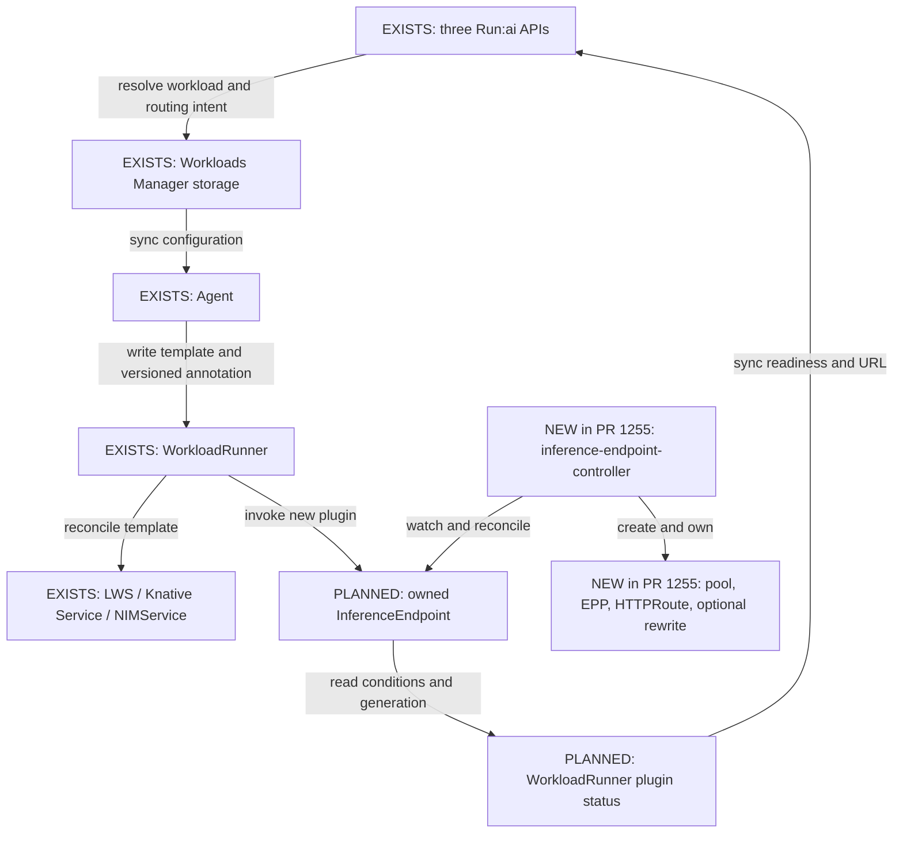

# Automatic InferenceEndpoint Integration Implementation Plan

> **For agentic workers:** Use superpowers:executing-plans to implement and verify each task. Checkboxes are the implementation ledger; preserve incomplete phases for follow-up.

**Goal:** Automatically create an InferenceEndpoint alongside newly submitted supported distributed-inference, inference, and NIMService workloads through their existing Run:ai APIs.

**Architecture:** Keep the workload CR and its InferenceEndpoint as sibling resources owned by the WorkloadRunner. A Run:ai-specific Anyworkload plugin manages the endpoint lifecycle; inference-endpoint-controller remains the only manager of its pool, EPP, and HTTPRoute. Workloads Manager stores resolved routing intent, Agent transports it, and cluster-sync reports status back.

**Tech stack:** Go, Ginkgo/Gomega, controller-runtime, existing Workloads V2 storage/sync, Gateway API and inference-extension CRDs.

**Spec:** The agreed design in this document: automatic creation for new supported workloads, administrator-configured Gateway defaults, existing workloads unchanged, one shared plugin with workload-specific adapters. User explicitly requested saving this map and starting implementation on 2026-09-30.

## TL;DR

- New supported submissions create both their normal workload and an InferenceEndpoint.
- Implement the common contract/plugin first, then resolve API/defaults and workload-specific serving behavior.
- Initial plugin delivery does **not** claim API automatic creation is complete. No producer enables a workload until serving/authentication compatibility is verified.

## Global constraints

- Base is controller integration PR #1255, commit `00db2415b4422c2b28e652be5fbd49753fc32218`.
- Separate branch `nael/inference-workload-endpoints`; do not modify the original import PR during this follow-up.
- Preserve API group/version `inference.platform.run.ai/v1alpha1` and Kind `InferenceEndpoint`.
- Existing workloads without persisted inference-routing intent remain unchanged on updates and upgrades.
- No Gateway, hostname, port, model alias, or credential may be guessed from example manifests.
- No authentication bypass or additional public route for an internal-only endpoint.
- Keep Run:ai-specific configuration out of the neutral Dromos API. Follow existing versioned WorkloadRunner annotation contracts.
- No broad dependency upgrades to import the controller executable module. Carry the existing CRD spec as JSON; Kubernetes CRD admission remains authoritative for full spec validation.
- Do not share resource ownership with the ordinary networking plugin: it owns its Services/auth resources; inference-endpoint-controller owns inference routes.
- Stage unsupported serving combinations explicitly; do not silently claim them supported.

## Resource and status flow

Pseudocode:
1. Resolve routing only for a new eligible workload on a configured cluster.
2. Persist the selected mode and resolved endpoint spec with the workload.
3. Reconcile both sibling resources, retrying failures without creating duplicate workloads.
4. Treat routing as ready only after the current endpoint generation is ready.
5. Delete only the endpoint owned by this WorkloadRunner; Kubernetes removes its children.

## Complete CR field map

Source of truth: `inference-endpoint-controller/api/v1alpha1/inferenceendpoint_types.go`. API fields listed as proposed below do not exist yet.

| CR field | Distributed inference (LWS) | Inference (Knative) | NIMService | Resolver / default / notes |
|---|---|---|---|---|
| `apiVersion` | same | same | same | Constant `inference.platform.run.ai/v1alpha1`. |
| `kind` | same | same | same | Constant `InferenceEndpoint`. |
| `metadata.name` | WorkloadRunner identity | WorkloadRunner identity | WorkloadRunner identity | Plugin generates a stable DNS-label name from runner UID; avoids long-name overflow in generated child names. |
| `metadata.namespace` | Project workload namespace | Project workload namespace | Project workload namespace | Always runner namespace; never accepted from routing input. |
| `metadata.ownerReferences[]` (`apiVersion`, `kind`, `name`, `uid`, `controller`, `blockOwnerDeletion`) | WorkloadRunner | WorkloadRunner | WorkloadRunner | Set by plugin using controller-runtime owner-reference helper; never owned by mutable child workload/revision. |
| `metadata.labels`, `metadata.annotations` | No required caller fields | Same | Same | Plugin owns only its resource marker. Do not copy arbitrary credentials/annotations from workload. Server owns UID, resourceVersion, generation, timestamps, managedFields, deletion metadata; spec transport cannot set them. |
| `spec.workload.selector.matchLabels` | Copy resolved LWS Service selector: set-name plus worker-index `0`; retain additional bound labels after matching the leader template | Adapter must resolve intended serving revision; workload-wide label alone can select old revisions | Derive from the NIM operator's serving Service/pod-template contract, including multi-node leaders | DINF topology adapter: `workloads-manager/pkg/inferenceendpoint/distributed.go`. Source: `composer_v2/dinf_to_lws/setters.go`. Do not select every worker or every revision. Other sources: `inference_workloads/setters.go`, `workloads-manager/pkg/services/nim_networking.go`. |
| `spec.workload.port` | Resolved Service numeric `targetPort`, validated against the primary leader container's declared TCP port; proxy targets rejected | Resolve Knative request-entry path, preserving queue proxy and auth | Actual serving target, accounting for standalone auth topology | Do not copy public Service port (usually 80). DINF adapter currently supports direct public HTTP only; protected workloads require separate auth/metrics design before eligibility. |
| `spec.routing.gatewayRef.name` | Cluster administrator default | Same | Same | `RunaiConfig.spec.global.gatewayAPI.name`, reported as `gatewayName`; require explicit `gatewayAPIEnabled=true` and ready integration. Gateway must support inference pools. |
| `spec.routing.gatewayRef.namespace` | Configured Gateway namespace | Same | Same | `RunaiConfig.spec.global.gatewayAPI.namespace`, reported as `gatewayNamespace`. Resolver requires and persists it explicitly; route acceptance verifies attachment asynchronously. |
| `spec.routing.hostnames[]` | Single concrete hostname from the native composer's resolved HTTPRoute; require its unfiltered root-path Service route and administrator Gateway | Preserve existing serving hostname where compatible | Parse `servingPort.exposedUrl` / existing generated URL | Native composer resolves explicit URL or configured-domain URL first; adapter does not allocate a second hostname. Domain allocator must ensure uniqueness, DNS/TLS and correct internal/external access. Current endpoint route only matches `/v1`; path-based legacy URLs are rejected by the DINF adapter. |
| `spec.epp.profile` | Administrator policy default | Same, after compatibility validation | Same, after runtime metrics validation | Initial supported default `gie-v1.5`. Not derived from workload image name. `llm-d-v0.10` remains experimental. |
| `spec.epp.image` | Omitted with profile | Same | Same | Endpoint controller resolves pinned profile image. A future admin override must obey CRD image/profile compatibility; no generic image rewrite assumed. |
| `spec.epp.scheduling.scorers[].type` | Omit initially unless explicit supported policy | Same | Same | Omitted scheduling currently means queue, kvCache, prefixCache. Verify engine exposes those signals before eligibility. Future shared API/policy config supplies overrides. |
| `spec.epp.scheduling.scorers[].weight` | Same policy | Same | Same | Controller defaults are 30/20/10; explicit weights 0–100. Never infer from replica counts. |
| `spec.epp.scheduling.profiles[].name` | Omitted initially | Same | Same | Future administrator-approved profile catalog; requires `llm-d-v0.10`. |
| `spec.epp.scheduling.profiles[].scorers[].type` | Omitted initially | Same | Same | Future catalog; mutually exclusive with legacy scorers. |
| `spec.epp.scheduling.profiles[].scorers[].weight` | Omitted initially | Same | Same | Future catalog; at least one positive weight per profile. |
| `spec.epp.scheduling.defaultProfile` | Omitted initially | Same | Same | Future catalog member; changing it rolls EPP. |
| `spec.epp.scheduling.activeProfile` | Omitted initially | Same | Same | Future catalog member; changing it updates HTTPRoute live. |
| `spec.rewrites[].model` | Omitted initially | Same | Same | Explicit future alias/canary policy only; workload name is not necessarily the served model. |
| `spec.rewrites[].targets[].model` | Omitted initially | Same | Same | Must be a model/adapter actually served by selected pods. |
| `spec.rewrites[].targets[].weight` | Omitted initially | Same | Same | Explicit traffic weights, minimum 1; not replica counts. |
| `status.observedGeneration` | Controller-owned | Same | Same | Plugin reads; producers never write. |
| `status.conditions[].type` | Controller-owned | Same | Same | `Ready`, `RouteAccepted`. |
| `status.conditions[].status`, `.reason`, `.message` | Controller-owned | Same | Same | Map into plugin readiness and actionable errors. |
| `status.conditions[].observedGeneration`, `.lastTransitionTime` | Controller-owned | Same | Same | Reject stale-generation Ready; preserve transition semantics in plugin status. |

## Design decisions and remaining work

- **Confirmed:** automatically create for new supported submissions; no per-workload opt-in required.
- **Confirmed:** WorkloadRunner owns InferenceEndpoint; endpoint controller owns children.
- **Initial transport:** `run.ai/inference-endpoint` annotation, JSON `{ "schemaVersion": "v1", "spec": <InferenceEndpoint spec> }`. Missing annotation disables this plugin for that workload. This is an internal resolved intent, not the final public API design.
- **Initial names:** `inference-<runner UID>`; stable across template/revision changes, unique on delete/recreate, short enough for existing children. An unsaved runner is invalid for resource creation.
- **Initial status:** generation-aware `InferenceEndpointReady`, plus endpoint reference and hostnames in plugin additionalInfo. Ready does not prove model traffic; workload and traffic checks remain separate.
- **Initial lifecycle:** reconcile desired spec, retain unrelated metadata/status, reject foreign owner collisions, clean owned endpoint when intent removed. Deleting WLR uses owner-reference garbage collection. Stop/resume routing policy is task 5; no release until it is tested.
- **Optional CRD:** absence must not stop unrelated workloads/controller startup. Watch only if REST mapping exists at startup; return an actionable error for configured workloads when missing. Installing the CRD later requires a controller restart to establish the watch.
- **Eligibility and migration:** producers in task 3 gate on server-owned source/submission kind, supported cluster capability, runtime and serving topology. Do not enable arbitrary YAML submissions or infer eligibility from user-spoofable labels. Persist mode on creation; update retains it.
- **Knative decision:** prove autoscaling/queue proxy, revision selection and scale-to-zero before enabling. A direct pod route is insufficient evidence. If full compatibility requires a different serving backend, review that change before implementing it.
- **NIM decision:** verify operator version-specific selectors and metrics; do not assume all NIM images support vLLM scoring.
- **Auth decision:** retain current authorization, including private access. Evaluate separate serving/metrics ports and shared Gateway auth before enabling protected workloads.
- **Gateway decision:** resolve where admin defaults are stored/reported to CP; no implicit public Gateway installation in this change.

## Review focus

1. Same-name resources owned by a different runner must never be adopted or deleted.
2. Removing configuration and deleting/recreating a runner must not leak or delete another workload's route.
3. Ready from an earlier spec generation must not advertise a newly changed endpoint as ready.
4. Missing CRD, denied access and invalid intent must remain actionable without preventing unrelated workload startup.
5. A new serving path must not bypass authentication, revision routing, autoscaling, private-only access or tenant boundaries.

## Implementation tasks

### Task 1: Shared resolved-intent contract (initial implementation)

Files: new `common/endpoints/inference.go` and `inference_test.go` in the existing shared module.
Interfaces: `InferenceEndpointConfig{SchemaVersion string, Spec json.RawMessage}`; `GetInferenceEndpoint(metav1.Object) (*InferenceEndpointConfig, error)`; `SetInferenceEndpoint(metav1.Object, *InferenceEndpointConfig) error`; `BuildInferenceEndpoint(metav1.Object, *InferenceEndpointConfig) (*unstructured.Unstructured, error)`.
- [x] Write and run failing standard Go tests (matching this shared module) for no intent, malformed/versioned intent, missing spec, full field round-trip, stable identity, namespace confinement, no source mutation and required spec sections.
- [x] Implement without importing the controller executable module or duplicating its nested API types.
- [x] Run `go test ./...` in `common/endpoints`; PASS. Existing baseline also passed.

### Task 2: Shared plugin and runtime wiring (initial implementation)

Files: new `anyworkload-controller/plugins/inferenceendpoint/{plugin,reconcile,status,validate}.go` plus co-located Ginkgo suites; modify `cmd/main.go`, `runai-chart/templates/clusterroles/anyworkload-controller.yaml` and a chart RBAC test.
Consumes Task 1 resolved-intent contract. Produces `New(context.Context, framework.PluginDeps) (framework.Plugin, error)`, AdditionalResourcePlugin, StatusPlugin, WatcherPlugin and ValidatorPlugin.
- [x] Test create, idempotent update, spec changes, ownership conflicts, cleanup, foreign-resource protection and retry errors before implementation.
- [x] Test Disabled/Pending/Ready/Failed status, stale Ready generations, missing CRD, watcher optionality, and admission errors.
- [x] Implement using the existing framework; use current ownership checks and optimistic concurrency. Endpoint spec validation remains the installed CRD's responsibility.
- [x] Register in Anyworkload. Limit writes/deletion to project role; cluster-wide read/watch only. Do not grant status-write access.
- [x] Run shared-contract suite, plugin suite, Anyworkload service checks and chart RBAC test. Record exact results and environment limitations.
- [x] Commit initial implementation with DCO and a fresh review. Do not label all API integration complete.

### Task 3: Administrator defaults, persistence, and Agent transport

Implementation decisions (2026-10-05):
- Reuse the existing administrator source `RunaiConfig.spec.global.gatewayAPI.{enabled,name,namespace}` → `runai-public.configuration.{gatewayAPIEnabled,gatewayName,gatewayNamespace}` → cluster reported configuration. Do not invent a second Gateway default. Administrators must select a Gateway that supports InferencePool; route acceptance remains an asynchronous controller check.
- Hostnames come from each adapter's existing resolved serving URL, using the existing cluster domain/subdomain allocator. A URL with a non-root path is not representable by the current `/v1` route and must be rejected for inference routing.
- Initial EPP policy is the explicit `gie-v1.5` profile. Runtime compatibility remains an adapter prerequisite; the profile is not inferred from image names.
- Add `inferenceEndpointSchemaVersion` to operator/cluster-sync reported configuration as a capability declaration, emitted only when Agent, Anyworkload and inference-endpoint-controller are enabled and their configured images have fully rolled out (current observed generation; nonzero, matching total/updated/available replica counts). The server additionally requires their ready operand statuses, including the endpoint operand's CRD checks. Missing/unknown capability cannot authorize a new endpoint during upgrades. As with other operator capabilities, configured component images are trusted to implement their release contract; arbitrary old custom-image overrides are not certified.
- The public `WorkloadV2Configuration` stays unchanged. `AgentInferenceEndpoint` belongs only to internal `WorkloadV2UpdateConfiguration`; resolved intent is stored in the existing JSONB configuration. No database column migration is needed.
- The existing plan is the sole progress ledger. No separate execution workspace document is created.

Files: `workloads-manager/swagger/source/schemas/WorkloadsV2/{AgentInferenceEndpoint,WorkloadV2UpdateConfiguration}.yaml`, corresponding generated server/clients, workload queue configuration mapping, `workloads-manager/pkg/inferenceendpoint/defaults.go`, `agent/pkg/handlers/{inference_endpoint,workloads_v2_handler}.go`, SDK `runaipublic_types.go`, operator `runai-public/resources/configmaps/inference_endpoint.go`, cluster-sync `cluster_info_parser.go`, and cluster-service `ClusterReportedConfig.yaml` plus generated outputs. Public `WorkloadV2Configuration` remains unchanged.
Interfaces: server-resolved inference endpoint spec persisted alongside workload configuration; Agent uses Task 1 setter and removes an absent prior annotation through normal desired-state application.
- [x] Finalize administrator Gateway/domain/default source and cluster capability report; document concrete fields here before implementation.
- [ ] Test new eligible create vs old update, absent defaults, unsupported cluster, explicit errors, server-owned source checks, dry-run, persistence/read-back and Agent sync.
- [x] Add shared administrator-default resolver and typed internal configuration; regenerate API/server/clients with repository tooling.
- [x] Unit-test rollout capability gating, legacy stored configuration, persisted intent read-back, generated-client interoperability, Agent validation and annotation replacement/removal.
- [ ] Connect the resolver to eligible API creates/dry-runs and preserve/recompute managed intent on updates without enabling old records. Verify the complete rolling upgrade flow in preview.

### Task 4: Distributed inference automatic creation

Files: `workloads-manager/pkg/inferenceendpoint/distributed{,_test}.go`, `workloads/pkg/services_crud/any_workload_submitter_dinf.go`, `composer/composer_v2/dinf_to_lws/{networking,setters}.go`, composer/API tests.
- [x] Add topology-adapter tests pinning leader-only selector, replica scaling, serving target and hostname resolution, including actual native composer output.
- [x] At the adapter boundary, reject proxy/protected Service targets, internal-only endpoints and unrepresentable routing constraints, including parallel Ingress.
- [ ] Connect those decisions to API eligibility and verify protected/internal-only behavior and legacy networking coexistence end to end.
- [ ] Populate Task 3 configuration on new supported submissions and preserve it through updates.
- [ ] API-to-cluster test: one request produces WLR, LWS, owned endpoint, ready route and valid inference response; workers never selected.

### Task 5: Status, lifecycle, and API connection reporting

Files: `cluster-sync/pkg/controllers/workload_runner_controller.go`, `cluster-sync/pkg/handlers/parsers/external_workload_parser.go`, connection serializers and tests.
- [x] Propagate new plugin condition/details changes even when aggregate workload phase stays unchanged.
- [x] Report distinct `InferenceEndpointReady` in the existing workload conditions, with Unknown for absent/stale runner-generation status, without changing workload phase or URLs.
- [ ] Return endpoint URL/reference and distinct routing readiness, without claiming traffic health from EPP health.
- [ ] Implement and test stop/resume/restart policy, intent removal, deletion and CRD reinstall/restart recovery.

### Task 6: NIMService adapter

Files: `workloads-manager/pkg/services/{api_nim_services_impl,nim_networking}.go`, `composer/composer_v2/nim_workloads/`, their tests.
- [ ] Verify serving selectors/ports for supported NIM operator versions, single-node and multi-node.
- [ ] Validate scoring metrics and protected-serving topology; add compatibility cases to this plan.
- [ ] Populate same resolved intent and verify API-to-cluster create/update/delete and authenticated traffic.

### Task 7: Knative serving compatibility and adapter

Files: `workloads/pkg/services_crud/any_workload_submitter_inference.go`, `composer/composer_v2/inference_workloads/`, tests.
- [ ] Establish a compatible path for queue proxy, scale-to-zero wakeup, auth and revision routing; record measured result here.
- [ ] If not possible with current CRD, present the required CRD/backend change for review; do not silently disable Knative behavior.
- [ ] Add adapter and tests for revision replacement, concurrent requests, scaling to/from zero and preserved authorization.

### Task 8: CI and preview acceptance

- [ ] Add cross-service tests for generated API/schema/RBAC and plugin registration.
- [ ] Add product E2E only in `/Users/nasbi/dev/runai-e2e-internal`, following its rules.
- [ ] Validate all three APIs on supported preview configurations with real CRs and requests, and old-workload regression cases.
- [x] Publish follow-up PR with clear dependency on #1255 and truthful supported scope; no merge without user request.

## Progress and rulings

- 2026-09-30: plan saved; initial execution is Tasks 1–2. Remaining tasks are explicit follow-up phases, with compatibility decisions required before enabling automatic producers.
- Ruling: use the existing shared `common/endpoints` module for the transport helper. It already provides the related Run:ai annotation contract and avoids duplicating the InferenceEndpoint schema or upgrading Anyworkload's controller-runtime dependency.
- Ruling: native worktree tool returned “Not a git repository” for the chat's `/Users/nasbi/dev` root. Created a sibling Git worktree from the reviewed PR head; the original PR worktree remains available to its CI monitor.

- 2026-10-01 review: fixed missing annotation-change watch after a real-API test reproduced a settled runner failing to create its endpoint. Owned-resource watches alone were insufficient because the root watch filters generation changes.
- 2026-10-01 review: rejected explicit JSON null values after a failing shared-contract regression; the current CRD has no nullable fields and prunes optional nulls. Strict server-side field validation also rejects unknown fields instead of repeatedly reapplying pruned intent (real-API regression).
- Ruling: metadata-only intent uses a dedicated WorkloadRunner watch, following the existing networking plugin. This preserves update/removal without changing the generic Dromos watch.
- Ruling: reject explicit nulls rather than guessing CRD defaults; callers omit unset fields. A future nullable CRD field will require revisiting this restriction.
- Review exclusions: API producers/defaults, authentication/runtime compatibility, stop/resume policy and CP status propagation remain Tasks 3–8. They must be completed before automatic serving is enabled.

### Initial-stage validation (2026-10-01)

- Existing shared endpoint tests and existing Anyworkload networking/personal-credential tests passed before implementation.
- Shared module `go test ./...`: PASS, including null-field rejection regression.
- Anyworkload `KUBEBUILDER_ASSETS=<local Kubernetes 1.36.2 binaries> go test ./... -timeout=15m`: PASS for all unit packages and the complete envtest suite (114 seconds).
- New real-API tests cover sibling creation, endpoint readiness watch, deletion repair, configuration removal, unknown CRD fields, and annotation-only changes after quiescence.
- Review regressions were observed failing before fixes: annotation-only update left endpoint absent; explicit null was accepted; unknown fields left routing Pending. Final suite passed after corrections.
- Repository-pinned golangci-lint 2.13.2, cluster config, diff against base: zero issues in shared contract and Anyworkload modules.
- Helm unit tests: 2/2 PASS for project-scoped writes and cluster-scoped reads.
- No API producers or preview deployment were changed by this initial stage. Original PR monitoring found latest CI failed during environment sync; its hostname does not resolve and Argo access is denied, so no fresh preview claim is made here.

- Linux controller builds: `CGO_ENABLED=0 GOOS=linux GOARCH=amd64 go build ./cmd` and arm64 equivalent both PASS.
- At the end of the initial stage (2026-10-01), Tasks 1–2 were complete and Tasks 3–8 remained unimplemented. No new PR was opened and no follow-up branch was pushed.

### Transport/defaults stage (2026-10-05)

- Task 3 infrastructure implemented: server-owned intent in the existing JSONB configuration, internal API/server/Go/TypeScript generation, Agent conversion to the shared annotation, administrator Gateway/default resolution, and capability reporting through operator → cluster-sync → cluster-service.
- Legacy configuration stays absent; a user annotation in a workload template cannot become runner intent. No producer is enabled by this stage. The defaults resolver is ready for adapters but is not called by workload creation yet.
- Independent review found a real upgrade race: `DeploymentAvailable` can describe old pods while a replacement is blocked. Six failing regression cases established the issue; gating on the configured image and completed rollout fixed it. Re-review found no further actionable issue in this slice.
- **Pending runtime decision:** distributed-inference input has no serving-engine/metrics capability field. Do not infer support from image-name patterns. Asked whether eligibility should use an administrator-approved runtime/image catalog (recommended) or explicit serving-runtime metadata in the workload API. This decision precedes the automatic producer; protected/internal-only behavior and Knative compatibility remain required work.
- Tasks 3 (API eligibility/create/update/dry-run), 4–8 remain open. Original PR monitoring stays paused. No preview deployment or follow-up PR has been made in this stage.

Validation for this stage:
- `go test -p 2 ./...` passed in Workloads Manager, Agent, cluster-service and cluster-sync, including database-backed service tests.
- Operator full suite passed after the rollout-gating review fix; the full configmap suite also passed with the six upgrade regressions.
- Workloads Manager and cluster-service `make openapi-validate` passed with the pinned Docker generators and native Go formatting. Public and system OpenAPI bundles regenerated; public workload-create configuration remains unchanged.
- Repository-pinned `golangci-lint v2.13.2` reported zero issues for all changed handwritten packages: Workloads Manager models/defaults, Agent handlers, operator runai-public configmaps, and cluster-sync parsers.
- No real preview or cross-service API submission acceptance is claimed. Generated Markdown retains the generator's existing trailing-whitespace convention; handwritten files pass `git diff --check`.
- SDK and `k8s.io/utils` retain their existing versions and are now marked direct dependencies in Workloads Manager. An optional whole-module `go mod tidy -diff` was stopped while fetching unrelated transitive test dependencies; no dependency versions or sums were changed.

### Published follow-up and readiness reporting (2026-10-05)

- Published draft PR [#1720](https://github.com/dsx-ai-factory/run-ai/pull/1720), stacked on #1255. Integrated controller branch head `27fea7624` with merge commit `adfe49a`; the original controller worktree and paused monitor remain unchanged.
- Runtime catalog remains a proposal, not an approved or implemented configuration. User asked what it is for and where it would be used; explained that Workloads Manager would consult explicit runtime capabilities during submission. Storage and unknown-runtime behavior still need a decision before the automatic producer.
- Ruling: continue the independent Task 5 readiness-reporting slice while runtime eligibility is undecided. Endpoint references/URL serialization, stop/resume behavior and automatic producers remain open.
- Cluster-sync now detects endpoint intent, generation, plugin phase, readiness status/reason/message and detail changes even when workload phase is unchanged. Timestamp-only and unrelated condition changes do not enqueue another sync.
- The sync payload includes `InferenceEndpointReady` as a distinct condition for configured runners; absent or stale-generation plugin status is Unknown. Existing workload conditions, phase and URLs remain intact. This reports route/EPP resource readiness, not successful model traffic.
- Regression evidence: eight status-change cases, two intent/generation cases and four projection cases failed before implementation. Final controller/parser suites, full cluster-sync suite, shared-contract suite and plugin suite passed. Pinned lint reported zero issues. Independent read-only review found no actionable correctness issue, including the sync checksum and backend condition mapping.
- Base integration verification: Workloads Manager, Agent, operator and Anyworkload full suites passed; Anyworkload envtest used installed Kubernetes 1.33.0 binaries and passed in 113 seconds. Workloads Manager OpenAPI validation passed. Cluster-service full suite also passed with `DOCKER_AUTH_CONFIG='{}'`. The first run stalled before tests in Testcontainers Docker credential lookup; its goroutine dump identified the helper wait. Stopped only that run and its helper processes; the process-local auth override uses public test images without changing user Docker configuration.
- No automatic workload producer, runtime catalog, preview deployment or successful traffic claim is included in this stage. PR CI/preview acceptance remain pending.

### Distributed-inference topology adapter (2026-10-05)

- Added `BuildDistributedInferenceIntent` in Workloads Manager, taking the final LWS, its resolved networking endpoint and administrator defaults. It copies the leader-only selector and any matching ownership labels, uses the declared application target port, and preserves the resolved hostname and Gateway.
- The initial topology is direct public HTTP with one created Service and one root-hostname HTTPRoute. The adapter rejects proxy targets, protected Services, internal-only endpoints, alternate Gateways/listeners, path-based URLs, filters/header matches, wildcard hosts and parallel Ingress/Route objects. It must not weaken the existing serving path to make it fit the CR.
- Runtime support and server-owned submission origin are deliberately outside this pure mapper. **There is no production API caller yet.** The runtime eligibility question remains open; no catalog, API request fields or Swagger changes were added in this stage. Subsequent API wiring must run after policy and networking ownership binding, preserve managed mode on updates and leave older records unchanged.
- Verification: the initial test run failed on the missing adapter; implemented package tests passed, including actual native DINF composer output. Full Workloads Manager `go test -p 2 ./... -timeout=5m` passed with process-local `DOCKER_AUTH_CONFIG='{}'`; pinned golangci-lint v2.13.2 reported zero issues for the changed package. Independent read-only review found no actionable findings and reran the package suite uncached.
- Existing Gateway API and LWS dependencies are now marked direct with unchanged versions. Automatic API-to-preview acceptance remains open.
