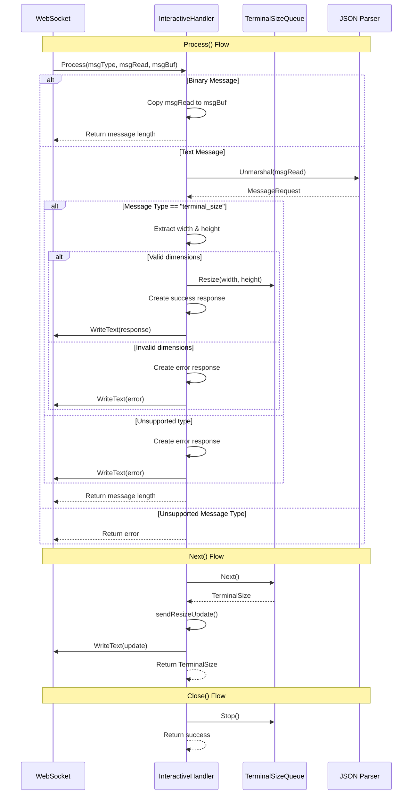
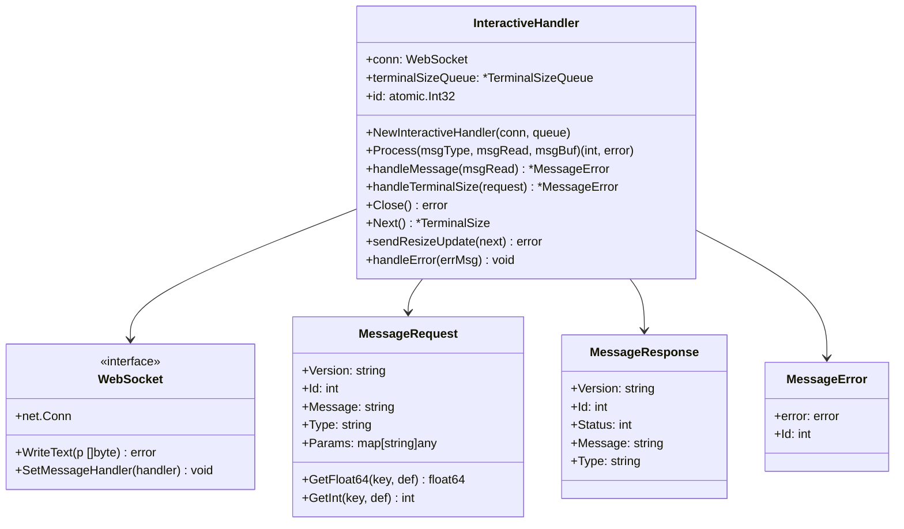

# InteractiveHandler Flow Diagram

## Overview
The InteractiveHandler manages WebSocket connections for interactive terminal sessions, primarily handling terminal size updates and binary data forwarding.

## Main Flow Diagram

```mermaid
flowchart TD
    A[WebSocket Message Received] --> B{Message Type?}
    
    B -->|Binary| C[Copy to Buffer]
    B -->|Text| D[Parse JSON Message]
    B -->|Other| E[Return Error]
    
    C --> F[Return Message Length]
    E --> F
    
    D --> G{Message Type?}
    G -->|terminal_size| H[Handle Terminal Size]
    G -->|Other| I[Return Unsupported Error]
    
    H --> J{Width and Height > 0?}
    J -->|Yes| K[Update Terminal Size Queue]
    J -->|No| L[Return Validation Error]
    
    K --> M[Send Success Response]
    L --> N[Send Error Response]
    I --> N
    
    M --> F
    N --> F
    
    %% Next Flow
    O[Next Called] --> P[Get Next Terminal Size]
    P --> Q[Send Resize Update]
    Q --> R[Return Terminal Size]
    
    %% Close Flow
    S[Close Called] --> T[Stop Terminal Size Queue]
    T --> U[Return Success]
    
    %% Error Handling
    V[handleError] --> W[Create Error Response]
    W --> X[Marshal JSON]
    X --> Y[Send via WebSocket]
    
    %% Styling
    classDef success fill:#d4edda,stroke:#155724,stroke-width:2px
    classDef error fill:#f8d7da,stroke:#721c24,stroke-width:2px
    classDef process fill:#d1ecf1,stroke:#0c5460,stroke-width:2px
    classDef decision fill:#fff3cd,stroke:#856404,stroke-width:2px
    
    class C,F,M,R,U success
    class E,I,L,N error
    class D,H,K,P,Q,T,W,X,Y process
    class B,G,J decision
```

## Detailed Process Flow

## Data Structures

## Key Features

1. **Message Processing**: Handles both binary and text WebSocket messages
2. **Terminal Size Management**: Processes terminal size updates and forwards them to the terminal size queue
3. **Error Handling**: Comprehensive error handling with structured error responses
4. **Response Generation**: Creates standardized JSON responses with version and status information
5. **Thread Safety**: Uses atomic operations for ID generation
6. **Resource Management**: Proper cleanup of terminal size queue on close

## Message Types

- **Binary Messages**: Forwarded directly to buffer
- **Text Messages**: JSON-encoded with specific message types
  - `terminal_size`: Updates terminal dimensions

## Error Scenarios

1. **Unsupported Message Type**: Non-binary, non-text messages
2. **Invalid JSON**: Malformed message structure
3. **Unsupported Message Type**: Non-terminal_size messages
4. **Invalid Dimensions**: Width or height ≤ 0
5. **Serialization Errors**: JSON marshaling failures
6. **WebSocket Write Errors**: Connection issues 