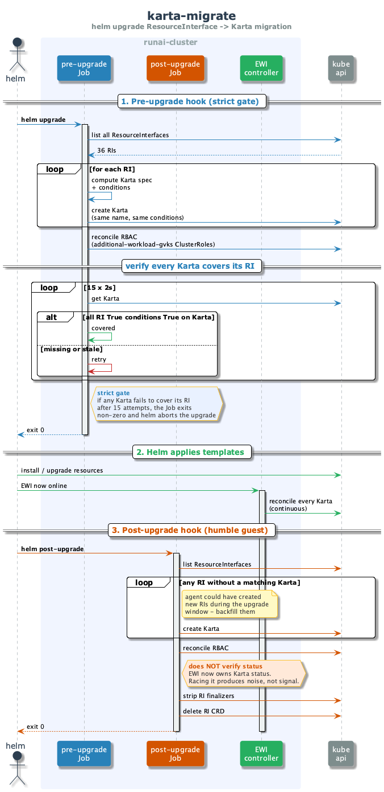

# karta-migrate

one-shot helm hook that migrates the legacy `ResourceInterface` CRs to the new
`Karta` CRs during a runai-cluster upgrade. runs twice (pre + post helm
upgrade), then never again.

## when it runs

two helm hooks, both wired in `runai-chart/templates/hooks/`:

| hook | trigger | what it does |
|---|---|---|
| `karta-migrate-pre-upgrade-job` | `helm.sh/hook: pre-upgrade` | copy every RI -> Karta, reconcile RBAC, **verify every Karta covers its RI**. if verification fails, the Job exits non-zero and helm aborts |
| `karta-migrate-post-upgrade-job` | `helm.sh/hook: post-upgrade` | backfill any RI that the agent created during the upgrade window, reconcile RBAC, strip RI finalizers, delete the RI CRD. **does NOT verify status** - EWI owns it by then |

## the flow



key things to notice in the diagram :

- the **pre-hook is the strict gate**. if it cant prove that every Karta is at
  least as healthy as its RI (every True condition mirrored), helm refuses to
  proceed.
- the verifier has a **15 x 2s retry loop** because EWI may need a moment to
  reconcile a freshly-created Karta. polling buys EWI time without hiding a
  real failure.
- the **post-hook is a humble guest**. by then EWI is online and continuously
  reconciles Karta status. if karta-migrate also wrote status, the two would
  fight each other. so the post-hook only backfills + cleans up.

## what counts as "covers"

`kartaCoversRI` returns true when every condition that is `True` on the RI is
also `True` on the matching Karta. one rename map handles the
`RIValidated -> KartaValidated` migration (same semantic, different name on the
karta side).

byte-for-byte spec equality was tried earlier and abandoned - the karta CRD
has more default fields than the RI CRD did (e.g. statusMappings entries
default the matcher fields), so the post-create spec would diverge from the RI
even on a perfect migration. condition coverage is the right invariant.

## key files

```
karta-migrate/
  cmd/main.go              # entrypoint: wires Clients + calls migration.Migrate
  migration/
    migrate.go             # top-level Migrate(): pre vs post hook routing
    create_kartas.go       # per-RI Karta creation + condition computation
    verify_health.go       # pre-hook coverage check w/ retry loop
    reconcile_rbac.go      # mirrors EWI's per-Karta RBAC reconcile
    cleanup_ris.go         # strips RI finalizers + deletes the RI CRD
    state.go               # migrationComplete() + RI->Karta condition rename map
    clients.go             # k8s client bundle
    const.go               # shared names / labels
```

(file names are the new layout - if your local checkout still has
`karta.go`, `ri.go`, `parity.go`, `rbac.go`, those are the old names being
renamed in the same PR.)

## developing locally

```bash
# build + push image to your dev registry, then redeploy the helm chart
make local-deploy ENVIRONMENT=lab-virt DOCKER_TAG=my-dev-tag

# trigger the hooks by running a helm upgrade
helm upgrade runai-cluster ./runai-chart -n runai
```

env-test covers the most subtle bug surface (the karta CRD schema vs what
`enrichKartaSpec` produces). real-cluster smoke is the post-upgrade Job run
log:

```bash
kubectl logs -n runai job/karta-migrate-pre-...
kubectl logs -n runai job/karta-migrate-post-...
```

## regenerating the diagram

```bash
cd runai-cluster/cluster/karta-migrate/docs
plantuml -tpng migration-flow.puml
```
